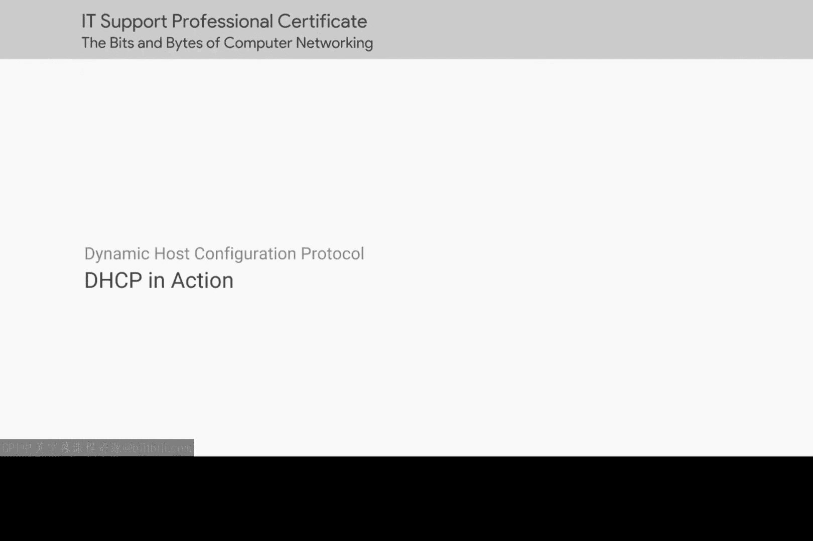
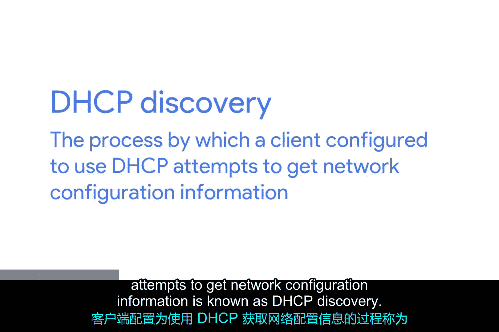
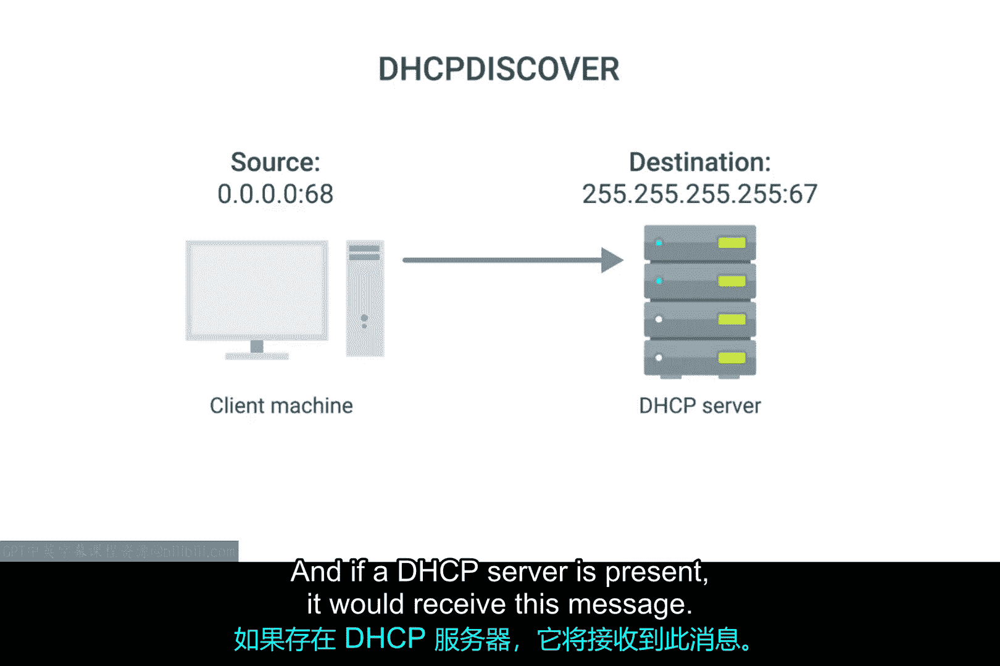
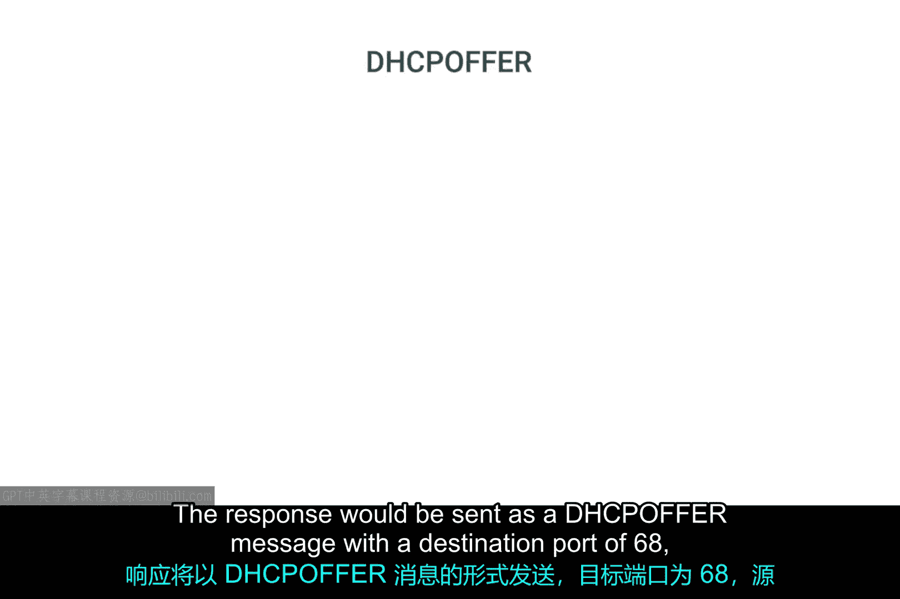
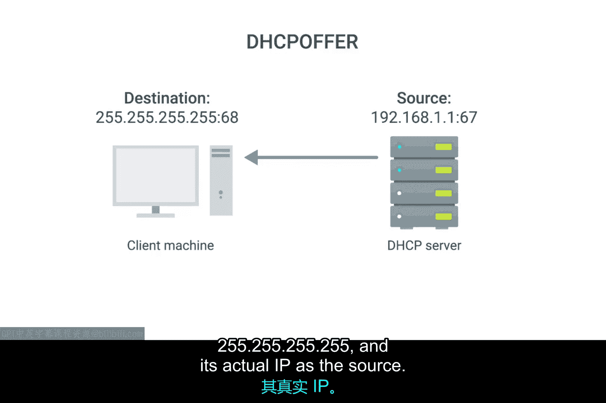
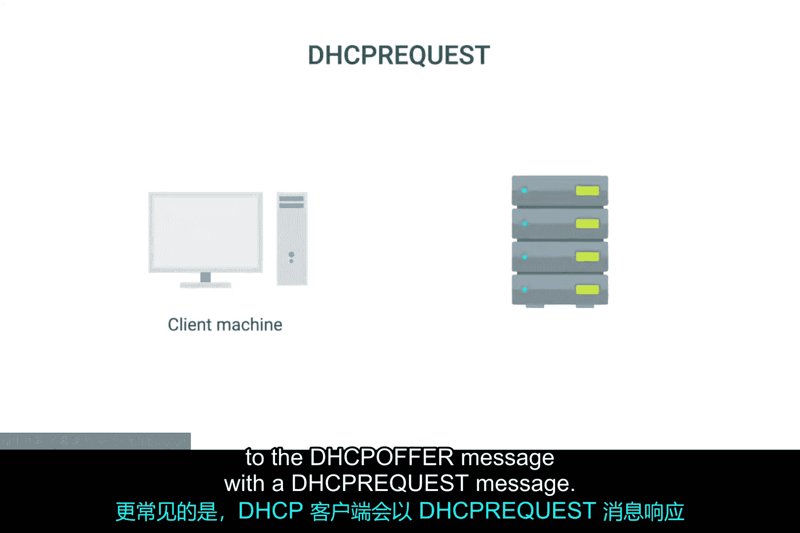
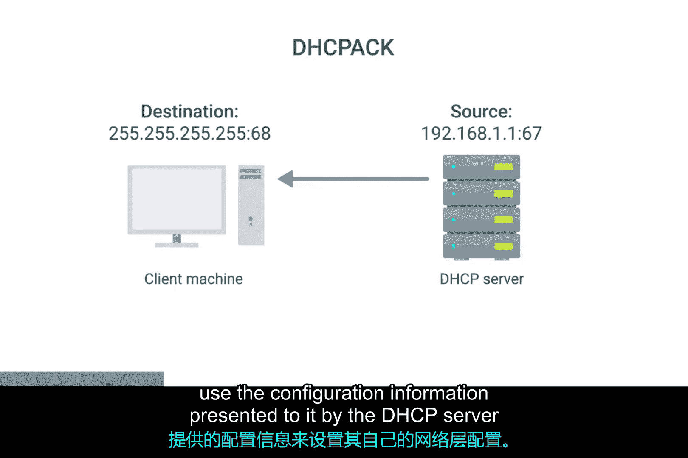

# 谷歌《IT支持（计算机网络⧸操作系统，第2、3课⧸共5课）｜Google IT Support》中英字幕deepseek p55 53_DHCP实战.zh_en -BV1uyqcYpExr_p55-

DHCP is an application layer protocol， which means it relies on the transport， network。

 data link and physical layers to operate， but you might have noticed that the entire point of DHCP is to help configure the network layer itself。

Let's take a look at exactly how DHCP works and how it accomplishes communications without a network layer configuration in place。

 warning， geeky stuff ahead。The process by which a client configured to use DHCP attempts to get network configuration information is known as DHCP Discovery。

The DHCP discovery process has four steps。 First， we have the server discovery step。

The DHCP client sends what's known as a DHCP Discover message out onto the network。

Since the machine doesn't have an IP and it doesn't know the IP of the DHCP server。

 a specially crafted broadcast message is formed instead。

DHCP listens on UDP port 67 and DHCP discoveryovery messages are always sent from UDP port 68。

 so the DHCP discoveryover message is encapsulated in a UDP datagram with a destination port of 67 and a source port of 68。

 This is then encapsulated inside of an IP datagram with a destination IP of 255。255。255。

255 and a source IP of 0。0。0。0。This broadcast message would get delivered to every node on the local area network。

 and if a DHCP server is present， it would receive this message。

Next， the DHTP server would examine its own configuration and would make a decision on what。

 if any IP address to offer to the client。This will depend on if it's configured to run with dynamic。

 automatic or fixed address allocation， the response would be sent as a DHCP offer message with a destination port of 68。

 a source port of 67， a destination broadcast IP of 255。255。255。255， and its actual IP as the source。

Since the DHCP offer is also a broadcast， it would reach every machine on the network。

The original client would recognize that this message was intended for itself。

This is because the DHCP offer has the field that specifies the Mac address of the client that sent the DHCP Discover message。

The client machine would now process this DHCP offer to see what IP is being offered to it。

Technically， a DHCP client could reject this offer。

 it's totally possible for multiple DHCP servers to be running on the same network and for a DHTP client to be configured to only respond to an offer of an IP within a certain range。

 but this is rare。More often， the DHCP client would respond to the DHCP offer message with a DHCP request message。

This message essentially says， yes， I would like to have an IP that you offered to me。

Since the IP hasn't been assigned yet， this is again sent from an IP of 0。0。0。

0 and to the broadcast IP of 255。255。255。255。Finally。

 the DHCP server receives the DHCP request message and responds with a DHCP A or DHCP Acknowledment message。

This message is again sent to a broadcast IP of 255。255。255。255。

 and with a source IP corresponding to the actual IP of the DHCP server。Again。

 the DHCP client would recognize that this message was intended for itself by inclusion of its Mac address in one of the message fields。

 the networking stack on the client computer can now use the configuration information presented to it by the DHCP server to set up its own network layer configuration。

At this stage， the computer that's acting as the DHCP client should have all the information it needs to operate in a full fledged manner on the network it's connected to。

All of this configuration is known as DHCP lease as it includes an expiration time a DHCP lease might last for days or only for a short amount of time once a lease has expired。

 the DHCP client would need to negotiate a new lease by performing the entire DHCP discovery process all over again。

A client can also release its lease to the DHCP server。

 which it would do when it disconnects from the network。

This would allow the DHCP server to return the IP address that was assigned to its pool of available IPs。

Now that you've seen DHCP in action， we've got a short quiz for you， when you're finished。

 it's time for you to learn the basics of Nat。