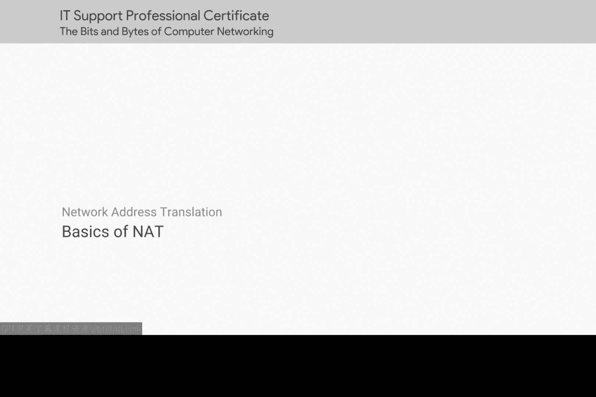
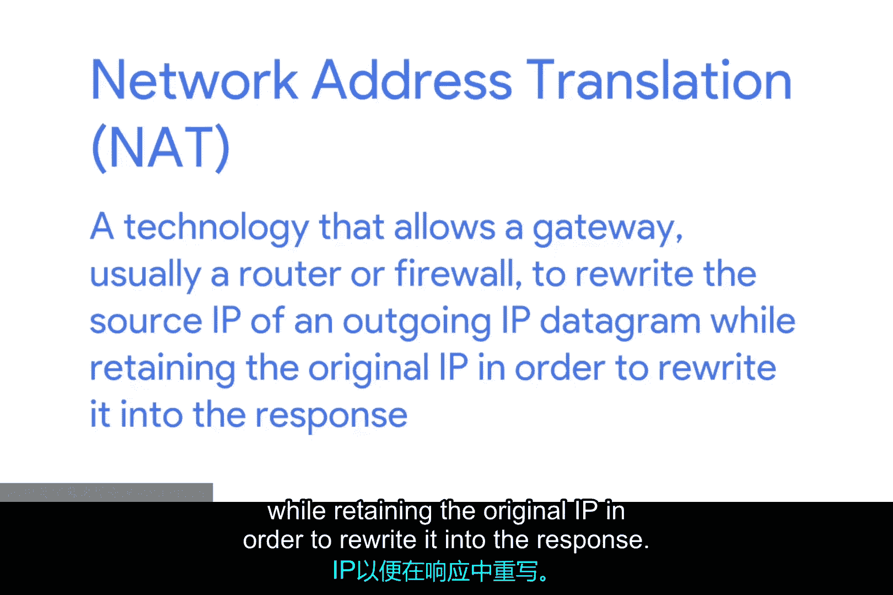
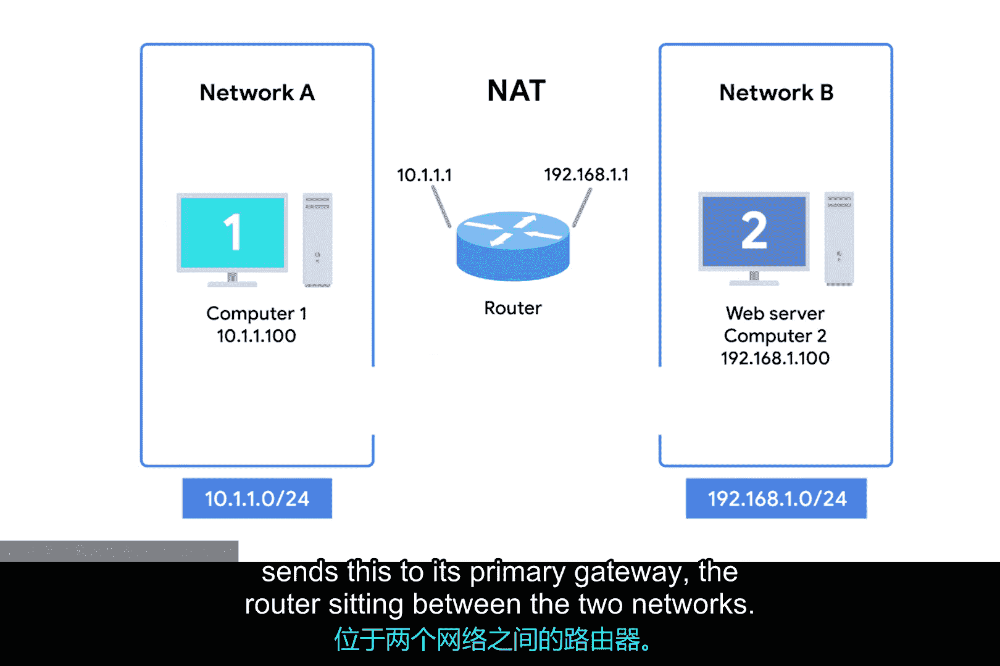
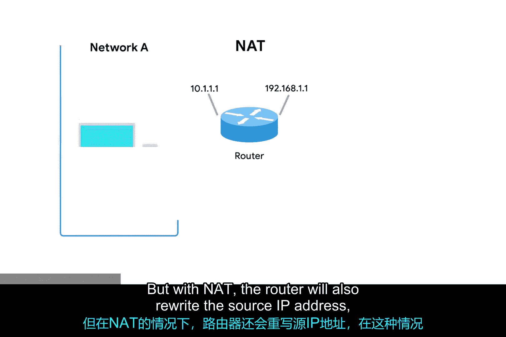
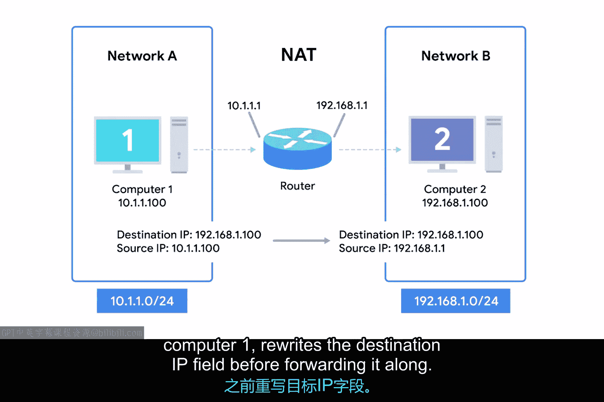

# 谷歌《IT支持（计算机网络⧸操作系统，第2、3课⧸共5课）｜Google IT Support》中英字幕deepseek p56 54_NAT基础.zh_en -BV1uyqcYpExr_p56-

Welcome back， ready to dive right in？So unlike protocols like DNS and DHCP。

 network address translation， or NaT is a technique instead of a defined standard。

This means that some of what we'll discuss in this lesson might be more high level than some of our other topics。

Different operating systems and different network hardware vendors have implemented the details of NAt in different ways。

 but the concepts of what it accomplishes are pretty constant。

Network address translation does pretty much what it sounds like。

 it takes one IP address and translates it into another。

There are lots of reasons why you would want to do this。

 they range from security safeguards to preserving the limited amounts of available IPV4 space we'll discuss the implications of NAT and the IPV4 address space later in this lesson。

 but for now let's just focus on how Nat itself works and how it can provide additional security measures to a network。

At its most basic level， NAAT is a technology that allows a gateway， usually a router or firewall。

 to rewrite the source IP of an outgoing IP datagram while retaining the original IP in order to rewrite it into the response。

To explain this better， let's look at a simple na example。Let's say we have two networks。

Network A consists of the 10。1。1。0/24 address space and network B consists of the 192。168。1。

0/24 address space。Sitting between these networks is a router that has an interface on network A with an IP of 10。

1。1。1 and an interface on network B of 192。168。1。1。Now， let's put two computers on these networks。

Computer1 is on network A。And has an IP of 10。1。1。100。

And Comp 2 is on network B and has an IP of 192。168。1。100。

Computer1 wants to communicate with a web server on Comp 2。

 so it crafts the appropriate packet at all layers and sends this to its primary gateway。

The router sitting between the two networks。

So far， this is a lot like many of our earlier examples， but in this instance。

 the router is configured to perform Nat for any outbound packets。Normally。

 a router will inspect the contents of an IP datagram， decrement the TTL by one。

 recalculate the checkum， and forward the rest of the data at the network layer without touching it。

But with Nat， the router will also rewrite the source IP address。

 which in this instance becomes the routers IP on network B or 192。168。1。1。

When the datagram gets to Computer 2， it'll look like it originated from the router， not from Comp1。

Now， Comp 2 crafts its response and sends it back to the router。

 the router knowing that this traffic is actually intended for Comp1。

 rewrites the destination IP field before forwarding it along。

What Nat is doing in this example is hiding the IP of Comp 1 from Comp 2。

 This is known as IP masquerading。IP masquerading is an important security concept。

 the most basic concept at play here is that no one can establish a connection to your computer if they don't know what IP address it has。

By using that in the way we've just described， we could actually have hundreds of computers on network A。

 all of their Is being translated by the router to its own to the outside world。

 the entire address space of network A is protected and invisible。This is known as one to many NA。

And you'll see it in use on lots of lands today。