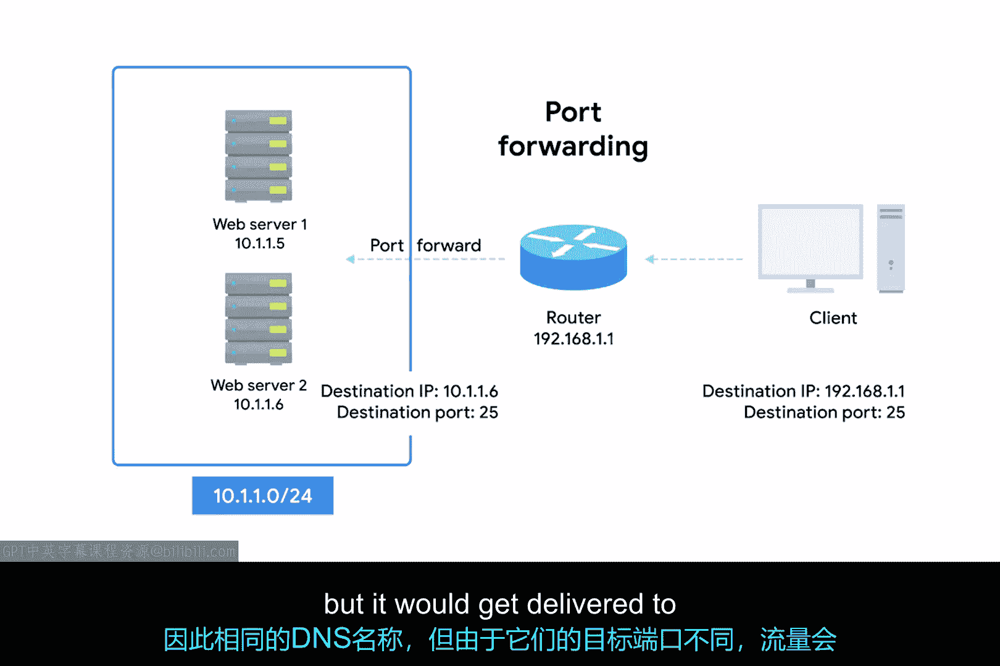
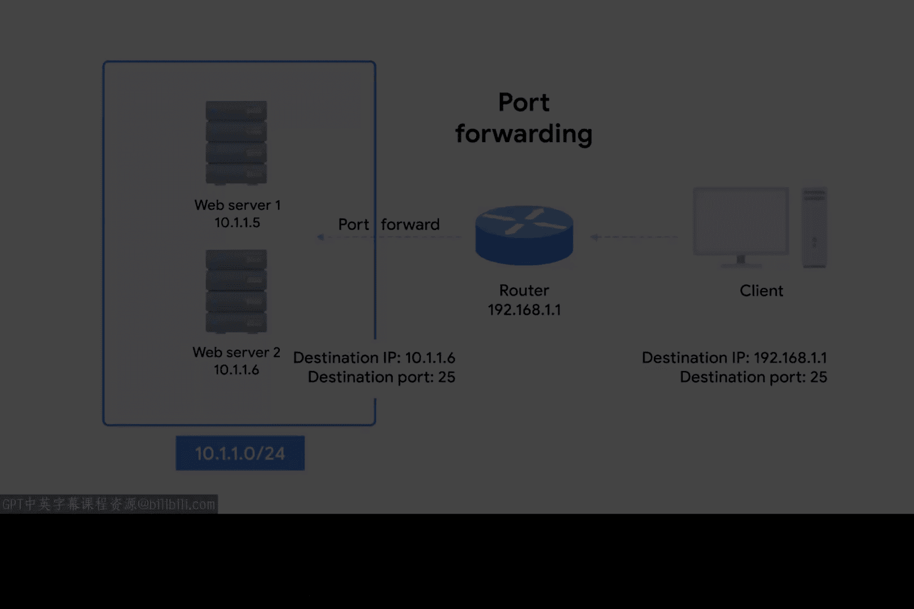

# 谷歌《IT支持（计算机网络⧸操作系统，第2、3课⧸共5课）｜Google IT Support》中英字幕deepseek p57 55_NAT与传输层.zh_en -BV1uyqcYpExr_p57-

Net at the network layer is pretty easy to follow One IP address is translated to another by a device。

 usually a router。But at the transport layer， things get a little bit more complicated and several additional techniques come into play to make sure everything works properly。

With once a manyNe， we've talked about how hundreds。

 even thousands of computers can all have their outbound traffic translated via Na to a single IP This is pretty easy to understand when the traffic is outbound。

 but a little more complicated once return traffic is involved。

We now have potentially hundreds of responses all directed at the same IP。

 and the router at this IP needs to figure out which responses go to which computer。

The simplest way to do this is to port preservation。

Port preservation is a technique where the source port chosen by a client is the same port used by the router。

Remember that outbound connections choose a source port at random from the ephemeral ports。

 or the ports in the range 49152 through 65，535。In the simplest setup。

 a router setup to Na outbound traffic will just keep track of what this source port is and use that to direct traffic back to the right computer。

Let's imagine a device with an IP of 10。1。1。100。It wants to establish an outbound connection。

 and the networking stack of the operating system chooses port 51，300 for this connection。

Once this outbound connection gets to the router， it performs network address translation and places its own IP in the source address field of the IP datagram。

But it leaves the source port in the TCP datagram the same and stores this data internally in a table。

Now， when traffic returns to the router on port 51，300。

 it knows that this traffic needs to be forwarded back to the IP 10。1。1。100。

Even with how large the set of ephemeral ports is， it's still possible for two different computers on a network to both choose the same source port around the same time。

 When this happens， the router normally selects an unused port at random to use instead。

Another important concept about NaP and the transport layer is port forwarding。

Poort forwarding is a technique where specific destination ports can be configured to always be delivered to specific nodes。

This technique allows for complete IP masquerading while still having services that can respond to incoming traffic。

Let's use our network 10。1。1。0/24 again to demonstrate this。

Let's say there's a web server configured with an IP of 10。1。1。5 with port forwarding。

 no one would even have to know this IP。 prospectivetive web clients would only have to know about the external IP of the router。

Let's say it's 19216811。Any traffic directed at port 80 on 19216811 would get automatically forwarded to 10115。

Response traffic would have the source IP rewritten to look like the external IP of the router。

This technique not only allows for IP masquerading。

 it also simplifies how external users might interact with lots of services all run by the same organization。

Let's imagine a company with both a web server and a mail server both need to be accessible to the outside world。

 but they run on different servers with different IPs。 Again。

 let's say the web server has an IP of 10。1。1。5， and the mail server has an IP of 10。1。1。6。

With port forwarding， traffic for either of these services could be aimed at the same external IP and therefore the same DNS name。

But it would get delivered to entirely different internal servers due to their different destination ports。

