# 谷歌《IT支持（计算机网络⧸操作系统，第2、3课⧸共5课）｜Google IT Support》中英字幕deepseek p58 56_NAT、不可路由地址空间与IPv4的局限.zh_en -BV1uyqcYpExr_p58-

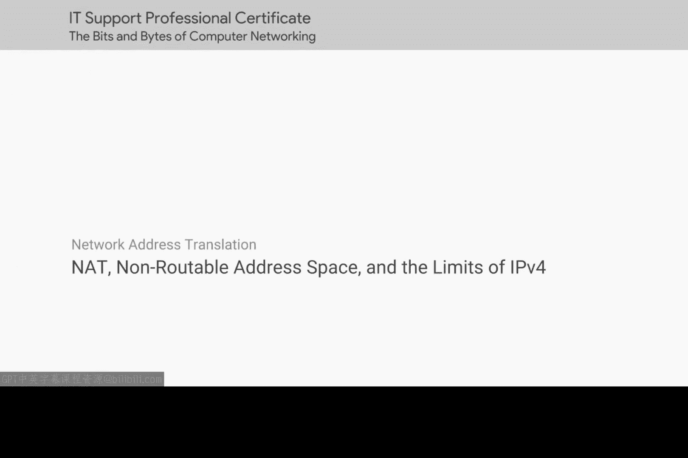

The IANA has been in charge of distributing IP addresses since 1988。Since that time。

 the internet has expanded at an incredible rate， the 4。

2 billion possible IPV4 addresses have been predicted to run out for a long time。

 and they almost have。For some time now， the IANA has primarily been responsible with assigning address blocks to the five regional internet registries or RIRs。

 the five RIRs are A， which serves the continent of Africa， Aaron， which serves the United States。

 Canada and parts of the Caribbean。

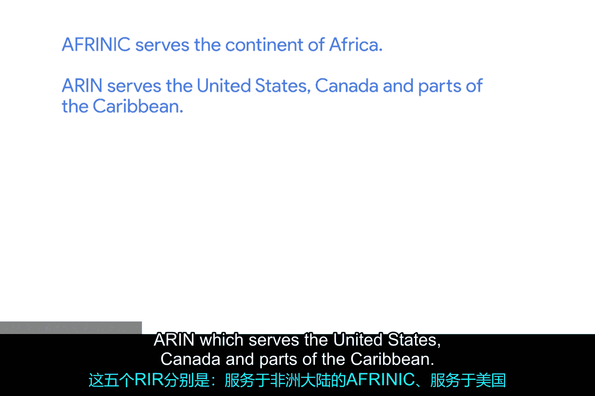

ApNic， which is responsible for most of Asia， Australia， New Zealand and Pacific Island nations。

 Lachnnik， which covers Central and South America and any parts of the Caribbean not covered by Aaron。

 and finally Rie， which serves Europe， Russia， and the Middle East and portions of Central Asia。

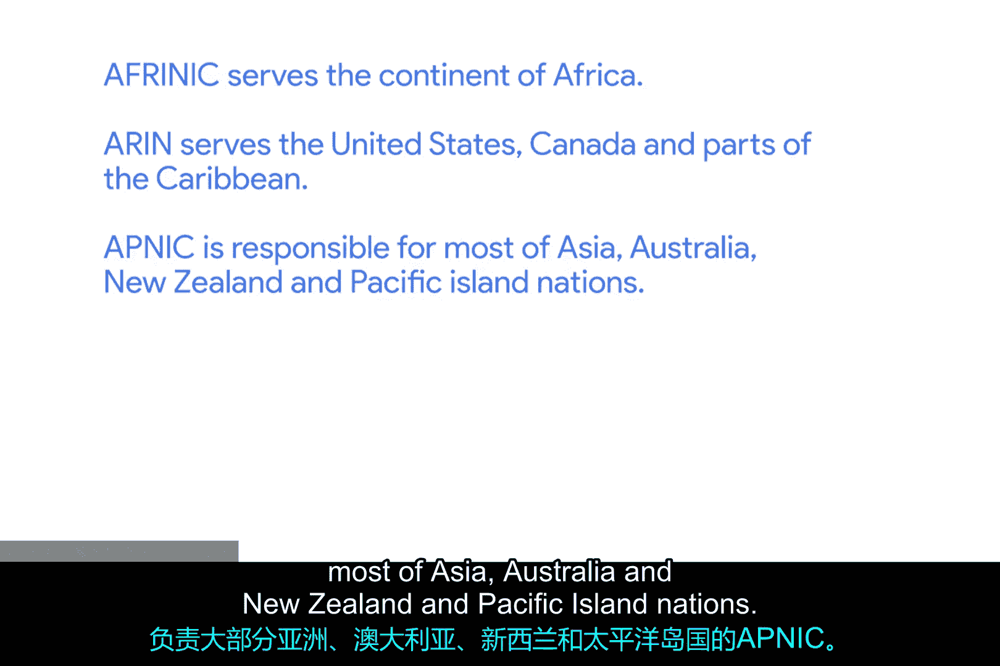

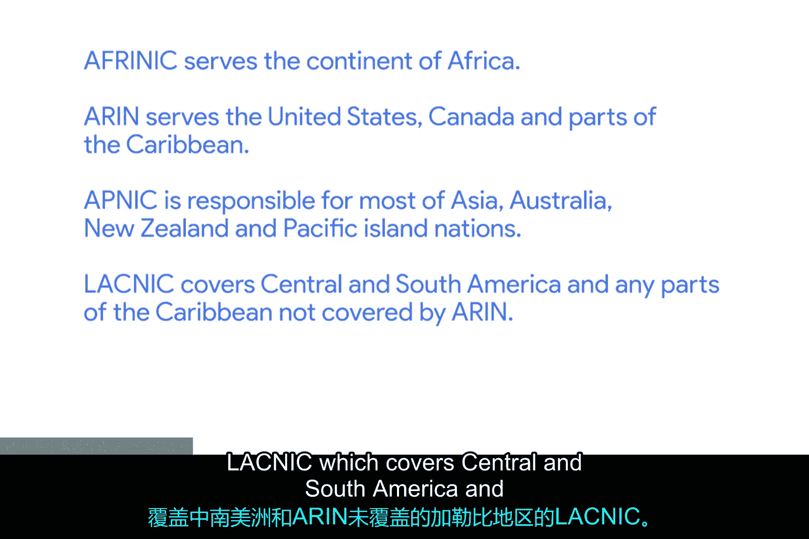

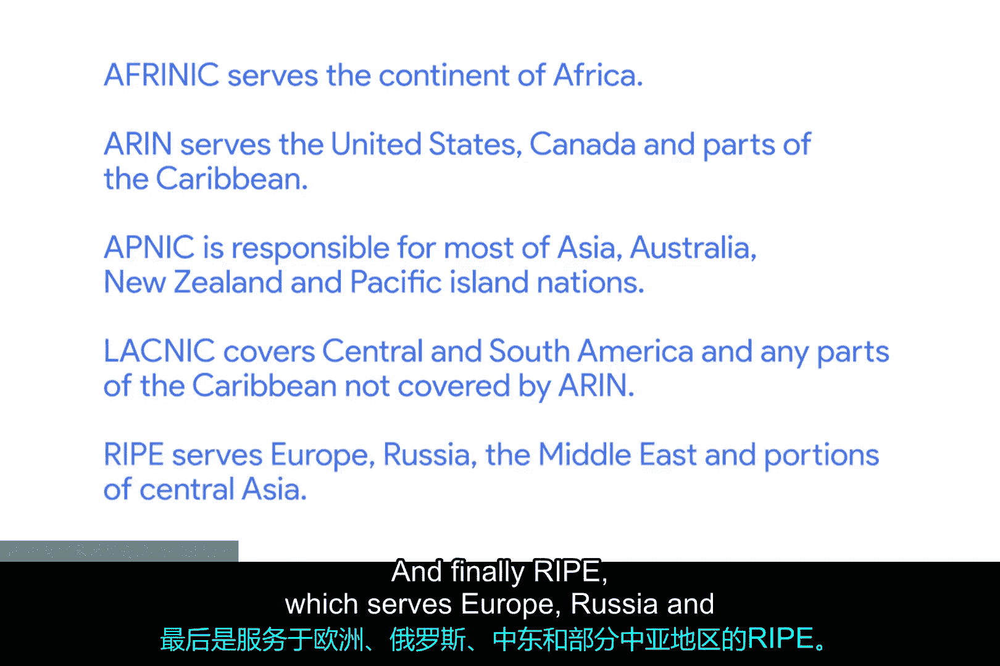

These five RIRs have been responsible for assigning IP address blocks to organizations within their geographic areas。

 and most have already run out the IANA assigned the last unallocated slash 8 network blocks to various RIRs on February 3d。

 2011。

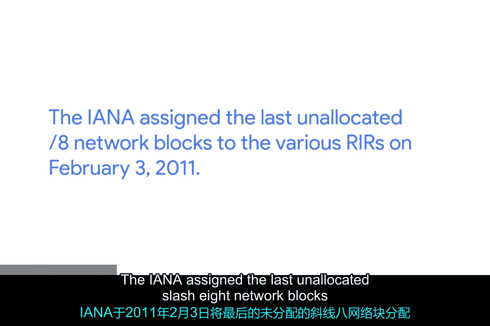

Then in April 2011， ApNI ran out of addresses， Rie was next in September of 2012。

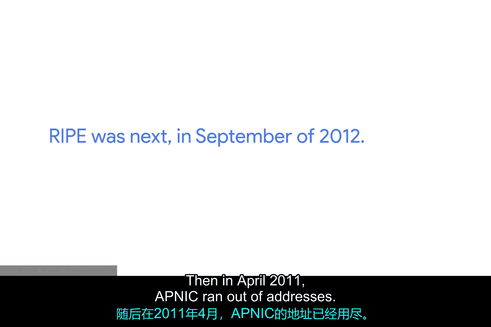

Blacknick ran out of addresses to assign in June 2014， and Aaron did the same in September 2015。

 only Aic has some Is left， but those are predicted to be depleted by 2018。

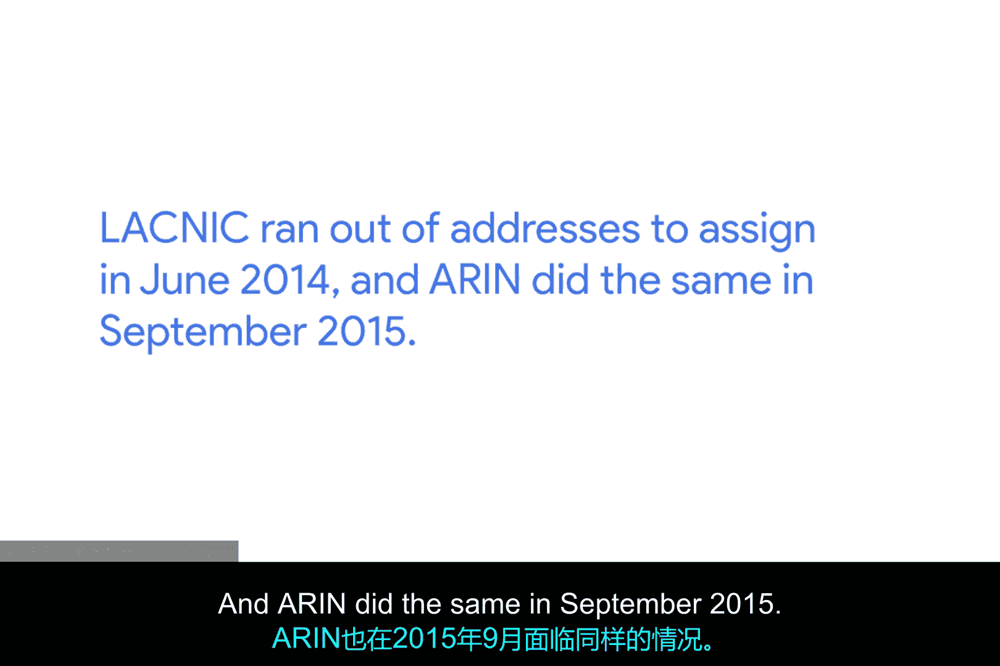

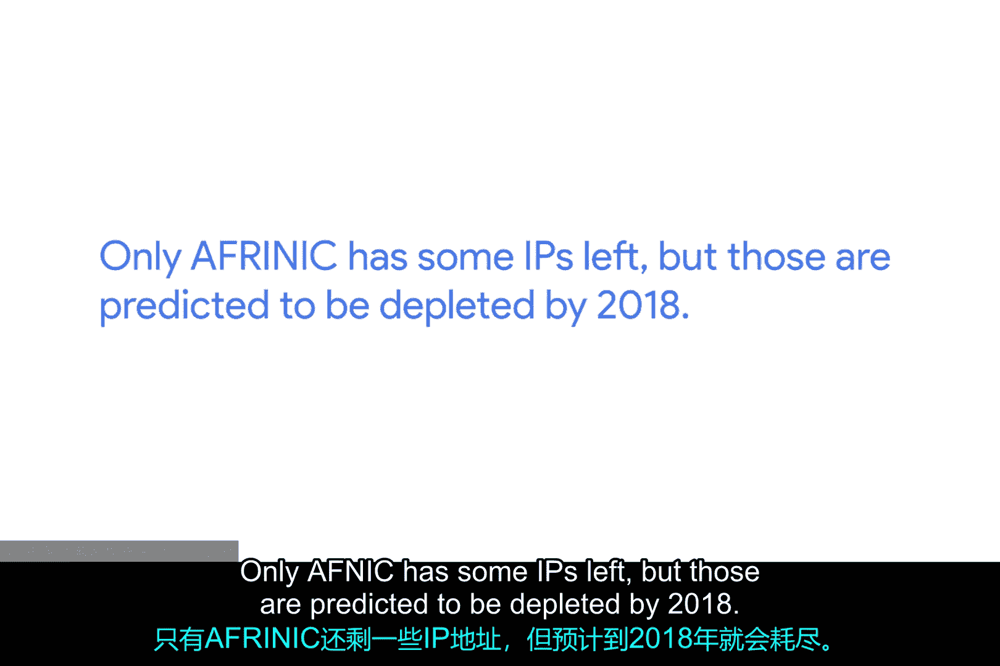

Wikippedia has a great article all about IPV4 exhaustusion and the timelines involved I've added a link to it in the reading just after this video。

This is， of course， a major crisis for the Internet。

 IPV6 will eventually resolve these problems and we'll cover it in more detail later in this course。

 But implementing IPV6 worldwide is going to take some time For now， we want to continue to grow。

 and we want more people and devices to connect to it。

 but without IP addresses to assign a workaround is needed。S layer alert。

 you already know about the major components of this workaround。

 Nat and non routeutable address space。Remember that non routeutable address space was defined in RFC 1918 and consists of several different IP ranges that anyone can use。

An unlimited number of networks can use non routeable address space internally because internet routers won't forward traffic to it。

 this means there's never any global collision of IP addresses when people use those address spaces。

Non routeutable address space is largely usable today because of technologies like Nat。With Nat。

 you can have hundreds， even thousands of machines using nonroutable address space。

 yet with just a single public IP， all those computers can still send traffic to and receive traffic from the internet All you need is one single IPV4 address and via Na a router with that IP can represent lots and lots of computers behind it。

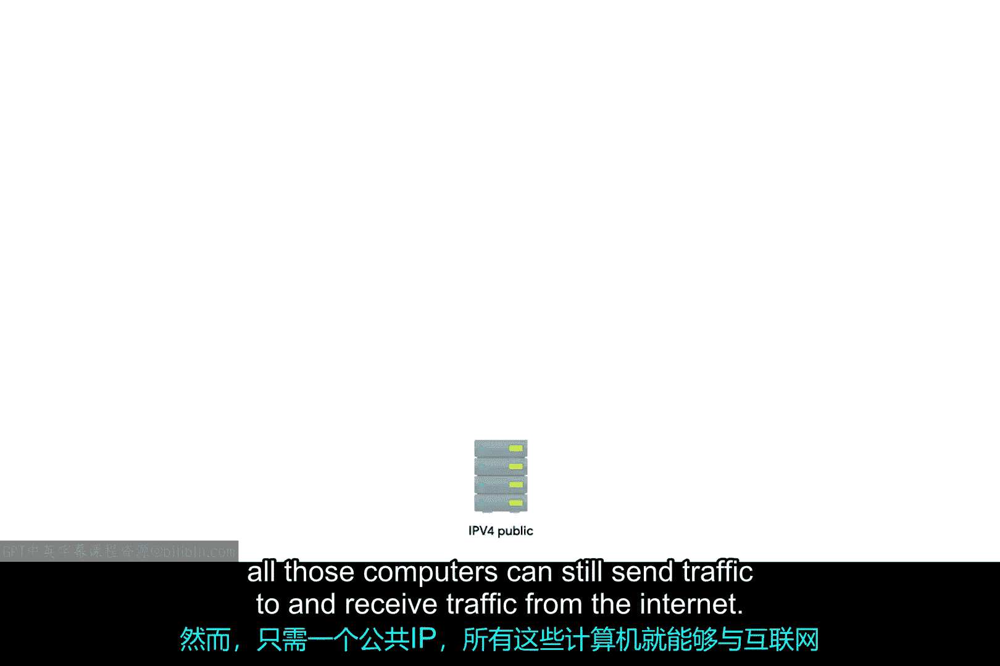

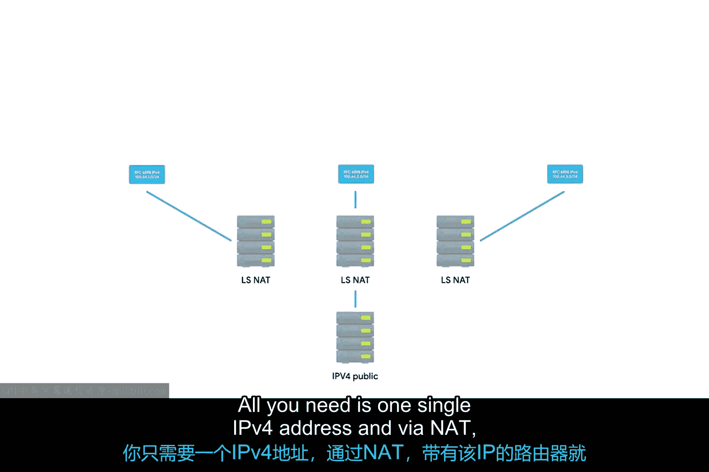

It's not a perfect solution， but until IPV6 becomes more globally available。

 non routeutable address space and Na will have to do。

