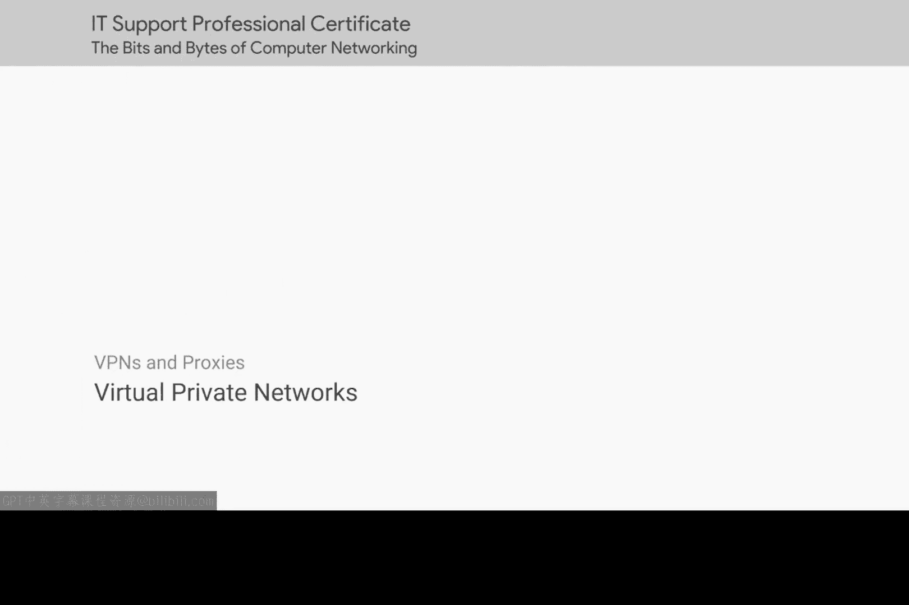
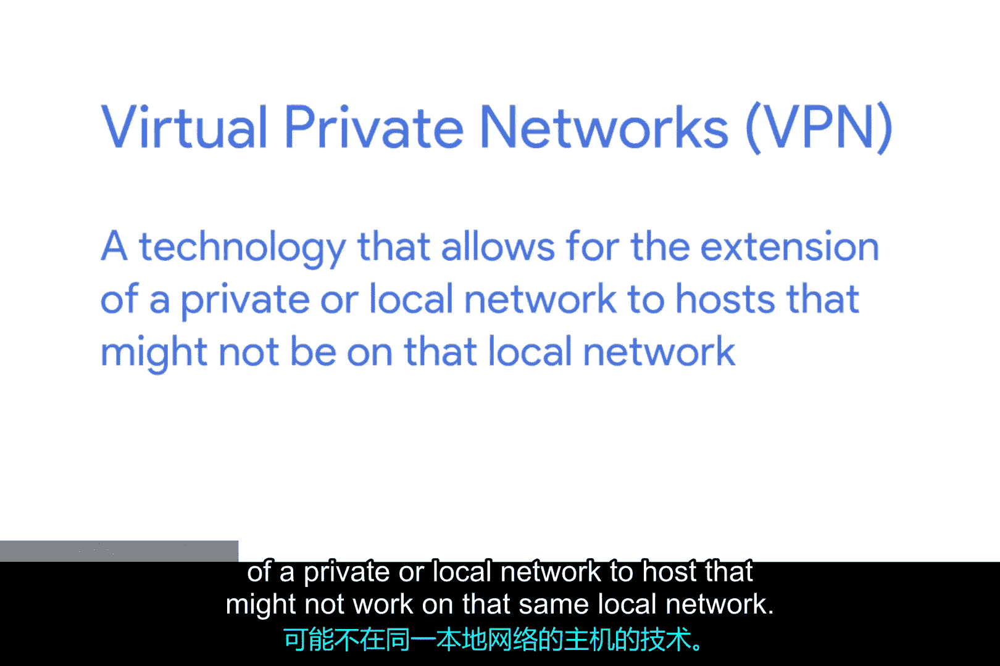
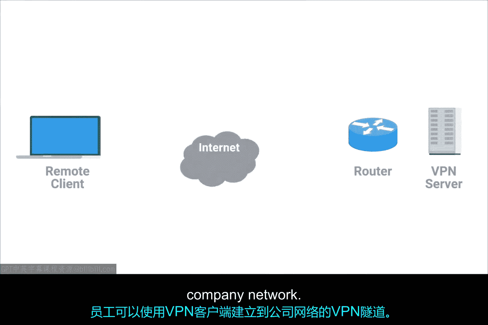
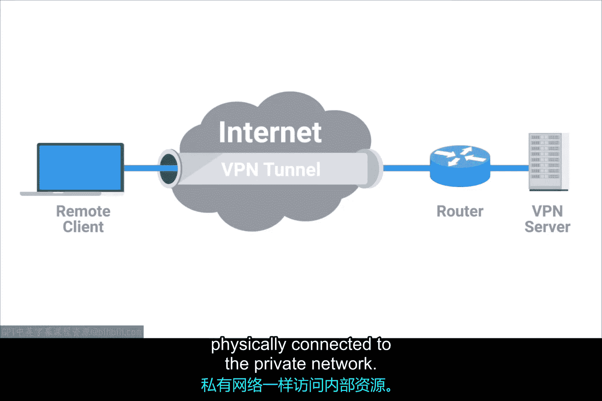
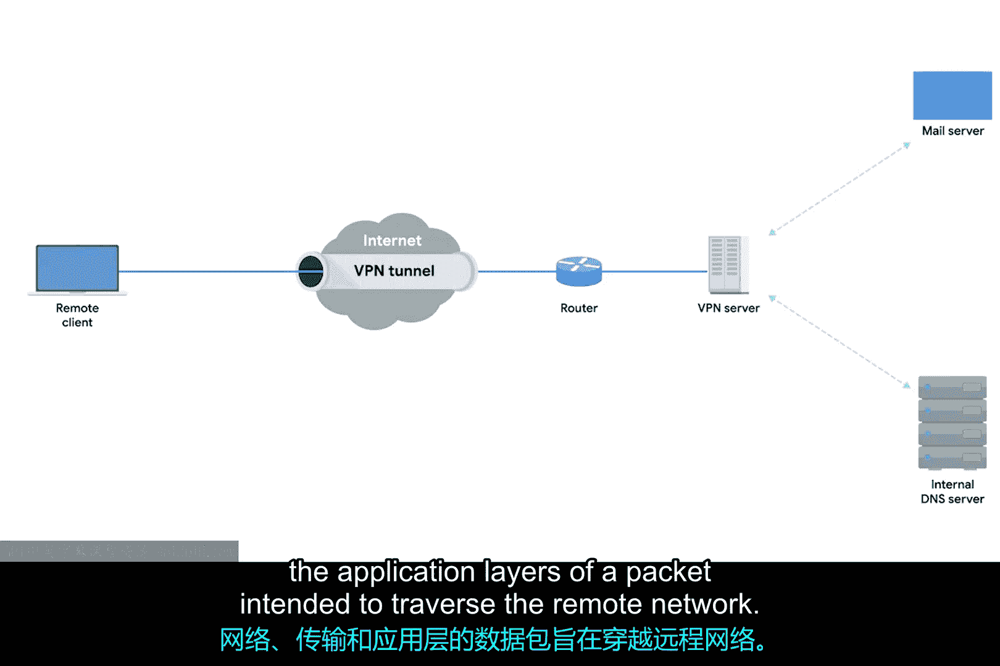
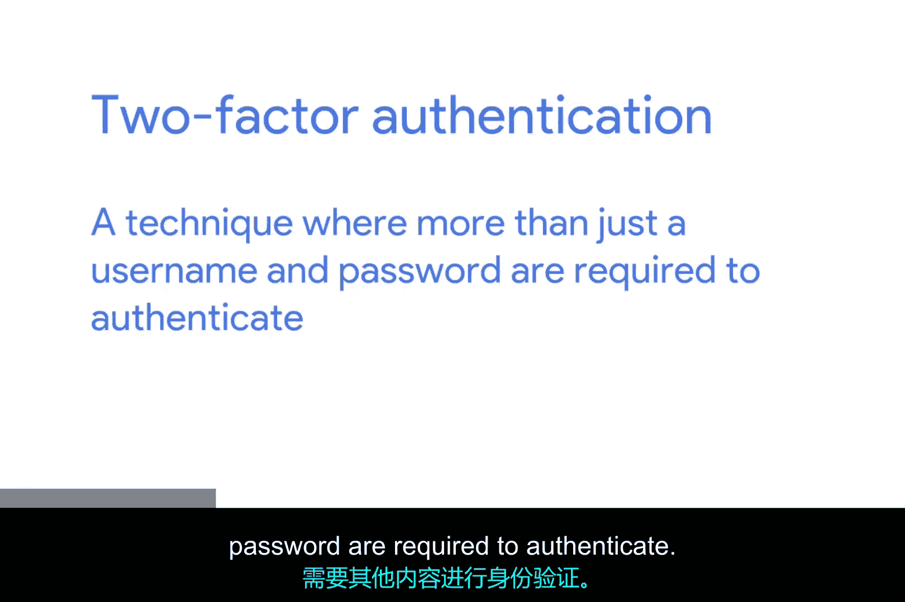
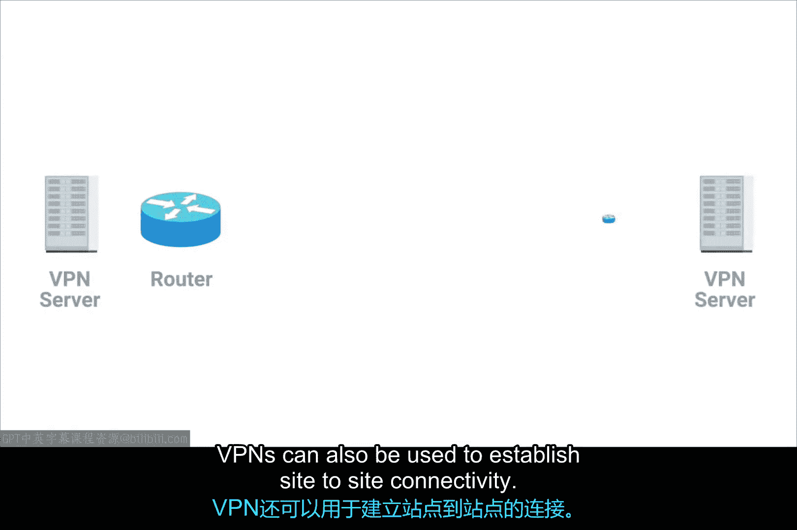
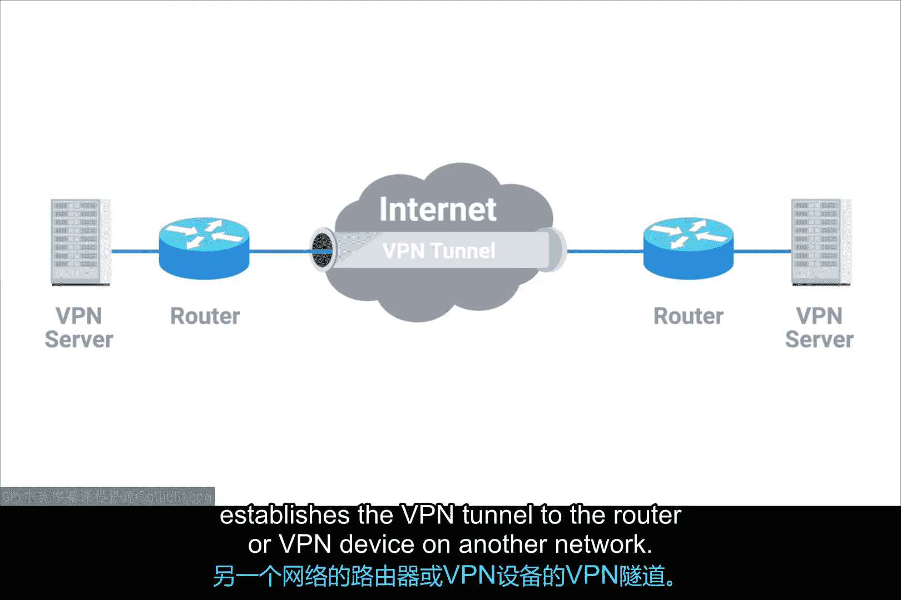
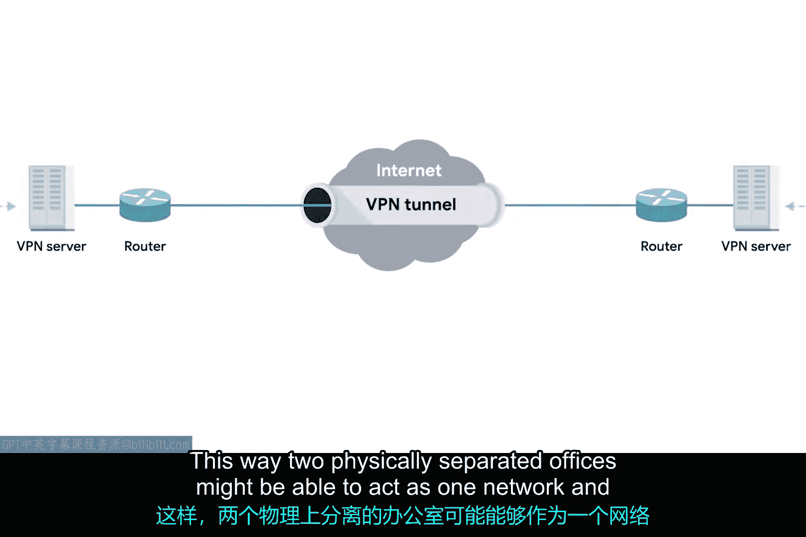
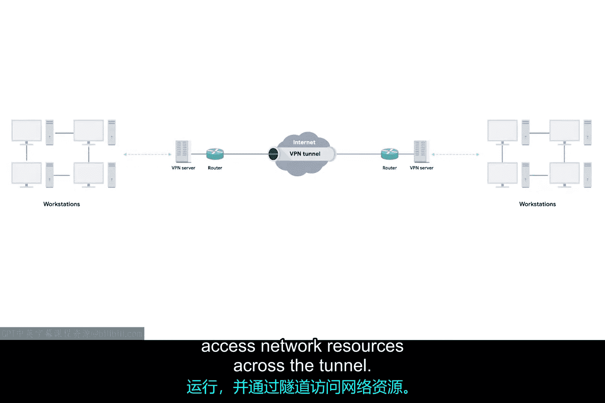

# 谷歌《IT支持（计算机网络⧸操作系统，第2、3课⧸共5课）｜Google IT Support》中英字幕deepseek p59 57_虚拟专用网络.zh_en -BV1uyqcYpExr_p59-

Businesses have lots of reasons to want to keep their network secure。

And they do this by using some of the technologies we've already discussed， Firewalls， Nat。

 the use of nonraable address space， things like that organizations often have proprietary information that needs to remain secure。

 network services that are only intended for employees to access and other things。

One of the easiest ways to keep network secure is to use various securing technologies so only devices physically connected to their local area network can access these resources。

But employees aren't always in the office。They might be working from home or on a business trip。

 and they might still need access to these resources in order to get their work done。

 That's where VPNs come in。Virtual private networks or VPNs are a technology that allows for the extension of a private or local network to host that might not work on that same local network。

VPNs come in many flavors and accomplish lots of different things。

 but the most common example of how VPNs are used is for employees to access their businesses network when they're not in the office。

VPNs are a tunneling protocol， which means they provision access to something not locally available。

When establishing a VPN connection， you might also say that a VPN tunnel has been established。

Let's go back to the example of an employee who needs to access company resources while not in the office。

The employee could use a VPN client to establish a VPN tunnel to their company network。

This would provision their computer with what's known as a virtual interface with an IP that matches the address space of the network they've established a VPN connection to。

By sending data out of this virtual interface， the computer could access internal resources。

 just like if it was physically connected to the private network。

Most VPNs work by using the payload section of the transport layer to carry an encrypted payload that actually contains an entire second set of packets。

 the network， the transport and the application layers of a packet intended to traverse the remote network。

Basically， this payload is carried to the VPN's endpoint where all the other layers are stripped away and discarded。

 Then the payload is unencrypted， leaving the VPN server with the top three layers of a new packet。

 This gets encapsulated with the proper data link layer information and sent out across the network。

This process is completed in the inverse， in the opposite direction。

VPNs usually require strict authentication procedures in order to ensure that they can only be connected to by computers and users authorized to do so In fact。

 VPNs were one of the first technologies where two factor authentication became common。

Two factor authentication is a technique where more than just a username and password are required to authenticate。

 Usually a short lived numerical token is generated by the user through a specialized piece of hardware or software。

DPNs can also be used to establish site to site connectivity。

Conceptually， there isn't much difference between how this works compared to our remote employee situation。

 it's just that the router or sometimes a specialized VPN device on one network establishes the VPN tunnel to the router or VPN device on another network。

This way， two physically separated offices might be able to act as one network and access network resources across the tunnel。

It's important to call out that just like Nat， VPNs are a general technology concept。

 not a strictly defined protocol。 There are lots of unique implementations of VPNs and the details of how they all work can differ a ton。

The most important takeaway is that VPNs are a technology that use encrypted tunnels to allow for a remote computer or network to act as if it's connected to a network that it's not actually physically connected to。

