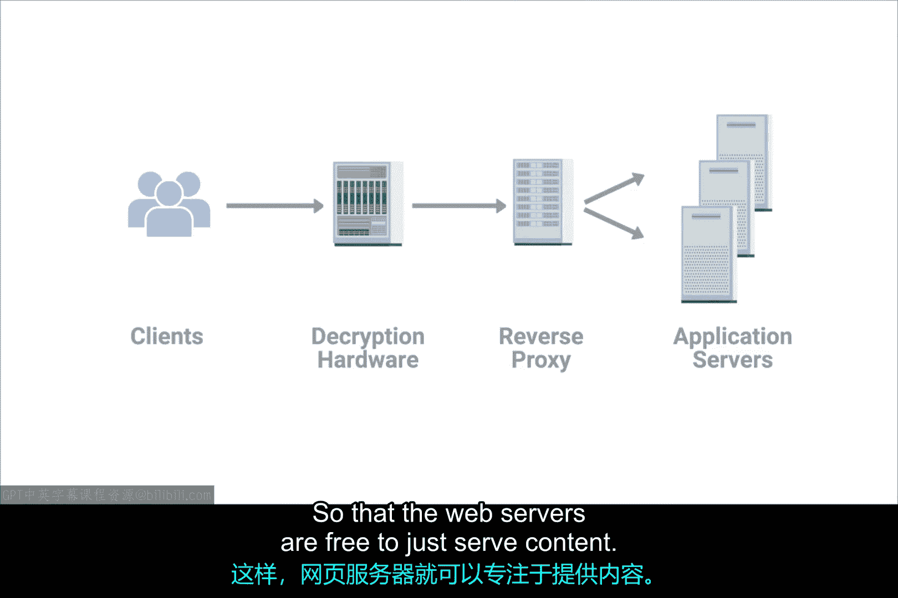

# 谷歌《IT支持（计算机网络⧸操作系统，第2、3课⧸共5课）｜Google IT Support》中英字幕deepseek p60 58_代理服务.zh_en -BV1uyqcYpExr_p60-

A proxy service is a server that acts on behalf of a client in order to access another service。

Proxies sit between clients and other servers， providing some additional benefit， anonymity。

 security， content filtering， increased performance， a couple other things。

If any part of this sounds familiar， that's good， we've already covered some specific examples of proxies like gateway routers。

You don't hear them refer to this way， but a gateway definitely meets the definition of what a proxy is and how it works。

The concept of a proxy is just that a concept or an abstraction。

 it doesn't refer to any specific implementation。 proxies exist at almost every layer of our networking model。

 There are dozens and dozens of examples of proxies you might run into during your career。

 but will cover just a few of the most common ones here。Most often。

 you'll hear the term proxy used to refer to web proxies， as you might guess。

 these are proxies specifically built for web traffic。A web proxy can serve lots of purposes。

Many years ago， when most Internet connections were much slower than they are today。

 lots of organizations used web proxies for increased performance using a web proxy。

 an organization would direct all web traffic through it。

 allowing the proxy server itself to actually retrieve the webp page data from the internet it would then cache this data this way if someone else requested the same web page。

 it could just return the cache data instead of having to retrieve the fresh copy every time。

This kind of proxy is pretty old and you won't often find them in use today。 Why well， for one thing。

 most organizations now have connections fast enough that caching individual web pages doesn't provide much benefit。

 Also the web has become much more dynamic。Going to www。twitter。

com is going to look different to every person with their own Twitter account。

 so caching this data wouldn't do much good。A more common use of a web proxy today might be to prevent someone from accessing sites like Twitter entirely。

A company might decide that accessing Twitter during work hours reduces productivity by using a web proxy。

 they can direct all web traffic to it， allowow the proxy to inspect what data is being requested。

 and then allow or deny this request， depending on what site is being accessed。

Another example of a proxy is a reverse proxy。A reverse proxy is a service that might appear to be a single server to external clients。

 but actually represents many servers living behind it。

A good example of this is how lots of popular websites are architected today。

Very popular websites like Twitter receive so much traffic that there's no way a single web server could possibly handle all of it。

A website that popular might need many， many web servers in order to keep up with processing all incoming requests。

A reverse proxy in this situation could act as a single front end for many web servers living behind it。

From the client's perspective， it looks like they're all connected to the same server。

But behind the scenes， this reverse proxy server is actually distributing these incoming requests to lots of different physical servers。

Much like the concept of DNS round Robin， this is a form of load balancing。

Another way that reverse proxies are commonly used by popular websites is to deal with decryption。

More than half of all traffic on the web is now encrypted。

 and encrypting and decrypting data is a process that can take a lot of processing power。

You'll learn a lot more about encryption and how it works in another course in this program。

Reverse proxies are now implemented in order to use hardware built specifically for cryptography to perform the encryption and decryion work so that the web servers are free to just serve content。

Proxies come in many other flavors， way too many for us to cover them all here。

 but the most important takeaway is that proxies are any server that act as an intermediary between a client and another server。

Good job， we covered a lot， take a break for a bit before you move on to the quiz and project we've cooked up for you。

Once you're done with these， take another break and then meet me back here for the next module where we'll cover the history of Internet connections。

