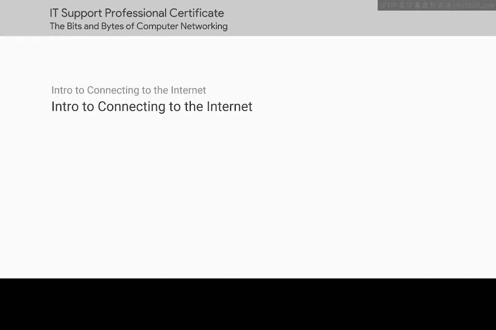
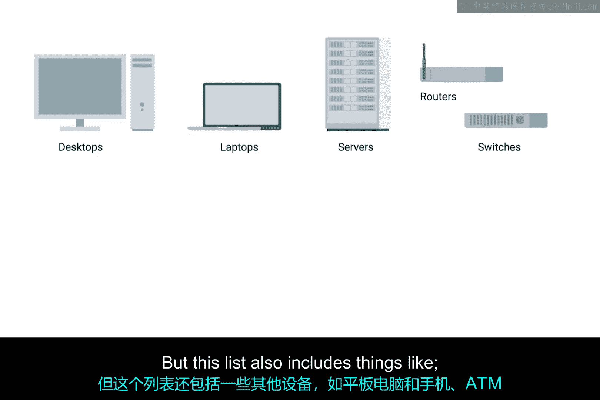
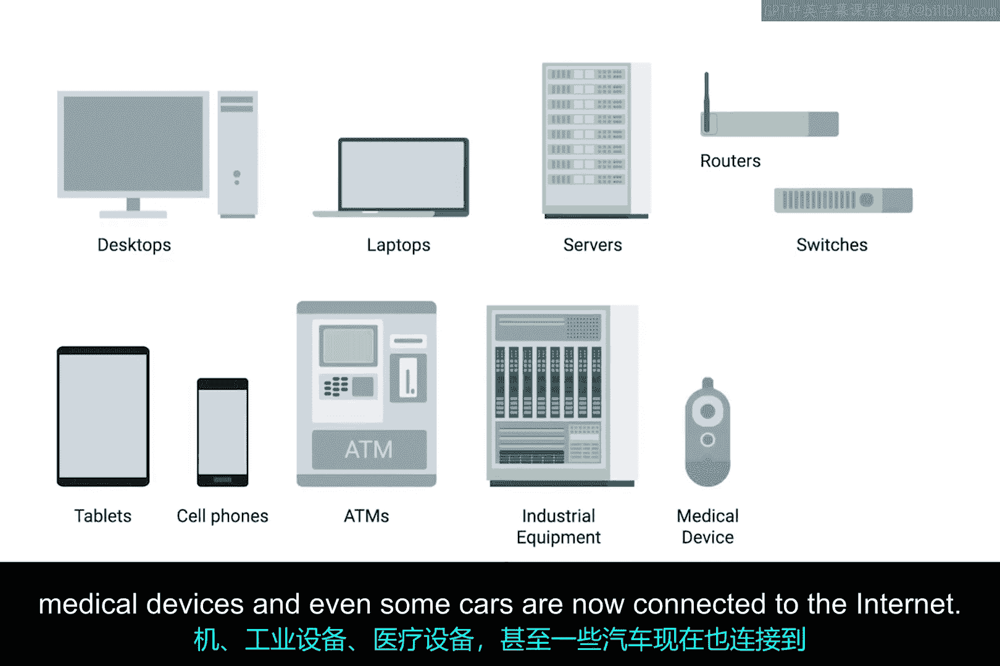

# 谷歌《IT支持（计算机网络⧸操作系统，第2、3课⧸共5课）｜Google IT Support》中英字幕deepseek p61 59_连接互联网介绍.zh_en -BV1uyqcYpExr_p61-

The Internet is a vast and diverse place。 Not only is it huge。

 the number of different devices connected to it can be just as staggering。

 And if we were to actually describe all these devices。

 they'd have an almost endless number of functions。

 The devices that connect to the Internet fall into familiar silos。Desktop and laptop computers。

 servers and data centers， routers and switches that direct network traffic， et cetera。

 But this list also includes things like tablets and cell phones， ATMs， industrial equipment。

 medical devices， and even some cars are now connected to the Internet。 The list go on and on。😊。

It's nice and simple to discuss everything in terms of a basic physical layer made up of Cat5 or Catt6 cables and a data link layer made entirely of Ethernet。

But that's not exactly how things work when they actually connect to the internet。

The technologies used to get people and devices connected are as different as the people and devices themselves by the end of this module。

You'll be able to describe various internet connectivity technologies。

You'll also be able to define the components of WANs and outline the basics of wireless and cellular networking。

These are the skills important as an IT support specialist because a big part of your job will be making sure people can get online。

See you at the top of the next video。