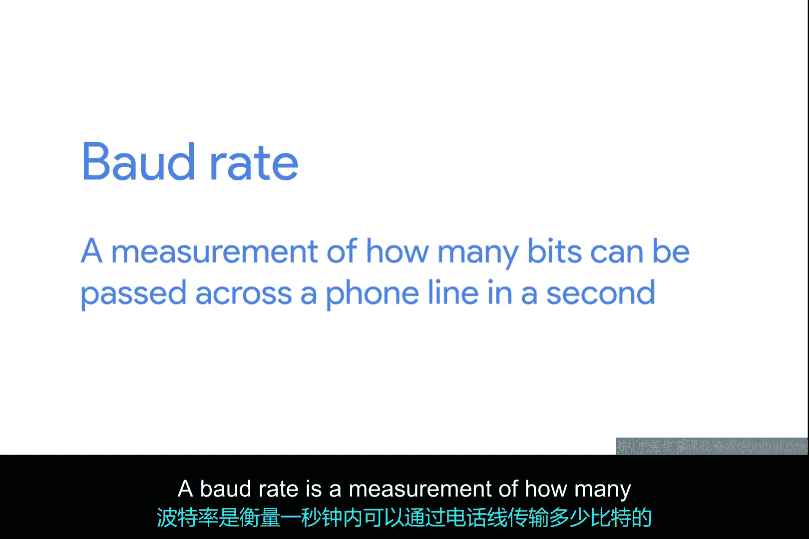
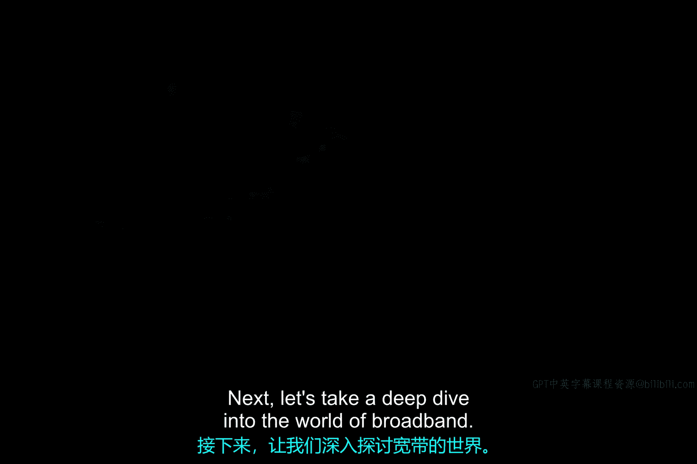

# 谷歌《IT支持（计算机网络⧸操作系统，第2、3课⧸共5课）｜Google IT Support》中英字幕deepseek p62 60_拨号调制解调器与点对点协议.zh_en -BV1uyqcYpExr_p62-

As computer use grew over the course of the 20th century。

 it became obvious that there was a big need to connect computers to each other so that they could share data for years before Ethernet。

 TCP or IP were ever invented， there were computer networks made up of technologies way more primitive than the model we've been discussing。

These early networking technologies mostly focused on connecting devices within close physical proximity to each other。

In the late 1970s， two graduate students at Duke University were trying to come up with a better way to connect computers at further distances。

They wanted to share what was essentially bulletin board material。 Then a light bulb moment went off。

 They realized the basic infrastructure for this already existed。 The public telephone network。

 the public switched telephone network or PT N is also sometimes referred to as the plain old telephone service or pots。

It was already a pretty global and powerful system by the late 1970s。

 more than 100 years after the invention of the telephone。

These Duke grad students weren't the first ones to think about using a phone line to transmit data。

But they were the first to do it in a way that became somewhat permanent precursor to the dialup networks to follow。

 The system they built is known as UsesNe， and a form of it is still in use today。At the time。

 different locations like colleges and universities used a very primitive form of a dialup connection to exchange a series of messages with each other。

 A dialup connection uses pots for data transfer and gets its name because the connection is established by actually dialing a phone number。

If you use dialup back in the day， this noise might sound familiar to you。🎼。For some of us。

 it was like nails on a chalkboard as we waited to get connected to the internet。

Transferring data across a dialup connection is done through devices called modems。

 modeM stands for modulator D modulator and they take data that computers can understand and turn them into audible wavelengths that can be transmitted over pots。

After all， the telephone system was developed to transmit voice messages or sounds from one place to another。

 This is conceptually similar to how line coding is used to turn ones and zeros into modulating electrical charges across ethernet cables。

 Early modems had very low bod rates。 A bo rate is a measurement of how many bits could be passed across a phone line in a second。

😊。

By the late 1950s， computers could generally only send each other data across a phone line at about 110 bits per second。

By the time UsNe was being developed， this rate had increased to around 300 bits per second。

And by the time dial access to the internet became a household commodity in the early 1990s。

 this rate had increased to 14。4 kilobits per second。 improvements continue to be made。

 but widespread adoption of broadband technologies。

 which we'll discuss in the next lesson replaced a lot of these improvements dial up internet connectivity is pretty rare today。

 but it hasn't completely gone away。In some rural areas， it might be the only option still available。

 You might never run into a dial up Internet connection during your I T career。

 but it's still important to know that for several decades。

 this technology represented the main way computers communicated with each other over long distances。

 I'm just glad we don't have to choose between using the phone or using the Internet anymore。😊，Next。

 let's take a deep dive into the world of broadband。

