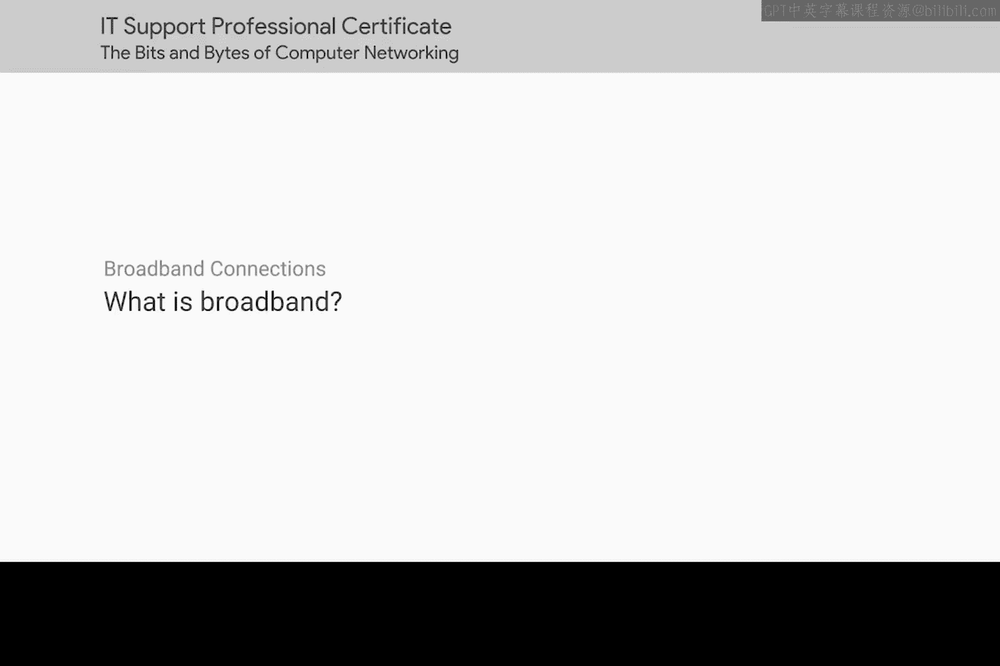
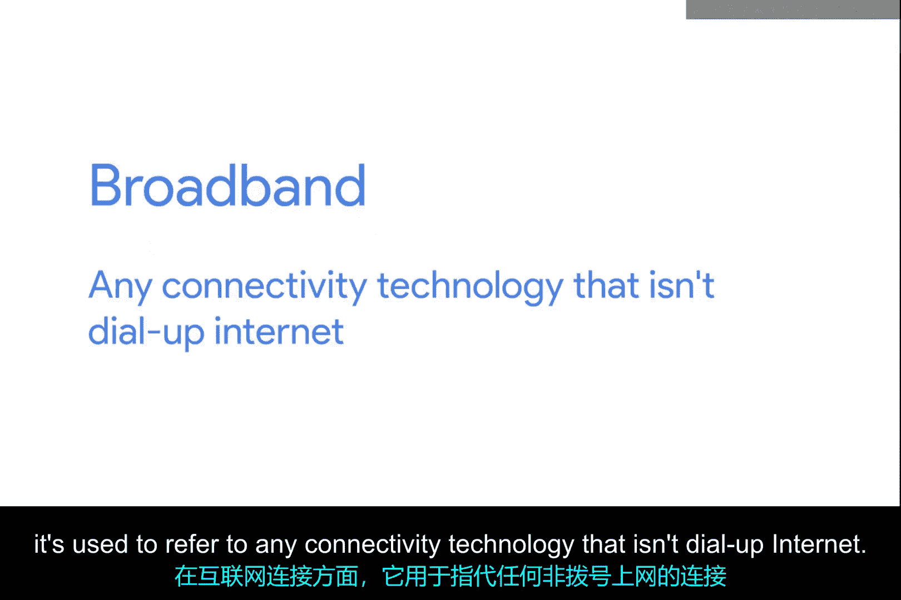
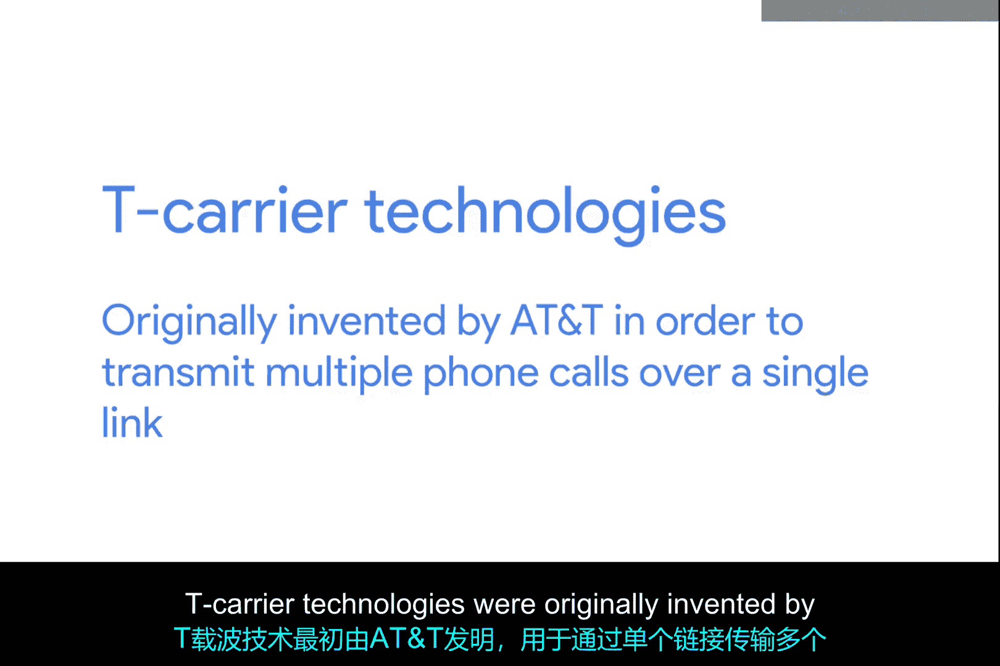
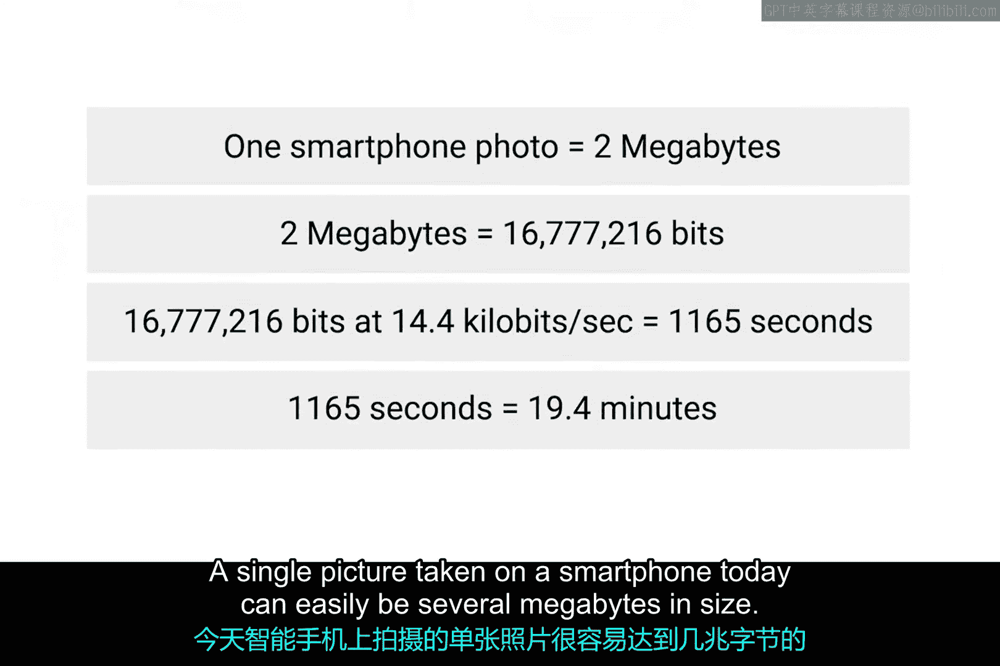
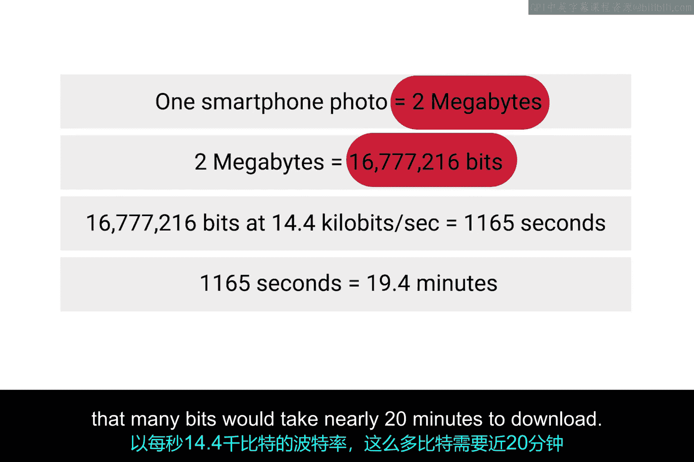

# 谷歌《IT支持（计算机网络⧸操作系统，第2、3课⧸共5课）｜Google IT Support》中英字幕deepseek p63 61_什么是宽带.zh_en -BV1uyqcYpExr_p63-

The term broadband has a few definitions。In terms of internet connectivity。

 it's used to refer to any connectivity technology that isn't dial up Internet。

 broadband Internet is almost always much faster than even the fastest dialup connections。

 and refers to connections that are always on。 This means that their long lasting connections that don't need to be established with each use。

 They're essentially links that are always present。 broadband shaped today's world。

 While the Internet itself is a totally amazing invention。

 It wasn't until the advent of broadband technologies that its true potential for business and home users was realized。

 long before people had broadband connections at home。 Business spent a lot of resources on them。

 Usually out of necessity。 If you had an office with more than a few employees。

 the bandwidth available by a single dialup connection would quickly be oversaturated by just a few users。

 by the mid 1990s。 It had become pretty common for businesses that needed Internet access for their employees to。

😊。

Use various T carrier carrier technologies were originally invented by AT&T in order to transmit multiple phone calls over a single link。

 eventually， they also became common transmission systems to transfer data much faster than any dial of connection could handle。

Well cover the details of T carrier technologies in an upcoming lesson after businesses got into the broadband game。

 home use became more prevalent as different aspects of the internet like the World W Web became more complex。

 they also required ever increasing data transfer rates。In the days of dial。

 even a single image on a webage could take many seconds to download and display high resolution photos that you can now take on a cell phone would have required a long time to download and a lot of your patients。

 A single picture taken on a smartphone today can easily be several mebys in size 2 mebys would translate to 16777216 B at a bo rate of 14。

4 kB per second。 That many bits would take nearly 20 minutes to download No one would have had time to download all the hilarious cat images on the Internet back then would a travesty without broadband Internet connection technologies。

 The Internet， as we know it today， wouldn't exist。

 We wouldn't be able to stream music or movies or easily share photos。

 You definitely couldn't be taking an online course like this。 T carrier technologies。

 require dedicated lines， which makes them more expensive。 For this reason， you usually。😊。

Only see them in use by businesses， but other broadband solutions also exist for both businesses and consumers in the next few videos we'll deep dive into four of the most common broadband solutions available today。

 T carrierer technologies， digital subscriber lines or DSL， cable broadband and fiber connections。

 Are you ready， Let's get started。😊。