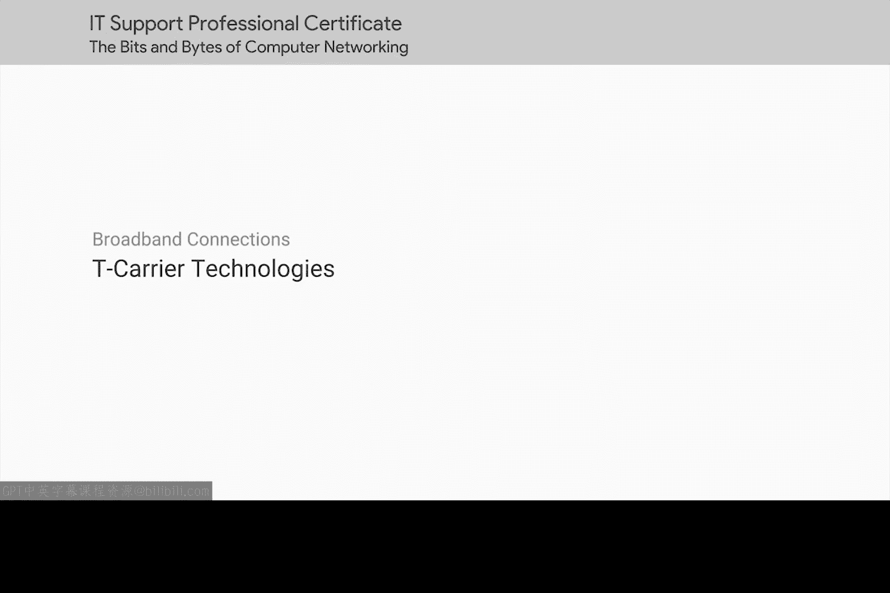
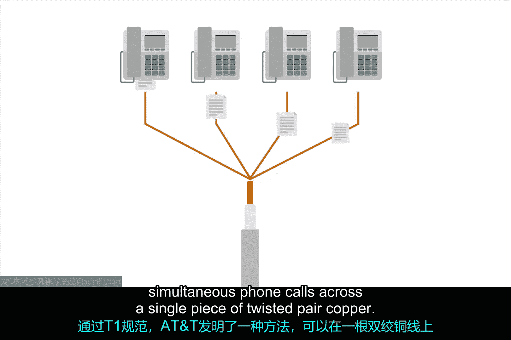
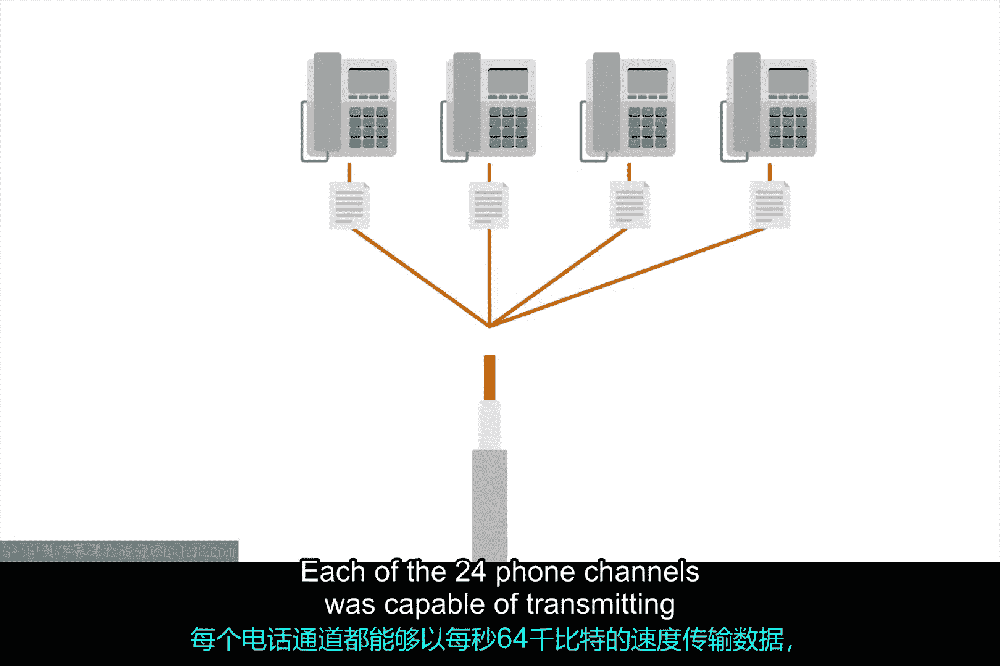
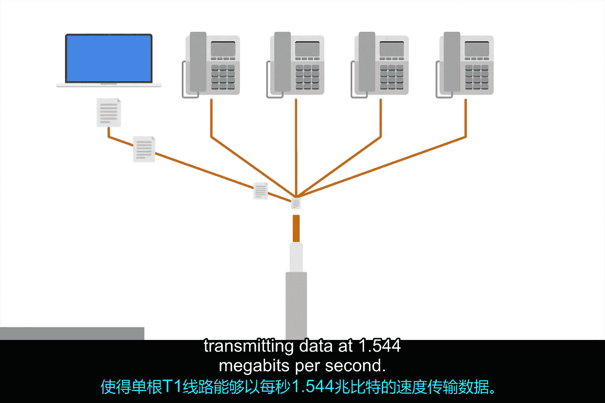

# 谷歌《IT支持（计算机网络⧸操作系统，第2、3课⧸共5课）｜Google IT Support》中英字幕deepseek p64 62_T载波技术.zh_en -BV1uyqcYpExr_p64-

T carrier technologies were first invented by A T and T in order to provision a system that allowed lots of phone calls to travel across a single cable。

 Every individual phone call was made over individual pairs of copper wire before transmission system 1。

 the first T carrier specification called T1 for short。With the T1 specification。

 AT&T invented a way to carry up to 24 simultaneous phone calls across a single piece of twisted pair copper。

Years later， this same technology was repurposed for data transfers。

 each of the 24 phone channels was capable of transmitting data at 64kbit per second。

 making a single T1 line capable of transmitting data at 1。544 mebits per second Over the years。

 the phrase T1 has come to mean any twisted pair copper connection capable of speeds of 1。

544 mebits per second， even if it doesn't strictly follow the original transmission system 1 specification。

Originally， T1 technology was only used to connect different telecom company sites to each other and to connect these companies to other telecom companies。

 but with the rise of the internet as a useful business tool in the 1990s。

 more and more businesses started to pay to have T1 lines installed at their offices to have faster internet connectivity。

 more improvements to the T1 line were made by developing a way of multiple t1s to act as a single link。

 So a T3 line is 28 t1s all multipleed achieving a total throughput speed of 44。736 mebit per second。

You'll still find T carrierer technologies in use today。

 but they've usually been surpassed by other broadband technologies for small business offices。

 cable broadband or fiber connections are now way more common since theyre much cheaper to operate for inner ISP communications。

 different fiber technologies have all replaced older copper based ones。

