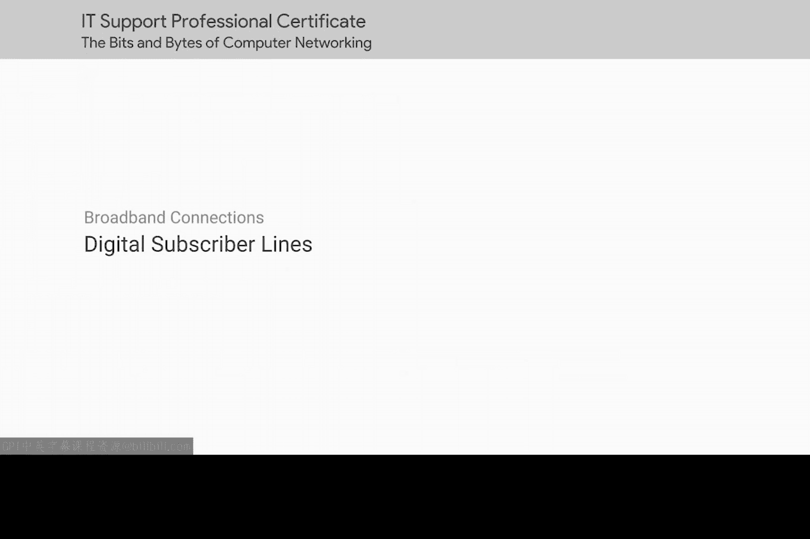
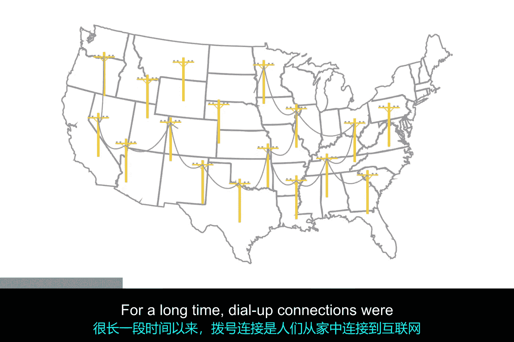
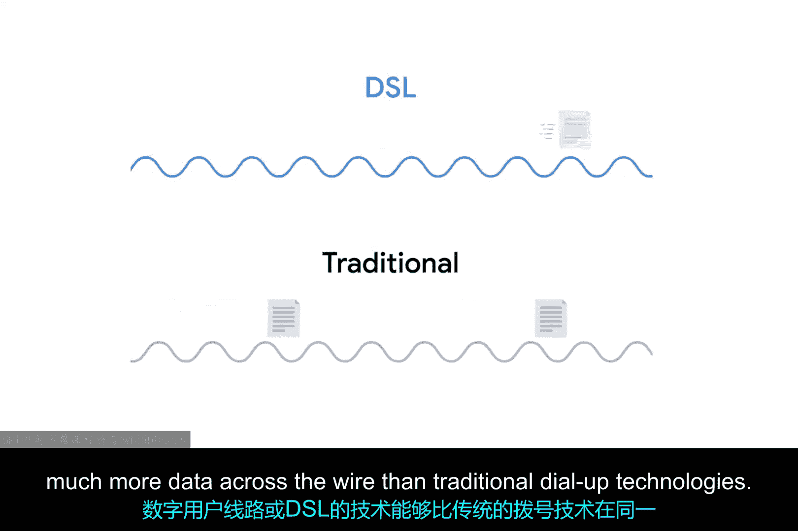
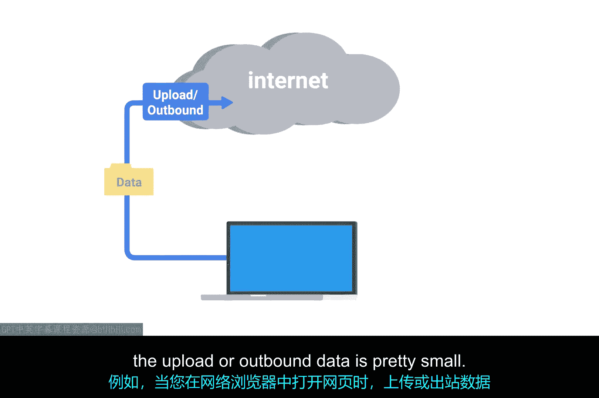
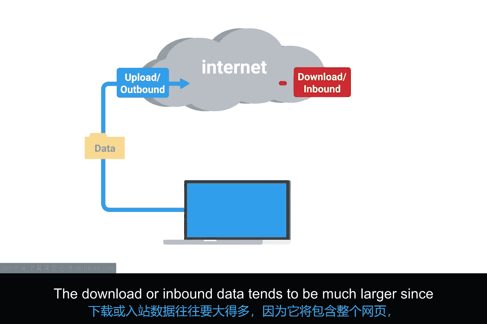

# 谷歌《IT支持（计算机网络⧸操作系统，第2、3课⧸共5课）｜Google IT Support》中英字幕deepseek p65 63_数字用户线路.zh_en -BV1uyqcYpExr_p65-

The Public telephone network was a great option for getting people connected to the internet since it already had infrastructure everywhere。

For a long time， dialup connections were the main way that people connected to the internet from home。

But there were certain limitations with trying to transmit data as what were essentially just audio ways。

As people wanted faster and faster internet access。

 telephone companies began to wonder if they could use the same infrastructure。

 but in a different way。The research showed that twisted pair copper used by modern telephone lines was capable of transmitting way more data than what was needed for voice to voice calls。

By operating at a frequency range that didn't interfere with normal phone calls。

 a technology known as digital subscriber Line or DSL was able to send much more data across the wire than traditional dialup technologies。

And to top it all off， this allowed for normal voice。

 phone calls and data transfer to occur at the same time on the same line。

 kind of like how dialup uses modems， DSL technologies also use their own modems。

 but more accurately， they're known as DSlams or digital subscriber line access multiplexors。

 just like dialup modems， these devices established data connections across phone lines。

 but unlike dialup connections， They're usually long running。

 This means that the connection is generally established when the DSslam is powered on and isn't torn down until the DSslam is powered off。

😊，There are lots of different kinds of DSL available。

 but they all vary in a pretty minor way for a long time。

 the two most common types of DSL were ADSL and S DSSL。

ADSL stands for asymmetric Digital subscriber Line ADSL connections feature different speeds for outbound and incoming data。

Generally， this means faster download speeds and slower upload speeds Home users rarely need to upload as much data as they download since home users are mostly just clients。

For example， when you open a web page and a web browser， the upload or outbound data is pretty small。

 You're just asking for a certain web page from the web server。

 The download or inbound data tends to be much larger， since it'll contain the entire web page。

 including all images and other media。 For this reason。

 asymmetric lines often provide a similar user experience for a typical home user。

 but at a lower cost。

SDSL， as you might be able to guess， stands forsymmetricsymmetric digital subscriber line SDSL technology is basically the same as ADSL。

 except the upload and download speeds are the same。😊，At one point。

 SDSL was mainly used by businesses that hosted servers that needed to send data to clients as the general bandwidth available on the Internet has expanded。

 and as the cost of operation have come down over the years。

 SSL is now more common for both businesses and home users。

 Most SSL technologies have an upper cap of 1。544 Mbit a second or the same as a T1 line。

Further developments in SDL technology have yielded things like HDL or high bit rate digital subscriber lines。

 These are DSL technologies that provision speeds above 1。544 mebits per second。

There are lots of other minor variations in DSL technology out in the wild。

 offering different bandwidth options and operating distances。

These variations can be so numerous and minor， it's not really practical to try to cover them here。

If you ever need to know more about a specific DSL line。

 you should contact the ISP that provides it for more details。

