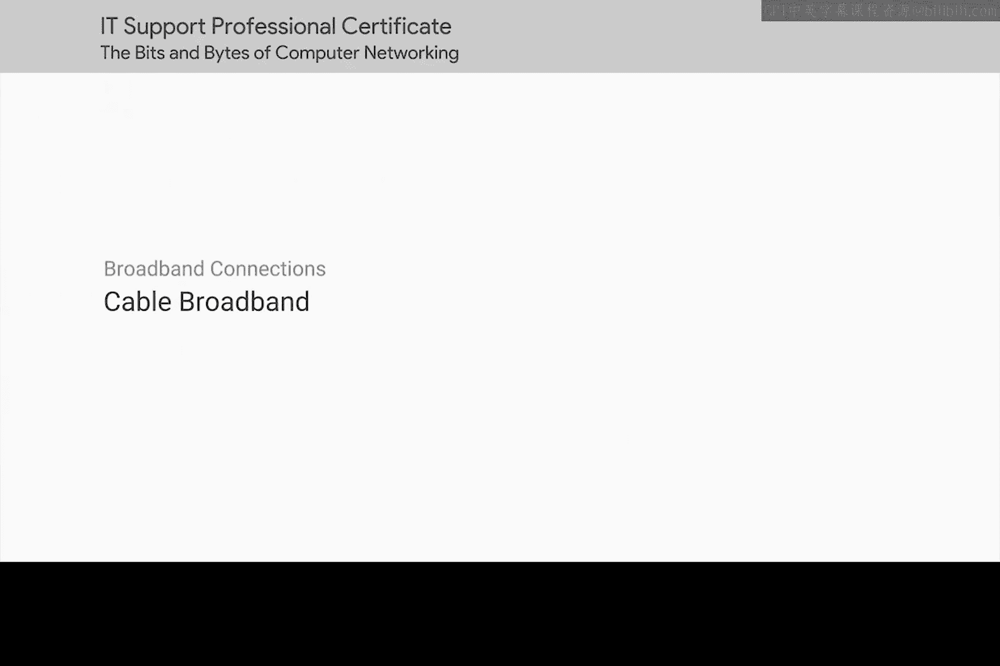
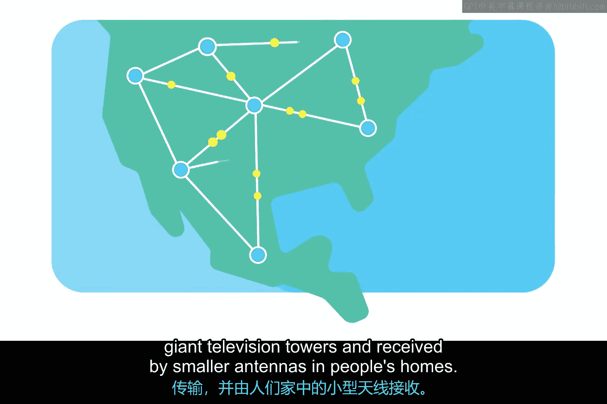
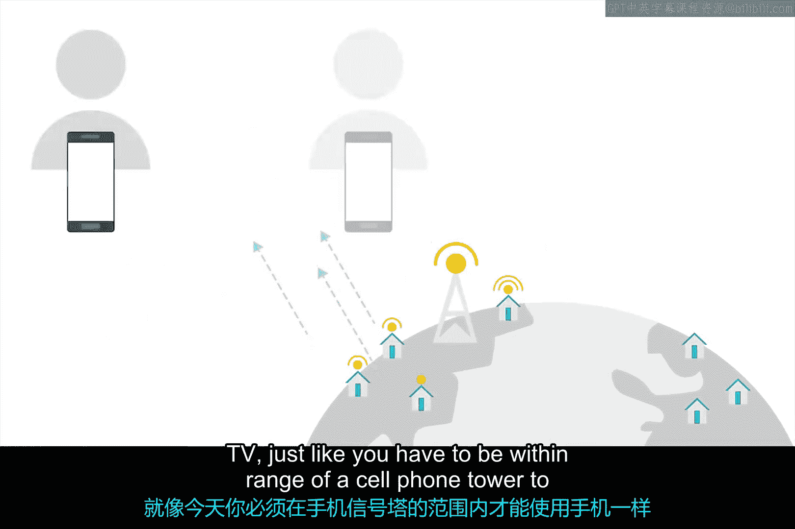
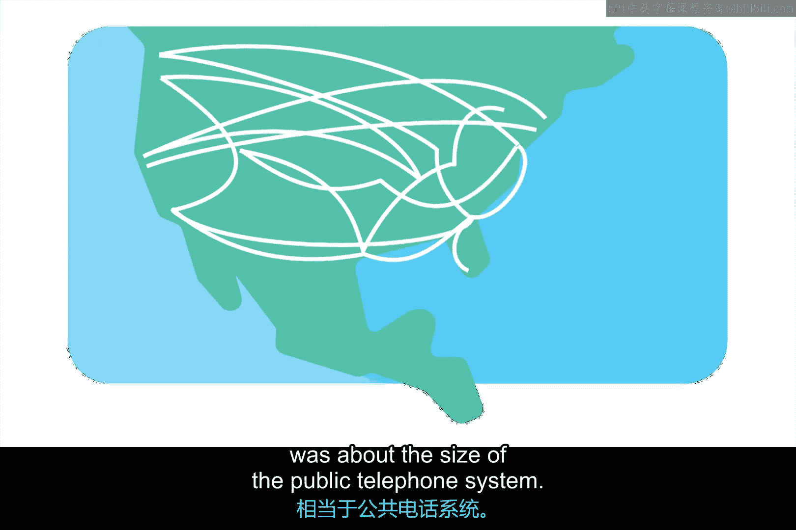
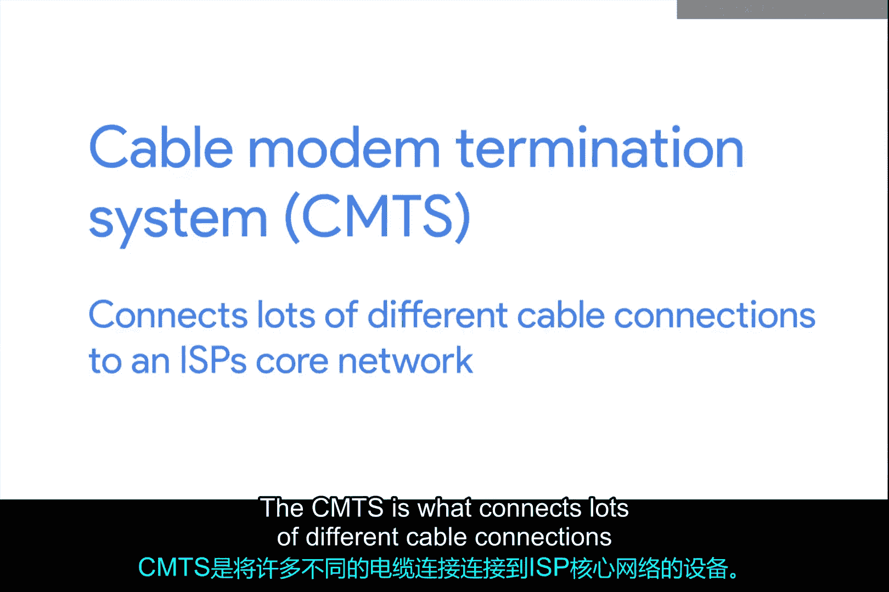

# 谷歌《IT支持（计算机网络⧸操作系统，第2、3课⧸共5课）｜Google IT Support》中英字幕deepseek p66 64_电缆宽带.zh_en -BV1uyqcYpExr_p66-

The history of both the telephone and computer networking tells a story that started with all communications being wired。

 But the recent trend is moving towards more and more of this traffic becoming wireless。

 The history of television follows the opposite path。 Originally。

 all television broadcasts or wireless transmissions sent out by giant television towers and received by smaller antennas in people's homes。

 This meant you had to be within range of one of these television towers to watch TV。

 just like you have to be within range of a cell phone tower to use your cell phone today。😊。

Starting in the late 1940s in the United States， the first cable television technologies were developed。

At the time， they mainly wanted to provide television access to remote towns and rural homes that were out of range of capabilities of television towers at the time。

Cable television continued to expand slowly over the decades。 But in 1984。

 the Cable Communications Policy Act was passed。 This deregulated the cable television business in the United States and caused a massive boom in growth and adoption。

 Other countries all over the globe soon followed。😊，By the early 1990s。

 cable television infrastructure in the United States was about the size of the public telephone system。

 not too long after that， cable providers started trying to figure out if they could join in on the massive spike in internet growth that was happening at the same time。

Much like how DSL was developed， cable companies quickly realized that the coaxal cables generally used by cable television delivery into a person's home were capable of transmitting much more data than what was required for TV viewing by using frequencies that don't interfere with television broadcast。

 cable-based internet access technologies were able to deliver high speed internet access across these same cables。

 This is the technology we refer to when we say cable broadband。

One of the main differences in how cable internet access works when compared to other broadband solutions is that cable is generally what's known as a shared bandwidth technology。

 with technologies like DSL or even dialup， the connection from your home or business goes directly to what's known as a central office or CO。

A long time ago， these COs were actually offices staffed with telephone operators who used a switchboard to manually connect the caller with the colee。

As technology improved， these COs became smaller pieces of automated hardware that handled these functions for the telephone companies。

 but the name stayed the same。Technologies that connect directly to a CO can guarantee a certain amount of bandwidth available over that connection since its point to point on the flip side of this are cable Internet technologies which employ a shared bandwidth model with this model in place。

 many users share a certain amount of bandwidth until the transmissions reach the ISP's core network。

 It could be anywhere from a single city block to entire subdivisions in the suburbs。

 It just depends on how that area was originally wired for cable。Today。

 most cable operators have tried to upgrade their networks to the point that end users might not always notice this shared bandwidth。

But it's also still common to see cable internet connections slow down during periods of heavy use。

 like when lots of people in the same region are using their internet connection at the same time。

Cable internet connections are usually managed by what's known as a cable modem。

 This is a device that sits at the edge of a consumer's network and connects it to the cable modem termination system or CMTS。

 The CMTS is what connects lots of different cable connections to an ISP's core network。

