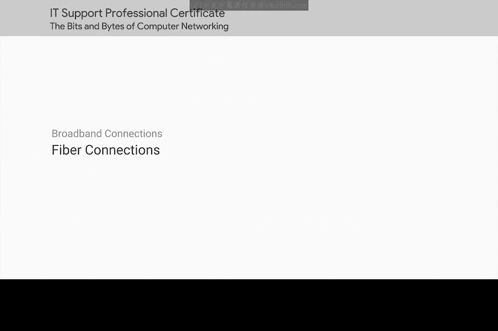
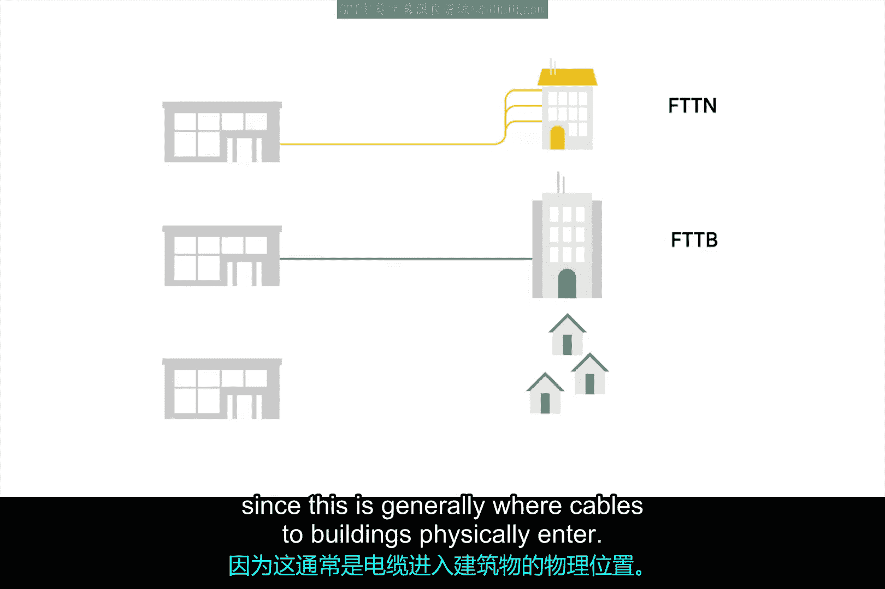
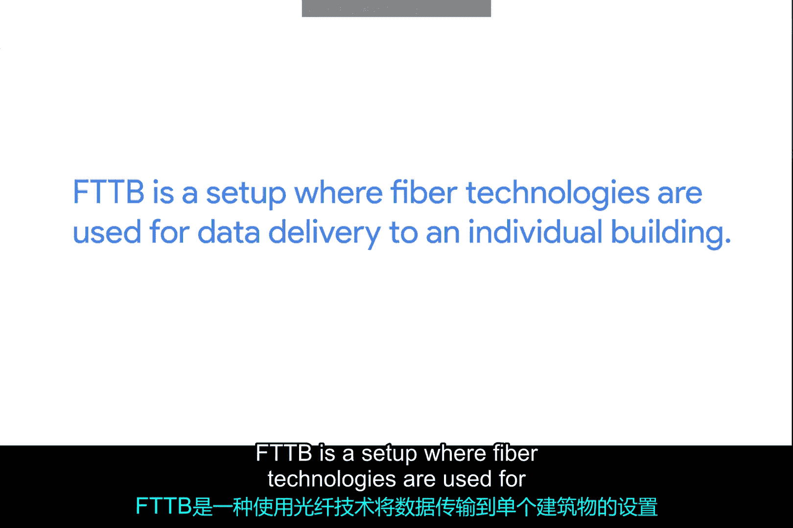
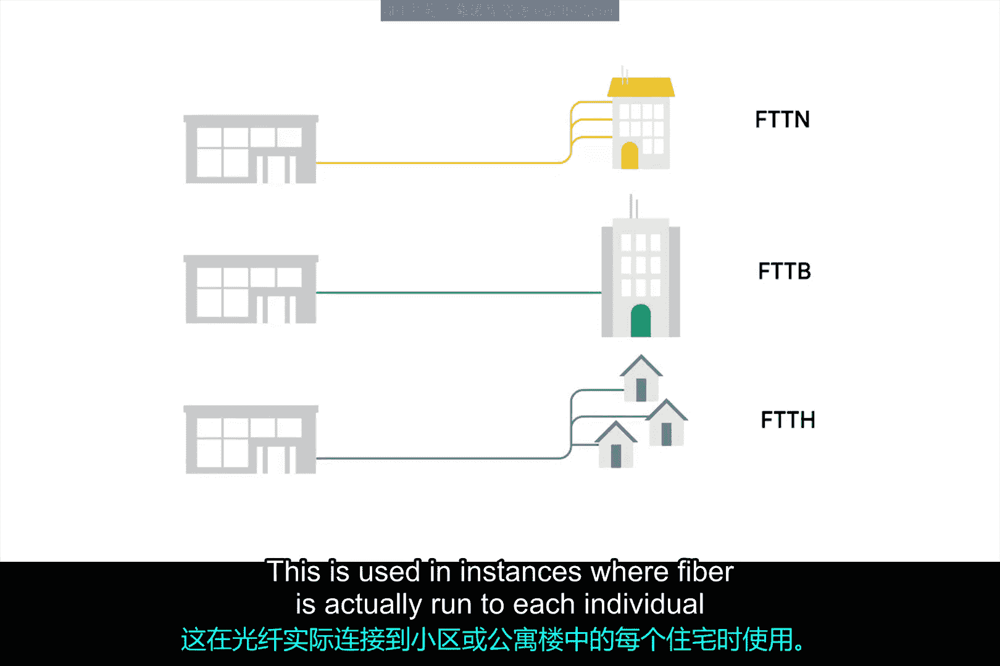
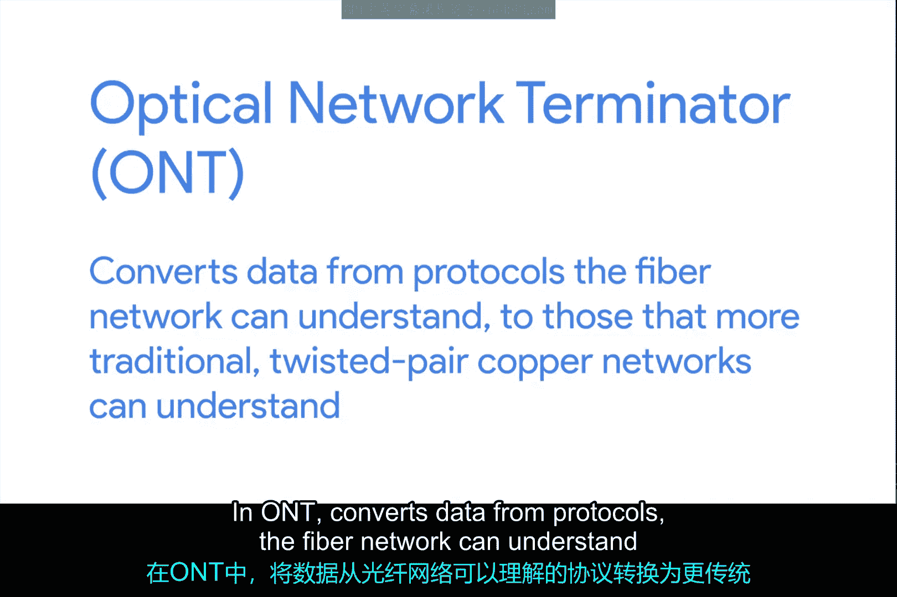
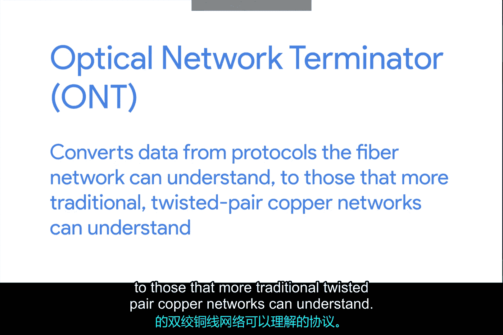

# 谷歌《IT支持（计算机网络⧸操作系统，第2、3课⧸共5课）｜Google IT Support》中英字幕deepseek p67 65_光纤连接.zh_en -BV1uyqcYpExr_p67-

The core of the Internet has long used fiber for its connections。

 both due to higher speeds and because fiber allows for transmission to travel much further without degradation of the signal。

Remember that fiber connections use light for data transmission instead of electrical currents。

 the absolute maximum distance and electrical signal can travel across a copper cable before it degrades too much and requires a repeater is thousands of feet。

 but certain implementations of fiber connections can travel many， many miles before signal degrades。

Producing and laying fiber is a lot more expensive than using copper cables。 So for a long time。

 it was a technology you only saw in use by ISps within their core networks。

 or maybe for use within data centers， But in recent years。

 it's become popular to use fiber to deliver data closer and closer to the end user。

 Exact how close to the end user can vary a ton across implementations。

 which is why the phrase F T T X was developed。 F T T X stands for fiber to the X。

 where the X can be one of many things， will cover a few of these possibilities。

The first term you might hear is F T T N， which means fiber to the neighborhood。

 This means that fiber technologies are used to deliver data to a single physical cabinet that serves a certain amount of the population。

From this cabinet， twisted pair copper or coax might be used for the last length of distance。

The next version you might come across is FTTB。This stands for fiber to the building。

 fiber to the business or even fiber to the basement。

 Since this is generally where cables to buildings physically enter。

FTTB is a setup where fiber technologies are used for data delivery to an individual building。

 After that， twisted pair copper is typically used to actually connect those inside of the building。

A third version you might hear is FTTH， which stands for fiberber to the home。

This is used in instances where fiber is actually run to each individual residence in a neighborhood or apartment building。

FTTH and FTTB may both also be referred to as FTTP fiber to the premises instead of a modem。

 the demarcation point for fiber technologies is known as optical network Terinator or ONT。

In ONT converts data from protocols the fiber network can understand to those that more traditional twisted pair copper networks can understand。

