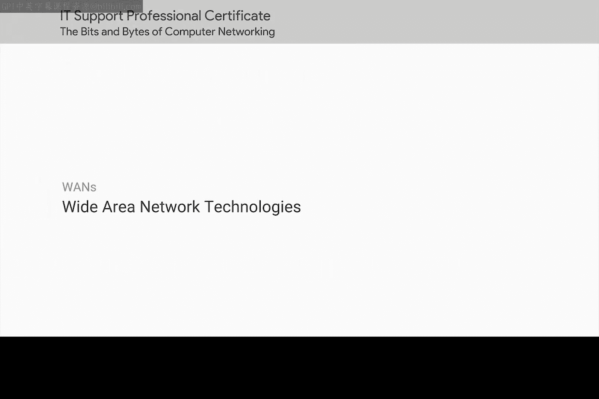
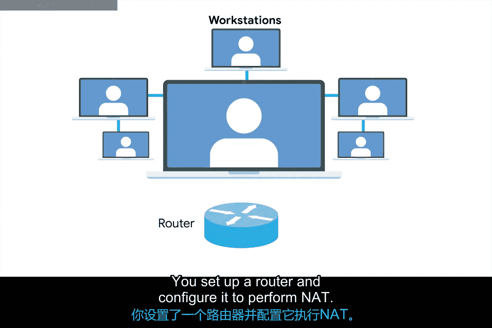
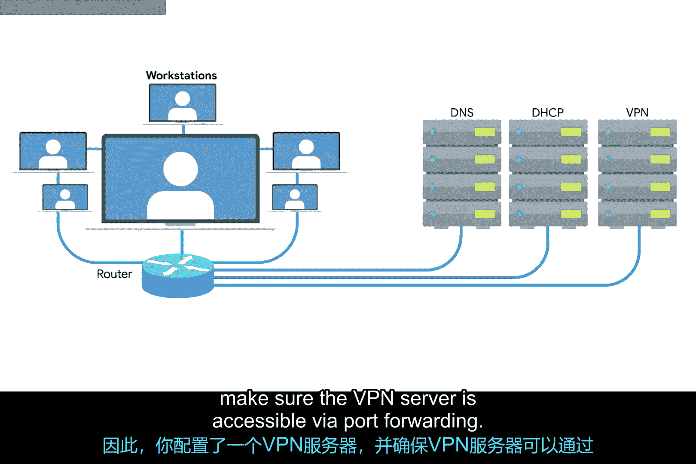
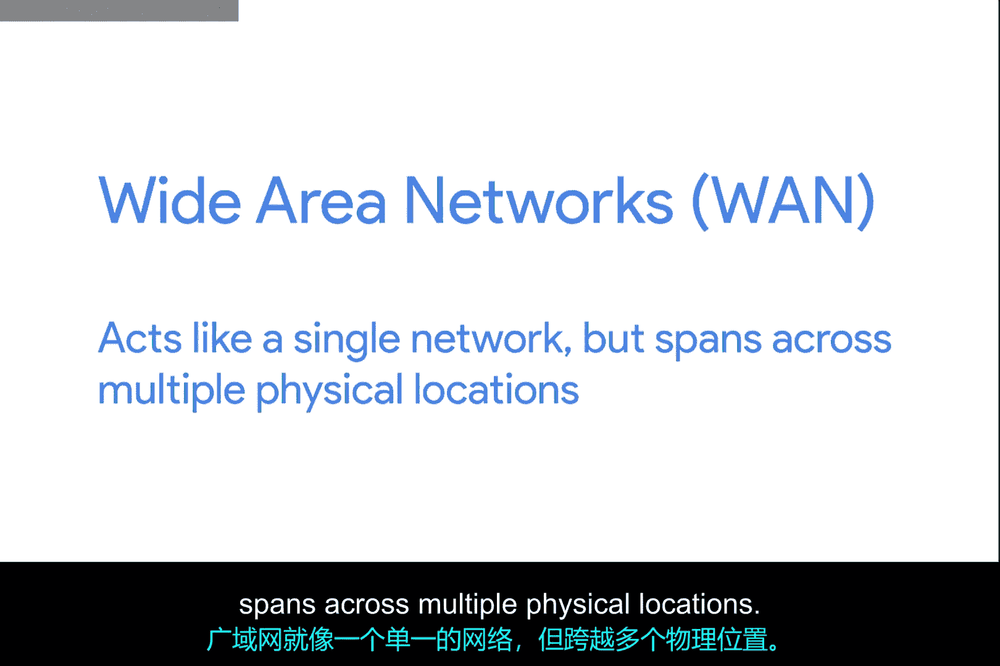
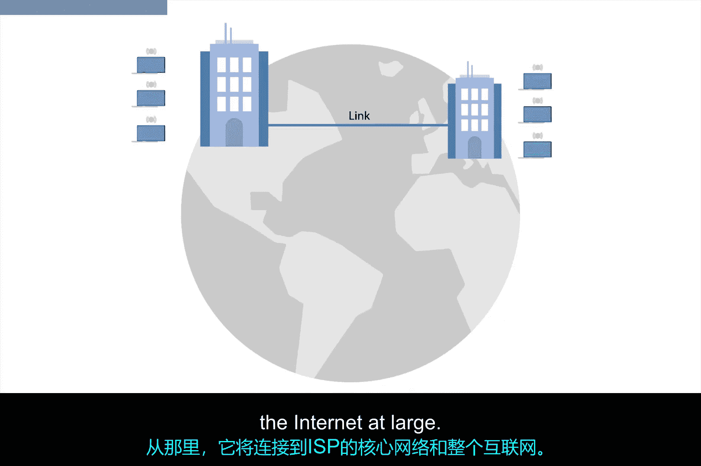

# 谷歌《IT支持（计算机网络⧸操作系统，第2、3课⧸共5课）｜Google IT Support》中英字幕deepseek p68 66_广域网技术.zh_en -BV1uyqcYpExr_p68-

Let's say that you're in charge of the network as the Sole IT support specialist at a small company。

 At first， the business only has a few employees with a few computers in a single office。

 you decide to use non-roudable address space for the internal IPs because IP addresses are scarce and expensive。

 you set up a router and configure it to perform na。

You configure a local DNS server and a DHCP server to make network configuration easier。

And of course， for all of this to really work， you sign a contract with an ISP to deliver a link to the internet to this office so your users can access the web。

😊，Now， imagine the company grows。 you're using non-rautable address space for your internal Is。

 so you have plenty of space to grow there。 maybe some salespeople need to connect to resources on the land you've set up while they're on the road。

 so you can a VPN server and make sure the VPN server is accessible via port forwarding。

Now you can have employees from all over the world connect to the office La。Business is good。

 and the company keeps growing。The CEO decides that it's time to open a new office in another city across the country。

Suddenly， instead of a handful of salespeople requiring remote access to the resources on your network。

 you have an entire second office that needs it。This is where wide area networks or WN technologies come into play。

 unlike a LAN or a local area network， WN stands for wide area network。

 a wide area network acts like a single network， but spans across multiple physical locations。

Wan technologies usually require that you contract a link across the internet with your ISP。

 This ISP handles sending your data from one site to the other。

So it could be like all of your computers are in the same physical location。

A typical w setup has a few sections， imagine one network of computers on one side of the country and another network of computers on the other。

Each of those networks ends at a demarcation point， which is where the ISPs network takes over。

The area between each demarcation point and the ISP's actual core network is called a local loop。

This local loop would be something like a T carrier line or a high speed optical connection to the provider's local regional office From there。

 it would connect out to the ISP's core network and the Internet at large。

 Wans work by using a number of different protocols at the data link layer to transport your data from one site to another。

 In fact， these same protocols are what are sometimes at work at the core of the Internet itself。

 Instead of our more familiar ethernet。

Covering all the details of these protocols is out of the scope of this course。

 but in an upcoming lesson， we'll give you some links to the most popular WAN protocols。

