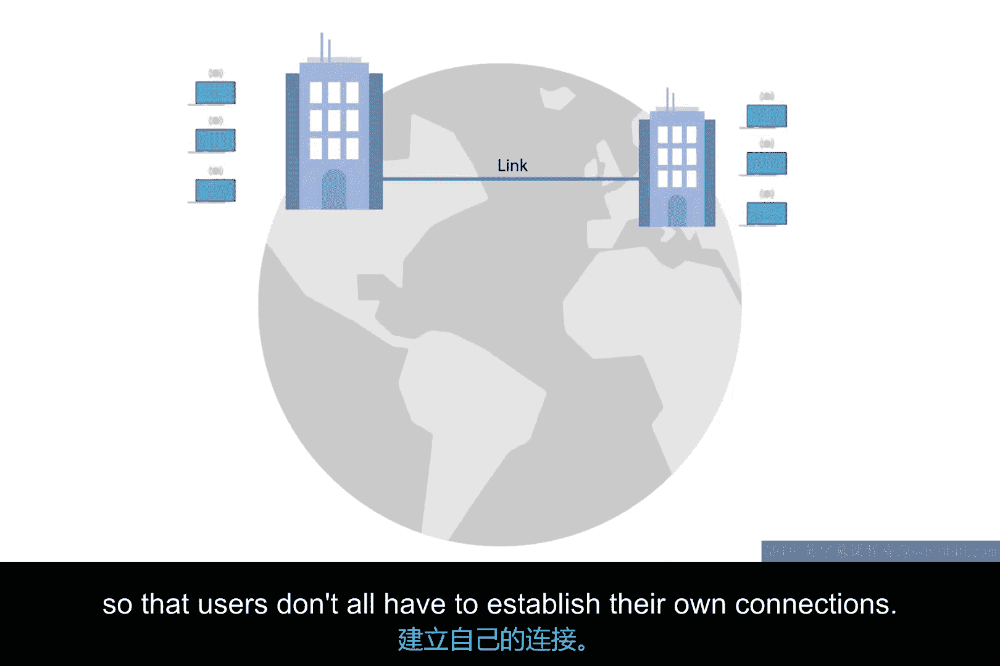

# 谷歌《IT支持（计算机网络⧸操作系统，第2、3课⧸共5课）｜Google IT Support》中英字幕deepseek p69 67_点对点VPN.zh_en -BV1uyqcYpExr_p69-

A popular alternative to WAN Tech are point to point VPNs WAN Tech are great for when you need to transport large amounts of data across lots of sites because WAN technologies are built to be super fast。

 a business cable or a DSL line might be way cheaper。

 but it just can't handle the load required in some of these situations。But over the last few years。

 companies have been moving more and more of their internal services into the cloud。

 We'll cover exactly what this means later， but for now。

 it's enough to know that the cloud lets companies outsource all or part of their different pieces of infrastructure to other companies to manage。

Let's take the concept of email。 In the past， a company would have to run their own email server if they wanted an email presence at all。

 Today， you could just have a cloud hosting provider， host your email server for you。

You could even go a step further and use an email as a service provider。

 then you wouldn't have an email server at all anymore。

 you just have to pay another company to handle everything about your email service。

With these types of cloud solutions in place， lots of businesses no longer require extreme high speed connections between their sites。

 This makes the expense of a wN technology totally unnecessary。 Instead。

 companies can use point to point VPNs to make sure that their different sites can still communicate with each other。

 a point to point VPN also called a site to site VPN establishes a VPN tunnel between two sites。

This operates a lot like the way that a traditional VPN setup lets individual users act as if they're on the network they're connecting to。

It's just that the VPN tunneling logic is handled by network devices at either side so that users don't all have to establish their own connections。

Now it's time for one more quiz to see how your connections are firing。

嗯。