# 谷歌《IT支持（计算机网络⧸操作系统，第2、3课⧸共5课）｜Google IT Support》中英字幕deepseek p72 70_无线信道.zh_en -BV1uyqcYpExr_p72-

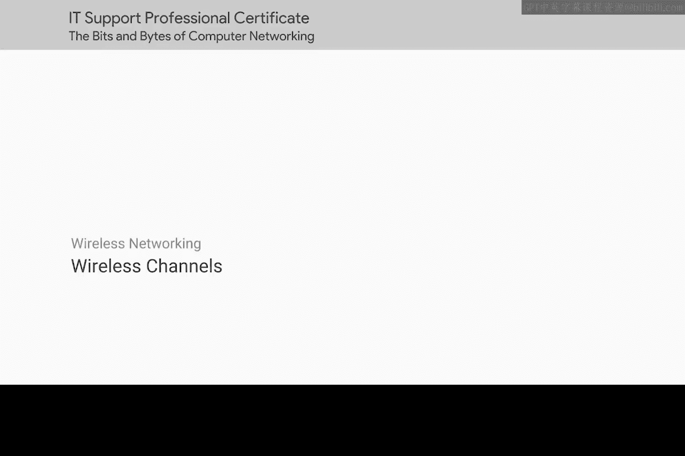

The concept of channels is one of the most important things to understand about wireless networking。

Channels are individual， smaller sections of the overall frequency band used by a wireless network。

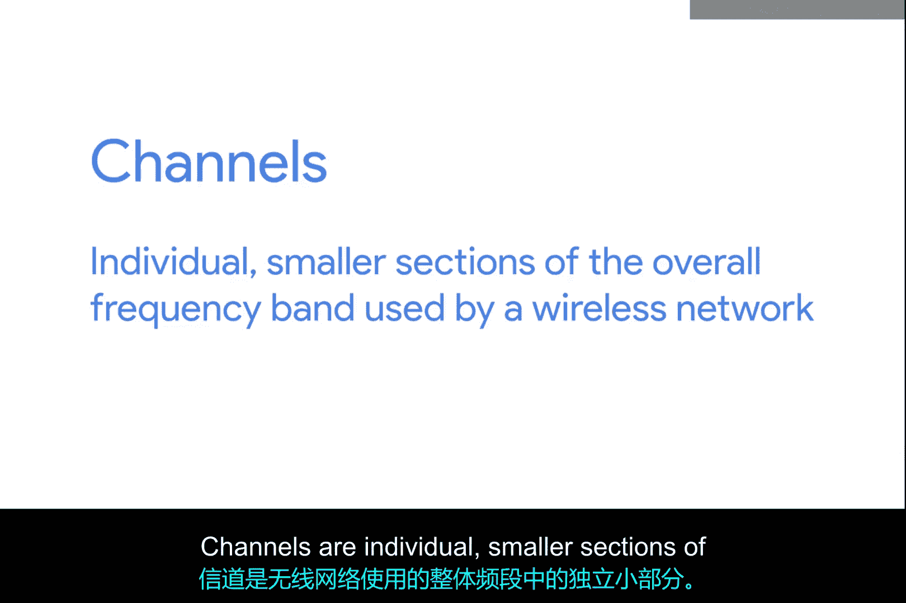

Channels are super important because they help address a very old networking concern。 Col domains。

 You might remember that a collision domain is any one network segment where one computer can interrupt another。

 Coms that overlap each other can't be properly understood by the receiving end。

 So when two or more transmissions occur at the same time， Also called a collision。

 All devices in question have to stop their transmissions。

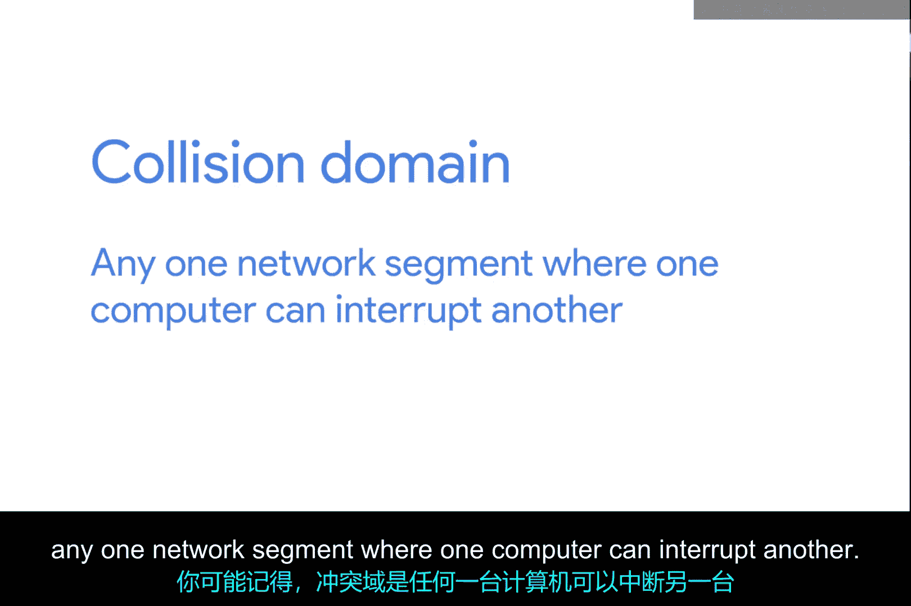

They wait a random amount of time and try again when things quiet down。

 This really slows things down。The problem caused by collision domains has been mostly reduced on wired networks through devices called switches。

 Swes remember which computers live on which physical interfaces。

 so traffic is only sent to the node it's intended for。Wireless networking doesn't have cables。

 so there aren't physical interfaces for a wireless device to connect to。

 That means we can have something that works like a wireless switch。

 Wireless devices are doomed to talk over each other。

Channels help fix this problem to a certain extent。

When we were talking about the concept of frequency bands。

 we mentioned that FM radio in North America operates between 88 MHz and 108 MHz。

 but when we discuss the frequency bands we use by Wifi，We just mentioned 2。4 gigHz and 5 gigHz。

 This is because that's really just shorthand for where these frequency bands actually begin for wireless networks that operate on the 2。

4 gig band， What we really mean is that they operate on roughly the band from 2。4 gigHz to 2。5 gigHz。

 between these two frequencies are a number of channels， each with a width of a certain mez。

 since different countries and regions have different regulatory committees for what radio frequencies might be used for what exactly how many channels are available for use depends on where in the world you are。

 For example， dealing with an 80211 B network， Cha 1 operates at 2412Hz。

 But since the channel width is 22 MHz。 the signal really lives on the frequencies between 2401 MHz and 2423 MHz。

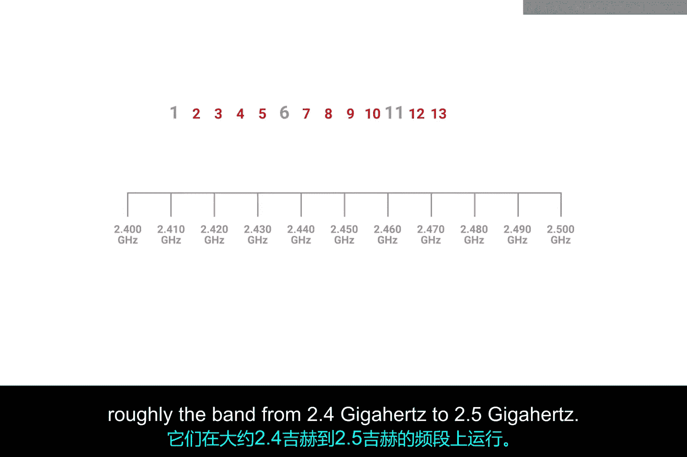

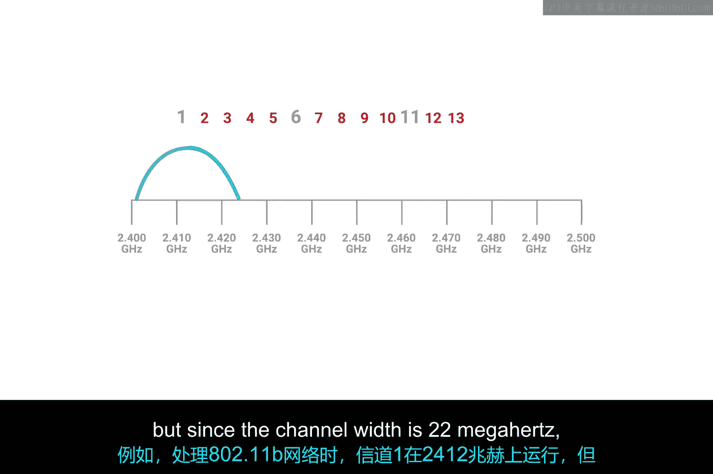

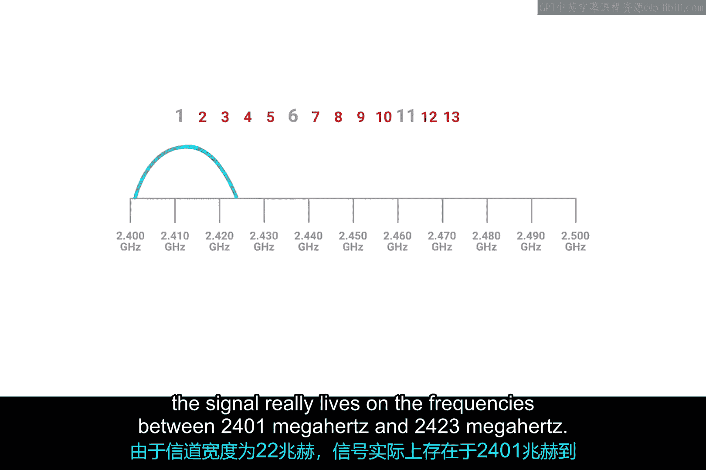

This is because radio waves are imprecise things， so you need some buffer around what exact frequencies a transmission might actually arrive on。

Some channels overlap， but some are far enough apart so they won't interfere with each other at all。

 Let's look again at an 802。11 B network running on the 2。

4 gigaher band because it's really the simplest and the concepts translate to all other 802。

11 specifications。

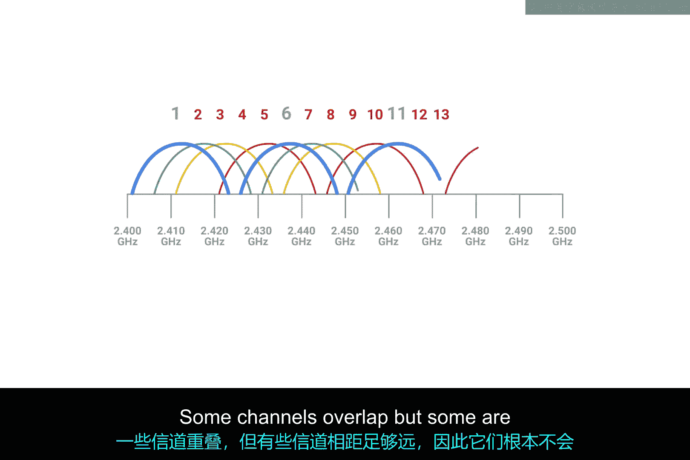

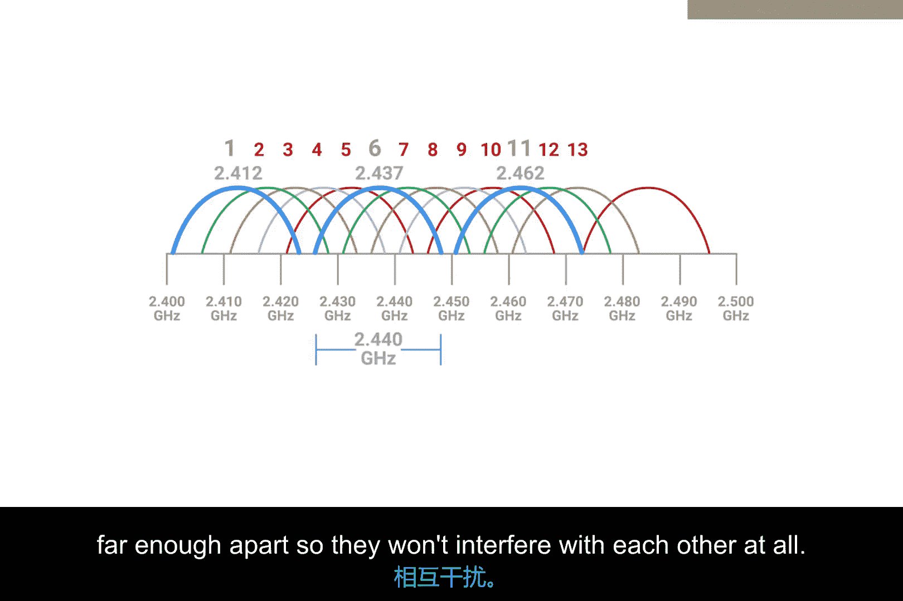

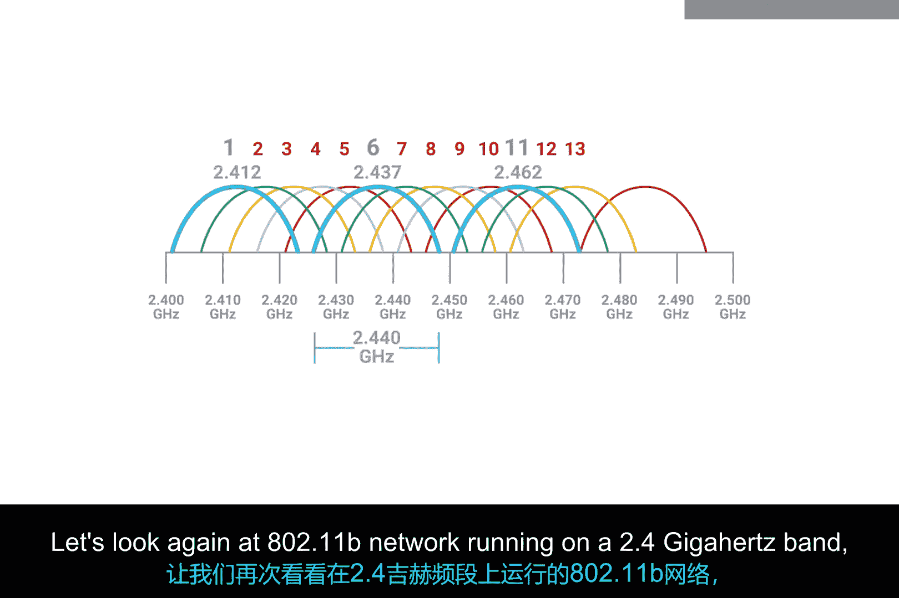

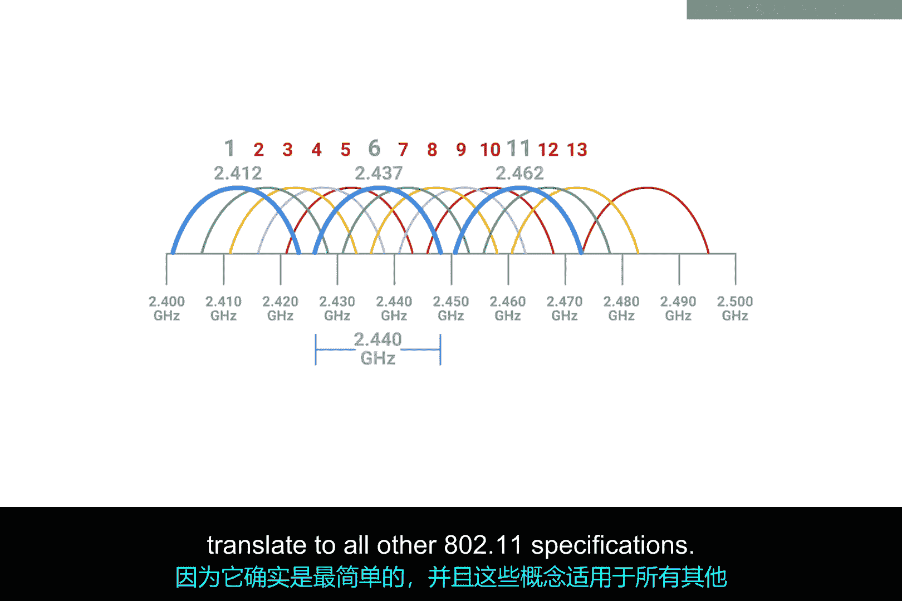

With a channel width of 22 meHtz， channel 1 with its midpoint at 2412 meHtz is always completely isolated from channel 6 with its midpoint at 2437 meHz。

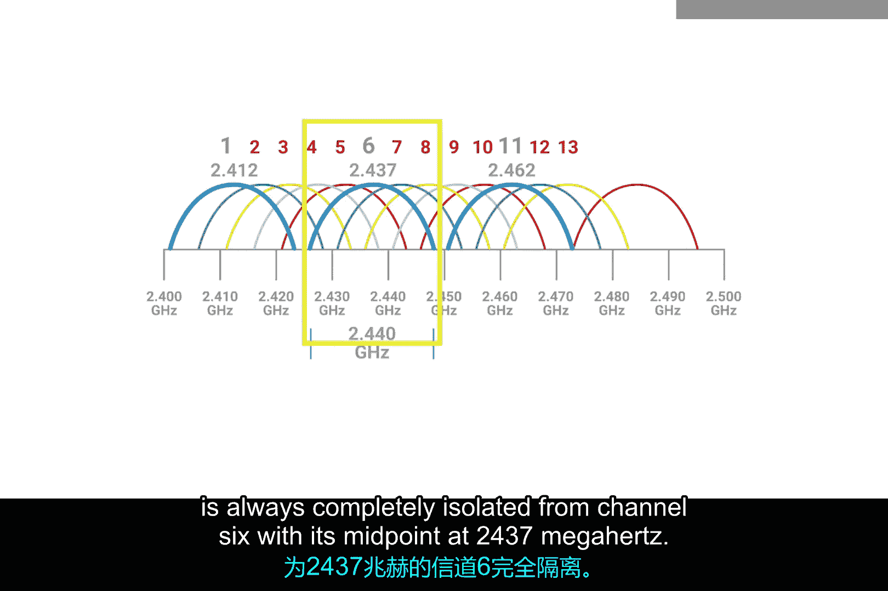

For an 802 dot 11 B network， this means that channels 1 and 6 and 11 are the only ones that never overlap at all。

 That's not all that matters， though， Today， most wireless networking equipment is built to auto sense what channels are most congested。

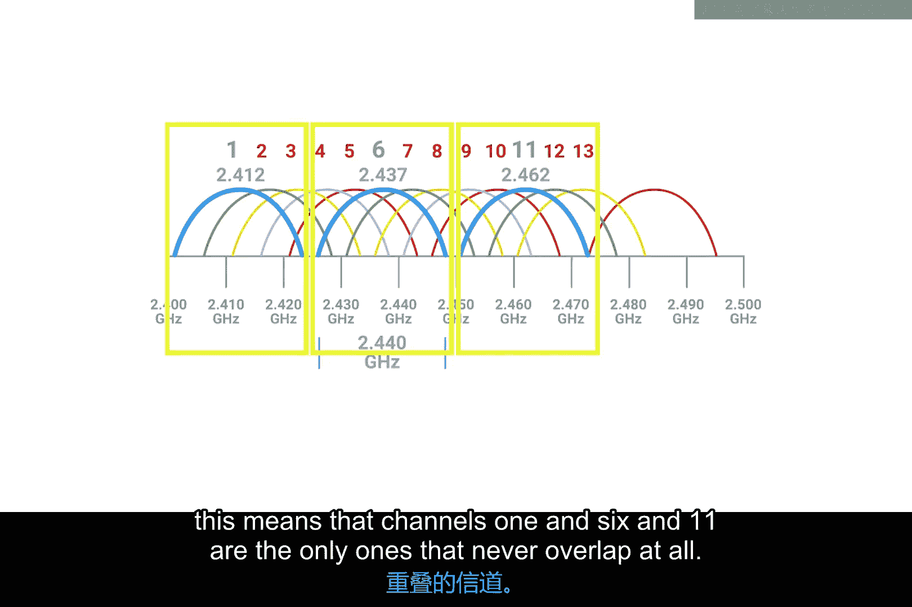

Some access points will only perform this analysis when they start up。

 Others will dynamically change their channel as needed between those two scenarios and manually specified channels。

 you can still run into situations where you experience heavy channel congestion。

 This is especially true in dense urban areas with lots of wireless networks in close proximity。

 So why is this important in the world of I T support。While。

 understanding how these channels overlap for all of the 80211 specifications is a way you can help troubleshoot bad wireless connectivity problems or slowdowns in the network。

 You want to avoid collision domains wherever you can。

 I should call out that it's not important to memorize all of the individual numbers we've talked about。

 The point is to understand how collision domains are a necessary problem with all wireless networks and how you can use your knowledge in this space to optimize wireless network deployments。

 You want to make sure that both your own access points and those of neighboring businesses。

 overlap channels as little as possible。

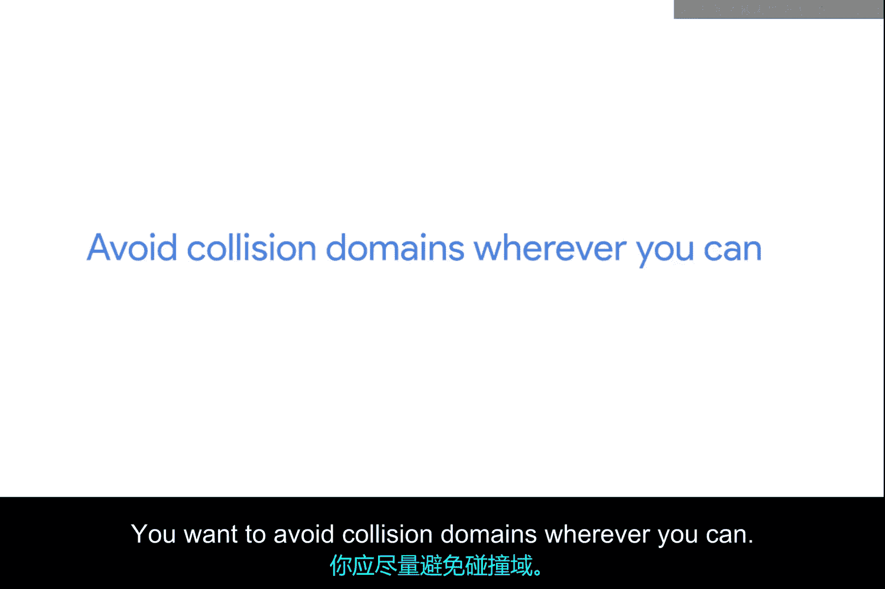