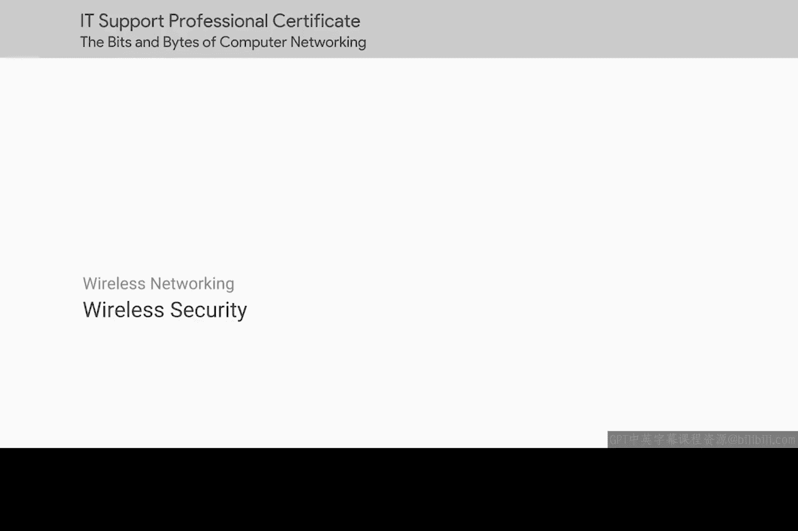
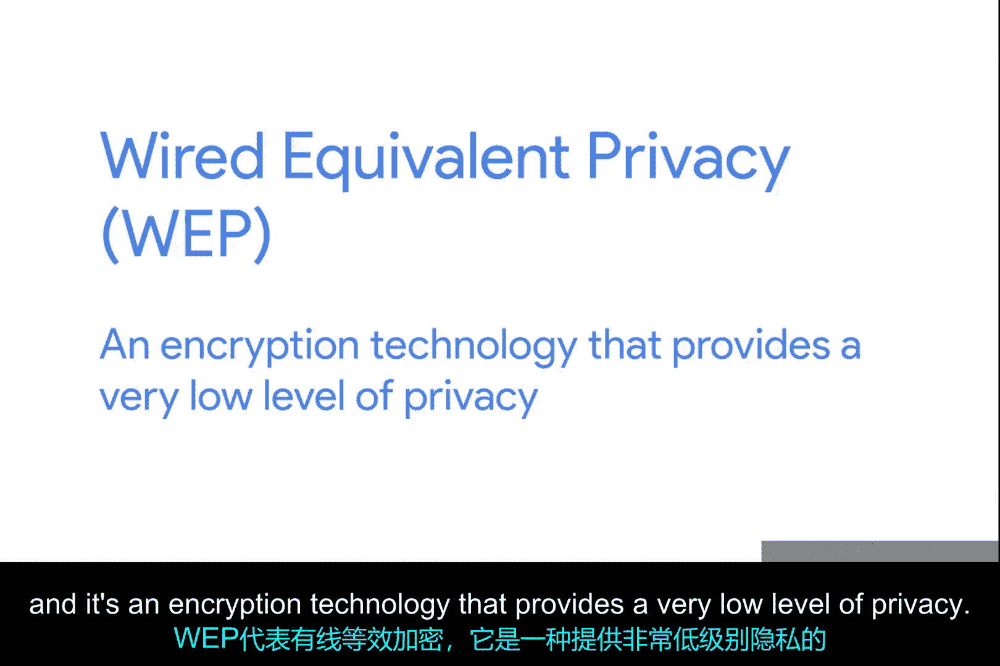
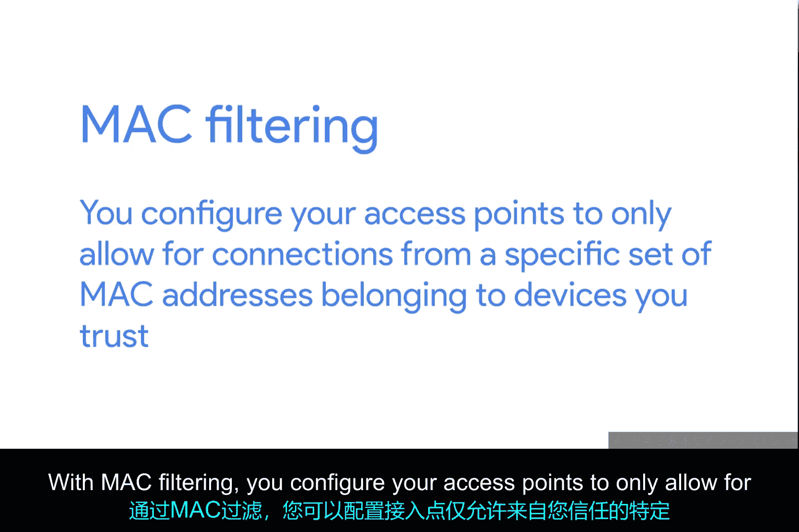
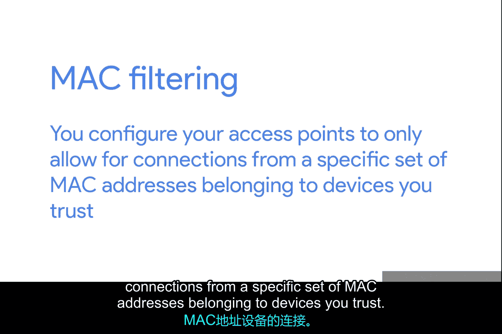

# 谷歌《IT支持（计算机网络⧸操作系统，第2、3课⧸共5课）｜Google IT Support》中英字幕deepseek p73 71_无线安全.zh_en -BV1uyqcYpExr_p73-

When you're sending data over a wired link， your communication has a certain amount of inherent privacy。

 The only devices that really know what data is being transmitted are the two nodes on either end of the link someone or some device that happens to be in close proximity can't just read the data with wireless networking。

 this isn't really the case since there aren't cables just radio transmissions being broadcast through the air。

 Anyone within range could hypothetically intercept any transmissions whether they were intended for them or not。

To solve this problem， WEP was invented， WEP stands for Wired equivalent privacy。

 and it's an encryption technology that provides a very low level of privacy。 Actually。

 it's really right there in the name， Wired equivalent privacy using web protects your data a little。

 but it should really only be seen as being as safe as sending unencrypted data over a wired connection。

The Web standard is a really weak encryption algorithm。

 It doesn't take very long for a bad actor to be able to break through this encryption and read your data。

 You'll learn more about key lengths and encryption in a future course。 But for now。

 it's important to know that the number of bits in an encryption key corresponds to how secure it is。

 The more bits in a key， the longer it takes for someone to crack the encryption。

Web only uses 40 Bs for its encryption keys， and with the speed of modern computers。

 this can usually be cracked in just a few minutes。

 We was quickly replaced in most places with WPA or Wi Fi protected access。

 WPA by default uses a 128 B key， making it a whole lot more difficult to crack than web。😊，Today。

 the most commonly used encryption algorithm for wireless networks is WPA2 an update to the original WPA WPA2 uses a 256 bit key。

 making it even harder to crack。Another common way to help secure wireless networks is through Mac filtering。

 with Mac filtering， you configure your access points to only allow for connections from a specific set of Mac addresses belonging to devices you trust。

This doesn't do anything more to help encrypt wireless traffic being sent through the air。

 but it does provide an additional barrier preventing unauthorized devices from connecting to the wireless network itself。

