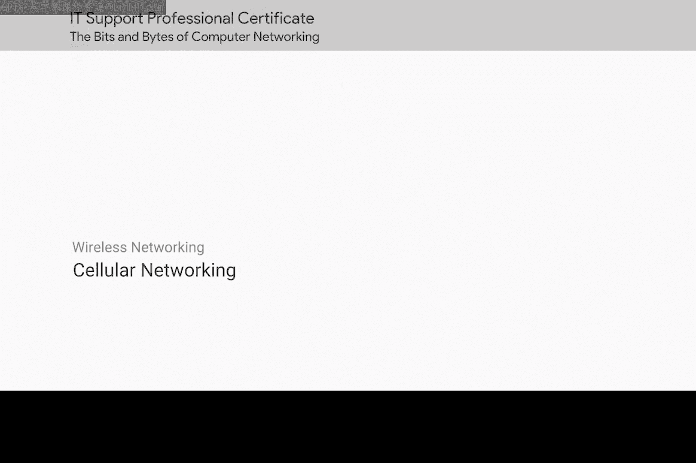
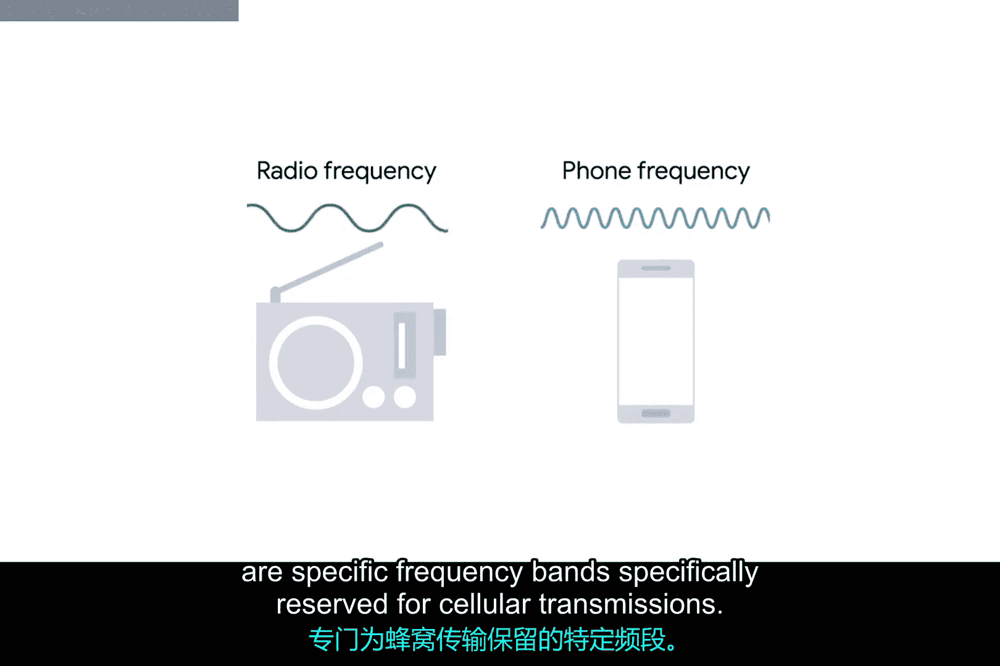
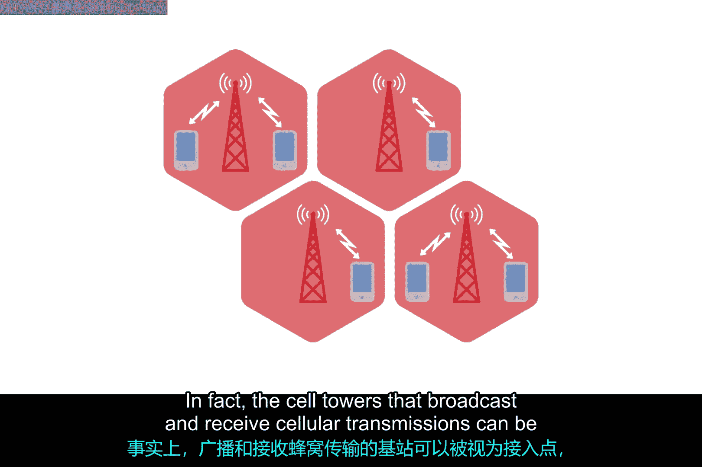

# 谷歌《IT支持（计算机网络⧸操作系统，第2、3课⧸共5课）｜Google IT Support》中英字幕deepseek p74 72_蜂窝网络.zh_en -BV1uyqcYpExr_p74-

Another super popular form of wireless networking is cellular networking。

 also called mobile networking。 Ceular networks are now common all over the world。 In some places。

 using a cellular network for Internet access is the most common way of connecting。At a high level。

 cellular networks have a lot in common with the 802。11 networks we've already talked about。

Just like there are many different 802。11 specifications。

 there are lots of different cellular specifications， just like WiF。

 cellular networking operates over radio waves， and there are specific frequency bands specifically reserved for cellular transmissions。

One of the biggest differences is that these frequencies can travel over longer distances more easily。

 usually over many kilometers or miles。Cellular networks are built around the concept of cells。

 Each cell is assigned a specific frequency band for use。

 neighboring cells are set up to use bands that don't overlap。

 just like how we discuss the optimal setup for a W land with multiple access points。 In fact。

 the cell towers that broadcast and receive cellular transmissions can be thought of like access points。

 just with a much larger range。

Lots of devices today use cellular networks for communication。And not just phones。

 also tablets and some laptops also have cellular antennas。

 It's become more and more common for high end automobiles to have built in cellular access to one module down。

 one final module to go。 Once you're done with the assessments we got for you， I'll see you there。😊。

