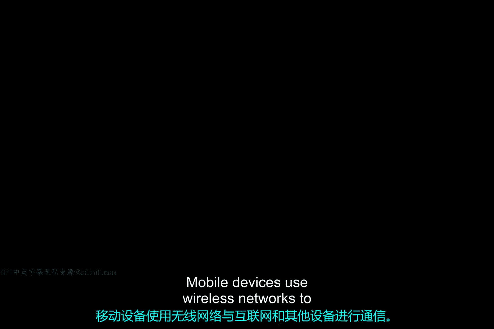
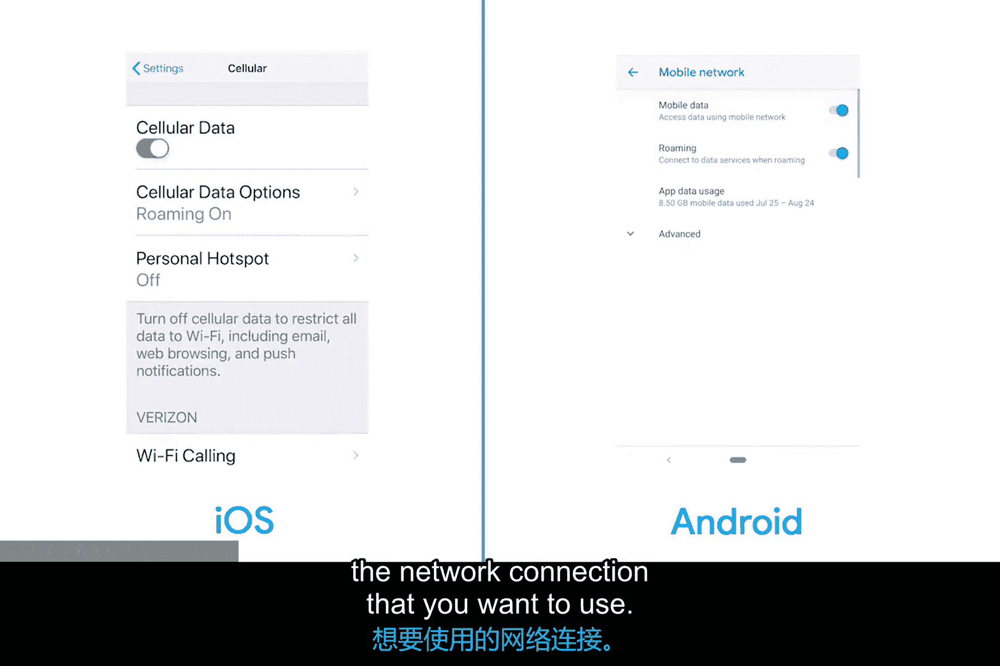

# 谷歌《IT支持（计算机网络⧸操作系统，第2、3课⧸共5课）｜Google IT Support》中英字幕deepseek p75 73_移动设备网络.zh_en -BV1uyqcYpExr_p75-

Mobile devices use wireless networks to communicate with the internet and with other devices。

 depending on the device， it might use cellular networks， Wi Fi， Bluetooth。

 and or one of several internet of things or IoT network protocols。As an IT support specialist。

 you'll often have to help troubleshoot networking or connectivity issues for end users。

 you'll need to figure out what network the device should be connecting to and then make sure the device is configured to do that。

For example， turning individual components and systems on and off is a common feature in mobile devices。

 which can sometimes be confusing for the end users。Battery life is precious。

 and people switch off these network radios to save battery life。

 If someone brings a device to you because it won't connect to a wireless network。

 The first thing you should check is whether the wireless radio has been disabled。 Yep。

 sometimes the solution is really that simple。 You can toggle the Wi Fi。

 Bluetooth and cellular networks on or off in the device' settings。

Lots of mobile devices will also have an airplane mode that disables all wireless networking at once。

It is also pretty common for a mobile device to have multiple network connections at the same time。

Both Wi Fi and cellular data， for example， mobile devices will try to connect to the Internet using the most reliable and least expensive connection available。

 That's right， I said least expensive。Many mobile operating systems understand the concept of metered connections。

 Does your cell phone plan have a limit on how much data you can use in a month or charge you based on how much data you use。

Then you have a metered connection through that cell phone plan mobile devices will use other nonmeterered connections like Wifi if they're available so that you don't use up your limited data connection。

 Here's another example of how you might help as an IT support specialist。

Let's say you have a remote employee that works from a coffee shop sometimes。

 but the Wi Fi network in the coffee shop restricts access to some websites。

 The employee might choose to disconnect from the Wi Fi network and use the cell network。

 even though it might be more expensive so that they can access the websites they need by toggling the w Fi and cellular data connections。

 you can force the device to use the network connection that you want to use。

If you're troubleshooting an unreliable wireless network connection。

 keep in mind that wireless networking works by sending a radio signal between two antennas。

 what you don't see an antenna will surprise your device has one。

It might be printed on a circuit board， or it might have a wire or ribbon that runs through your device。

 The radio signal will get weaker， The farther it has to travel。

 especially if it passes through or reflects off of things between the two antennas。

 Mobile devices can go with you to places where there is too much distance or interference for the wireless signal to be reliable。

 Even the way the mobile device is held or worn can impact the strength of the signal。

 So Wi Fi and cellular data networks are used to connect your mobile devices to the internet。

But there's one other type of wireless network to talk about。

Mobile devices connect to their peripherals using short range wireless networks。

 The most common short range wireless network is called Bluetooth。

 You might have used Bluetooth headphones， keyboards or mice before When you connect a wireless peripheral to a mobile device。

 we call that pairing the devices。 The two devices exchange information。

 sometimes including a pin or password。So that they can remember each other from then on。

 the devices will automatically connect to each other when they're both powered on and in range。

 pairairing devices like this can sometimes fail， and you might need to make your device forget the peripheral so it can be paired again。

 Check out the next supplemental reading to see how tothust in Ios and Android。 Remember。

 Bluetooth can be turned off very easily。 when your troubleshooting a Bluetooth peripheral。

 Always make sure that Bluetooth is on。