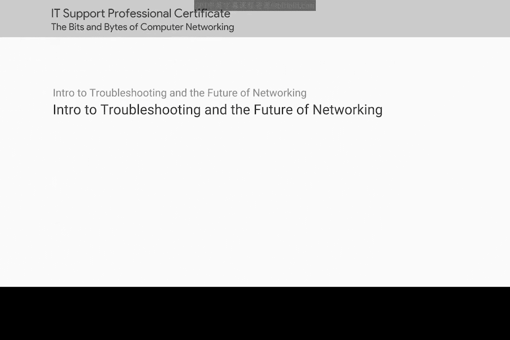
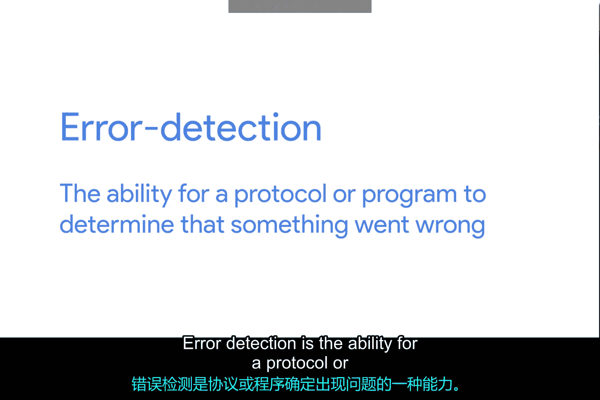
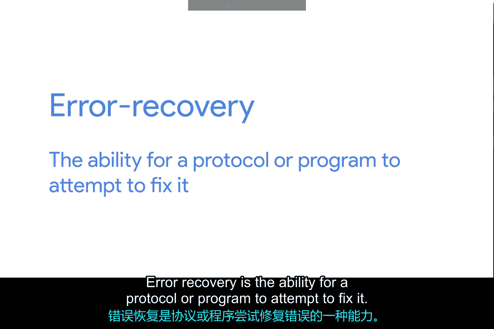
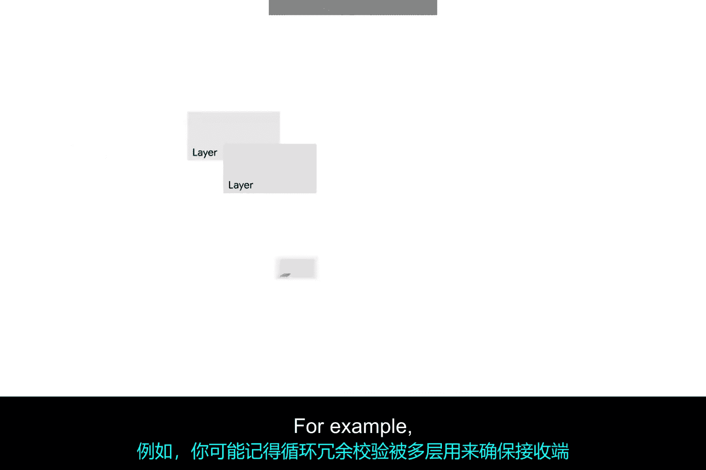
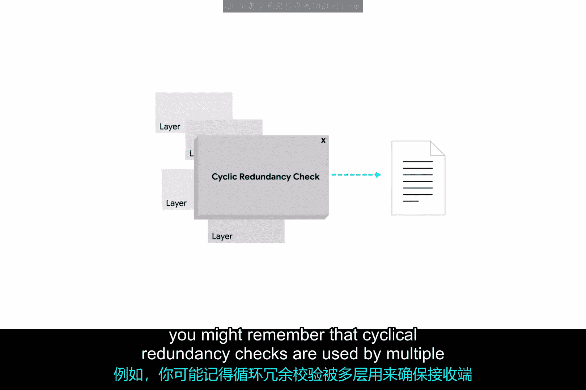

# 谷歌《IT支持（计算机网络⧸操作系统，第2、3课⧸共5课）｜Google IT Support》中英字幕deepseek p76 74_故障排除与网络未来介绍.zh_en -BV1uyqcYpExr_p76-

Welcome back。As you've seen， computer networking can be an incredibly complicated business。

 There are so many layers， protocols and devices at play。

 and sometimes this means that things just don't work properly。 No surprise there。

Many of the protocols and devices we've covered have built in functionalities to help protect against some of these issues。

These functionalities are known as error detection and error recovery error detection is the ability for a protocol or program to determine that something went wrong。

Error recovery is the ability for a protocol or program to attempt to fix it。

For example， you might remember that cyclical redundancy checks are used by multiple layers to make sure that the correct data was received by the receiving end。

If a CRC value doesn't match the data payload。The data is discarded。At that point。

 the transport layer will decide if the data needs to be reset。

But even with all of these safeguards in place， errors still pop up， misconfigurations occur。

 hardware breaks down， and system incompatibilities come to light。In this module。

 you'll learn about the most common techniques and tools you use as an IT support specialist when troubleshooting network issues by the end of this module。

 you'll be able to detect and fix a lot of the common network connectivity problems by using tools available on the three most common operating systems。

 Microsoft Windows， Mac and Linux。😊，And finally， at the end of this module。

 we'll cover some concepts that are super important to the future of networking， the cloud and IPV6。

