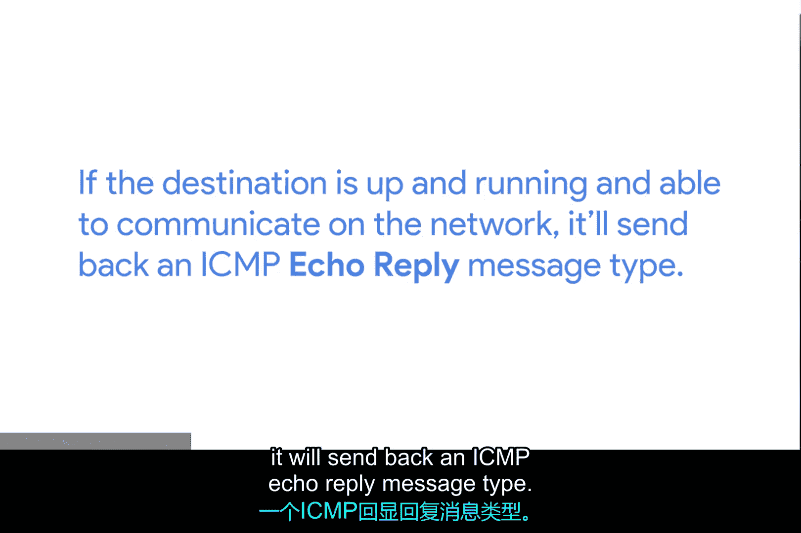
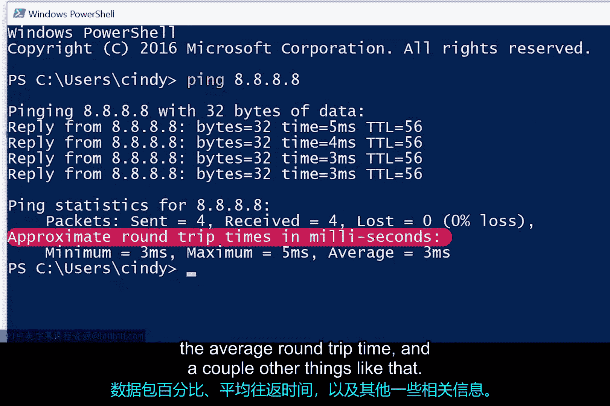
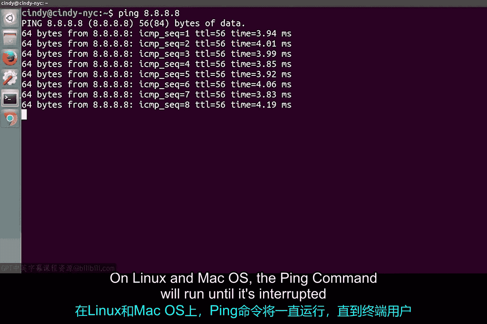
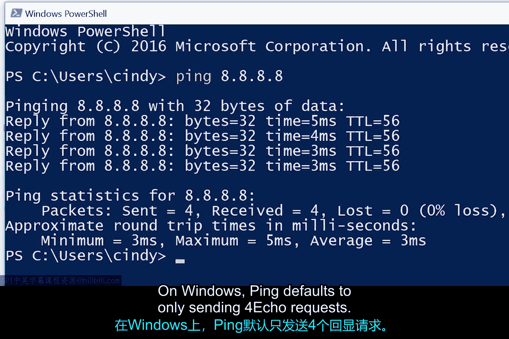

# 谷歌《IT支持（计算机网络⧸操作系统，第2、3课⧸共5课）｜Google IT Support》中英字幕deepseek p77 75_Ping与互联网控制消息协议.zh_en -BV1uyqcYpExr_p77-

When network problems come up， the most common issue you'll run into is the inability to establish a connection to something。

It could be a server you can't reach at all or a website that isnt loading。

Maybe you can only reach your resource on your land and can't connect to anything on the internet。

Whatever the problem is， being able to diagnose connectivity issues is an important part of network troubleshooting。

By the end of this lesson， you'll be able to use a number of important troubleshooting tools to help resolve these issues。

When a network error occurs， the device that detects it needs some way to communicate this to the source of the problematic traffic。

It could be that a router doesn't know how to route to a destination or that a certain port isn't reachable。

It could even be that the TTL of an IP datagram expired and no further router hops will be attempted。

For all of these situations and more， ICMP or internet control message protocol is used to communicate these issues。

ICMP is mainly used by a router or remote host to communicate why a transmission has failed back to the origin of the transmission。

 the makeup of an ICMP packet is pretty simple， it has a header with a few fields and a data section that's used by a host to figure out which of their transmissions generated the error。

The first field is the type field，8 Bs long， which specifies what type of message is being delivered。

 Some examples are destination unreachable or time exceeded。Immediately after this is the code field。

 which indicates a more specific reason for the message than just the type， for example。

 of the destination unreachable type， there are individual codes for things like destination network unreachable and destination port unreachable。

After this is a 16 bit checkum that works like every other checkum field we've covered so far。

Next up is a 32 bit field with an uninspired name，R of header。

You think they could come up with something a bit more interesting。

 but I can't really think of anything good， so who am I to judge？Anyway。

 this field is optionally used by some of the specific types and codes to send more data。

After this is the data payload for an ICMP packet。The payload for an ICMP packet exists entirely so that the recipient of the message knows which of their transmissions cause the error being reported。

It contains the entire IP header and the first8 bytes of the data payload section of the offending packet。

ICMP wasn't really developed for humans to interact with。

 the point is so that these sorts of error messages can be delivered between networked computers automatically。

 but there's also a specific tool and two message types that are very useful to human operators。

This tool is called Ping。Some version of it exists on just about every operating system and has for a very long time。

Ping is a super simple program， and the basics are the same no matter which operating system you're using。

Ping lets you send a special type of ICMP message called an Echo request。

 an ICMP echo request essentially just ask a destination， hey。

 are you there if the destination is up and running and able to communicate on the network。

 it'll send back an ICMP Echo replyly message type。

You can invoke the pink command from the command line of any modern operating system。

In its most basic use， you just type Ping and a destination IP or a fully qualified domain name。

If you don't know how to use a command line in an operating system， don't worry， you will soon。

 we'll cover that in another course。Output of the P command is very similar across each of the different operating systems。

Every line of output will generally display the address sending the ICMP E reply and how long it took for the round trip communications。

It will also have the TTL remaining and how large the ICMP message is in bytes。Once the command ends。

 there will also be some statistics displayed， like percentage of packets transmitted and received。

 the average roundship time， and a couple other things like that。

On Linux and Mac OS， the P command will run until it's interrupted by an end user sending an interrupt event。

They do this by pressing the control key and the C key at the same time。On Windows。

 payinging defaults to only sending four echo requests。

In all environments， Ping supports a number of command line flags that let you change its behavior。

 like the number of echo requests to send， how large they should be。

 and how quickly they should be sent。Check out the documentation for your operating system to learn a little bit more。

