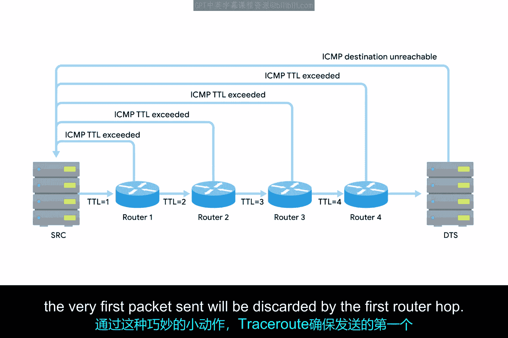
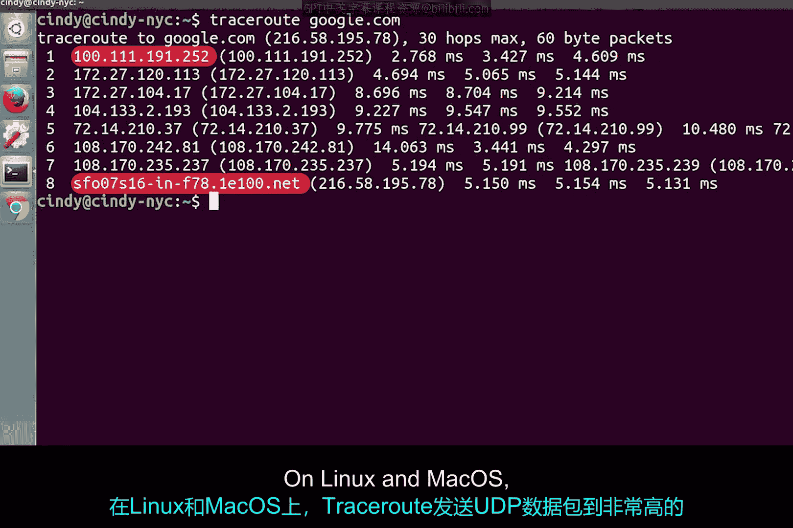
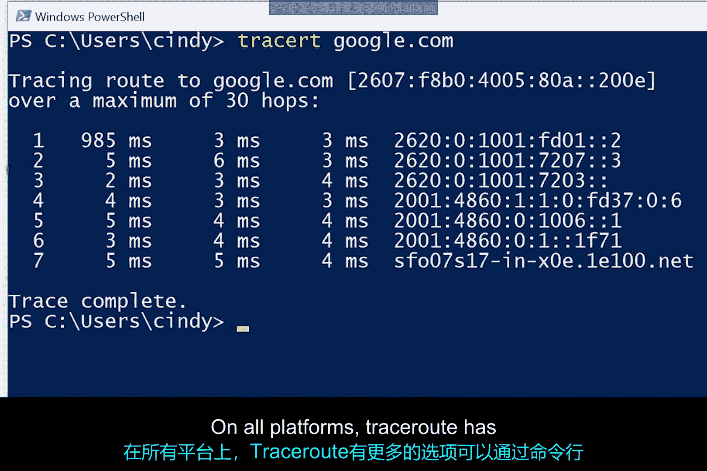

# 谷歌《IT支持（计算机网络⧸操作系统，第2、3课⧸共5课）｜Google IT Support》中英字幕deepseek p78 76_Traceroute.zh_en -BV1uyqcYpExr_p78-

With Ping， you now have a way to determine if you can reach a certain computer from another one。

You can also understand the general quality of the connection。But communications across networks。

 especially across the internet， usually cross lots of intermediary nodes。

 Sometimes you need a way to determine where in the long chain of router hops the problems actually are。

Trace route to the rescue Trace Ro is an awesome utility that lets you discover the paths between two nodes and gives you information about each hop along the way。

The way trace route works is through a clever manipulation technique of the TTL field at the IP level。

 we learned earlier that the TTL field is decremented by one by every router that forwards the packet When the TTL field reaches zero。

 the packet is discarded and an ICMP time exceeded message is sent back to the originating host。

Trace Ro uses the TTL field by first setting it to one for the first packet， then two for the second。

 three， for the third， and so on。By doing this clever little action。

 trace route makes sure that the very first packet sent will be discarded by the first router hop。

 This results in an ICMP time exceeded message。 The second packet will make it to the second router。

 The third will make it to the third and so on。

This continues until the packet finally makes it all the way to its destination， for each hop。

 trace routeute will send three identical packets。Just like with ping。

 the output of a trace route command is pretty simple On each line。

 you will see the number of the hop and the roundtri time for all three packets。

 You will also see the IP of the device at each shop and a host name if trace route can resolve one。

On Linux and Mac OSOS， trace Route sends UDP packets to very high port numbers on Windows。

 the command has a shortened name， trace RT and defaults to using ICMP E requests。On all platforms。

 traceceroute has more options than can be specified using command line flags。

Two more tools that are similar to tracero are MTR on Linux and Mac OS and PathPing on Windows these two tools act as long running trace routes so you can better see how things change over a period of time。

MTR works in real time and will continually update its output with all the current aggregate data about the trace route。

You can compare this with PathPing， which runs for 50 seconds and then displays the final aggregate data all at once。

