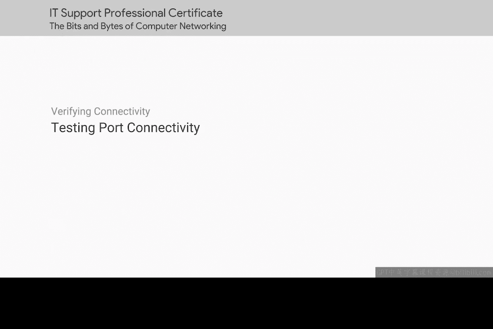
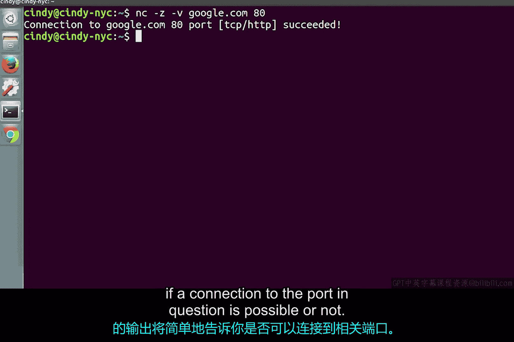
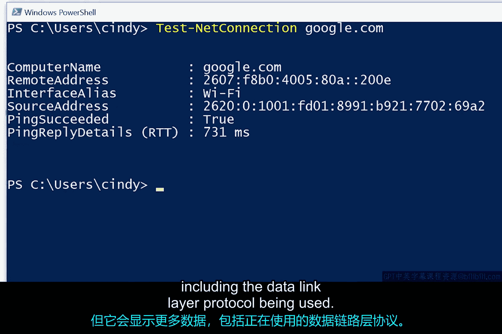

# 谷歌《IT支持（计算机网络⧸操作系统，第2、3课⧸共5课）｜Google IT Support》中英字幕deepseek p79 77_测试端口连通性.zh_en -BV1uyqcYpExr_p79-

We've covered a bunch of ways to test connectivity between machines at the network layer。

 but sometimes you need to know if things are working at the transport layer。For this。

 there are two super powerful tools at your disposal， Netcat on Linux and Mac OS。

 and test net connection on Windows。The Netcat tool can be run through the command N C and has two mandatory arguments。

 a host and a port。RunningncC Google。com Space 80 would try to establish a connection on port 80 to Google。

com。If the connection fails， the command will exit。 if it succeeds。

 you'll see a blinking cursor waiting for more input。

 This is a way for you to actually send application layer data to the listening service from your own keyboard。

 If you're really only curious about the status of a port。

 you can issue the command with the dash Z flag， which stands for0 input output mode。The dash V flag。

 which stands for verbose， is also useful in this scenario。

This makes the commands output useful to human eyes as opposed to non verbose output。

 which is best for usage and scripts side note。Vbose basically means talking too much。

 So while I bet you want to throw up a flag on me and my jabbering。

 we still have lots to get through。 Okay， so by issuing the net catt command with the dash Z and dash V flags。

 the commands output will simply tell you if a connection to the port in question is possible or not。

On Windows。TestNe connection is a command with some of the similar functionality。

If you run TestNe connection with only a host specified， it will default to using an ICMP E request。

 much like the program Ping， but it will display way more data。

 including the data link layer protocol being used。

When you issue test net connection with the dash port flag。

 you can ask it to test connectivity to a specific port。

 It's important to call out that both Necat and test net connection are way more powerful than the brief port connectivity examples we've covered here。

 In fact， they're such complex tools that covering all of their functionality would be too much for one video。

 you should read up about all of the other things these super powerful tools can do。

 We provided a few in the supplementary readings。 And after you've had a chance to read through the material well give you a short quiz。

