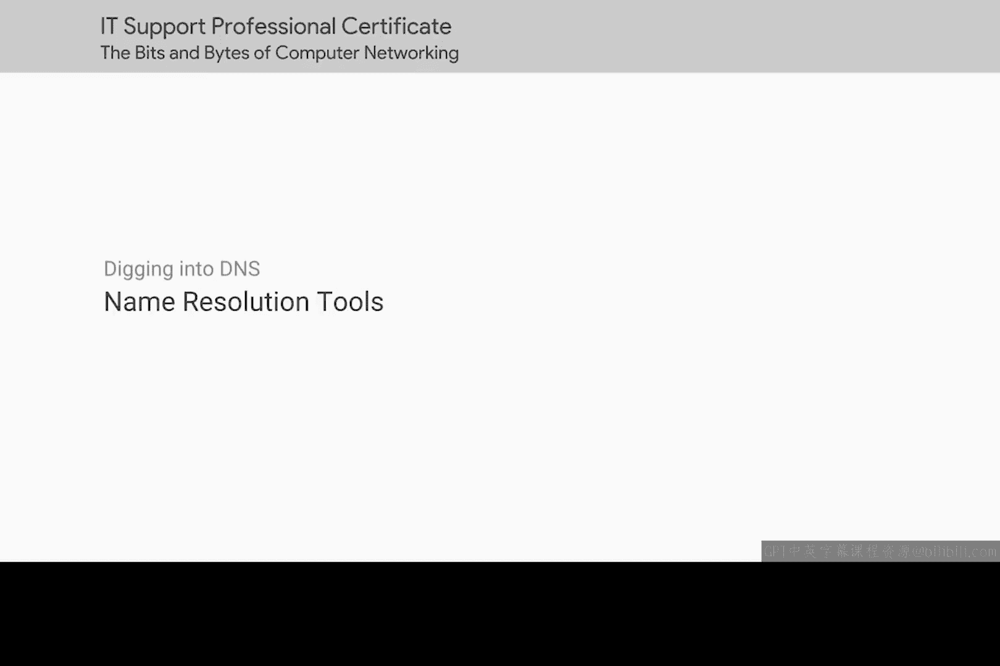
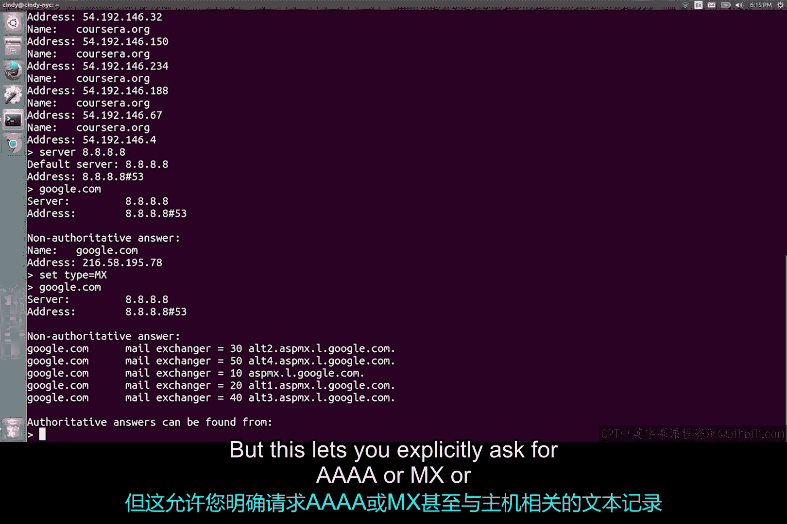

# 谷歌《IT支持（计算机网络⧸操作系统，第2、3课⧸共5课）｜Google IT Support》中英字幕deepseek p80 78_域名解析工具.zh_en -BV1uyqcYpExr_p80-

Name resolution is an important part of how the internet works。Most of the time。

 your operating system handles all lookups for you， but as an IT support specialist。

 sometimes it can be useful to run these queries yourself so you can see exactly what's happening behind the scenesLuckiily there are lots of different command line tools out there to help you with this。

The most common tool is known as NS Lookup， and it's available on all three of the operating systems we've been discussing。

 Linux， Mac and Windows。A basic use of NS lookup is pretty simple。

 you execute the NX lookup command with the host name following it。

 and the output displays what server was used to perform the request and the resolution result。

Let's say you needed to know the IP address for Twitter。com。

 you would just enter NSslookup Twitterwitter。com， and the A record would be returned。

NS Liup is way more powerful than just that it includes an interactive mode that lets you set additional options and run lots of queries in a row。

To start an interactive NS lookup session， you just enter NS Lookup without any host name following it。

You should see an angle bracket acting as your prompt。From interactive mode。

 you can make lots of requests in a row， you can also perform some extra configuration to help with more in depth troubleshooting。

While in interactive mode。If you type serverver， then in address。

 all the following name resolution queries will be attempted to be made using that server instead of the default name server。

You can also enter set type equals， followed by a resource record type By default。

 NS LookA will return A records， but this lets you explicitly ask for Quad A or MX or even text records associated with the host。

If you really want to see exactly what's going on， you can enter set debug。

 This will allow the tool to display the full response packets。

 including any intermediary requests and all of their contents。

 warning this is a lot of data and can contain details like the TTL left if it's a cached response all the way to the serial number of the zone file the request was made against。

