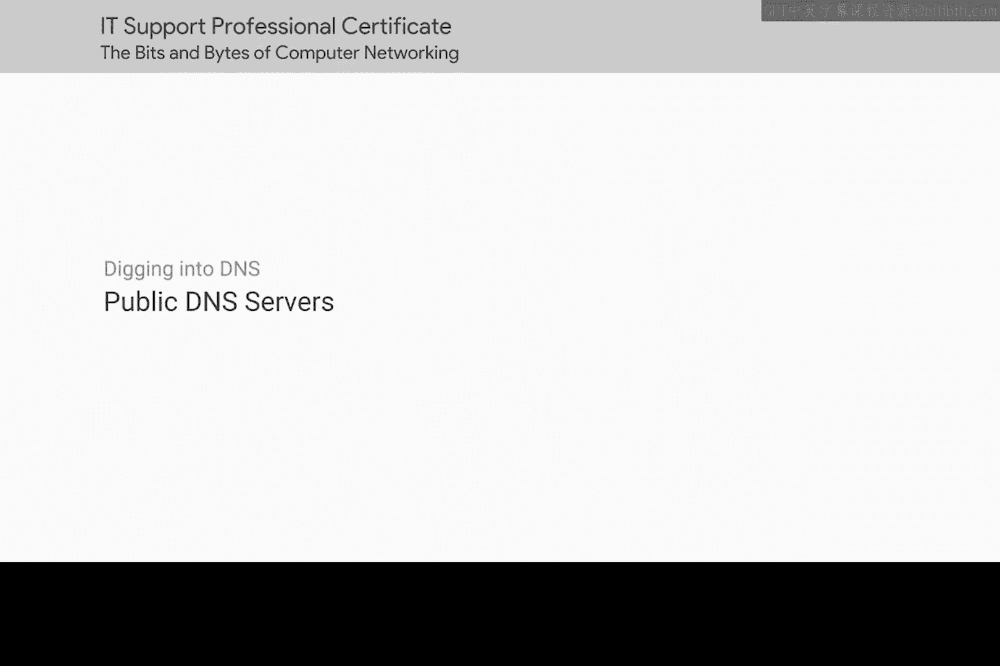
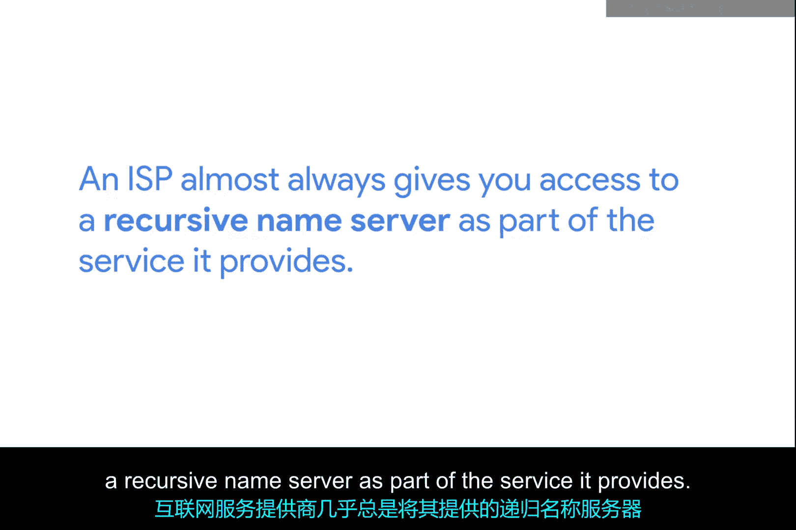
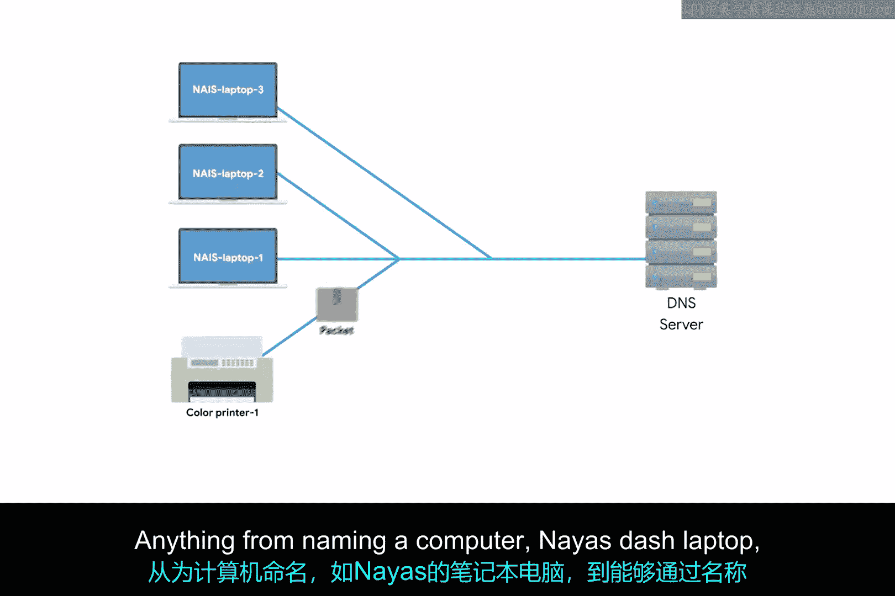
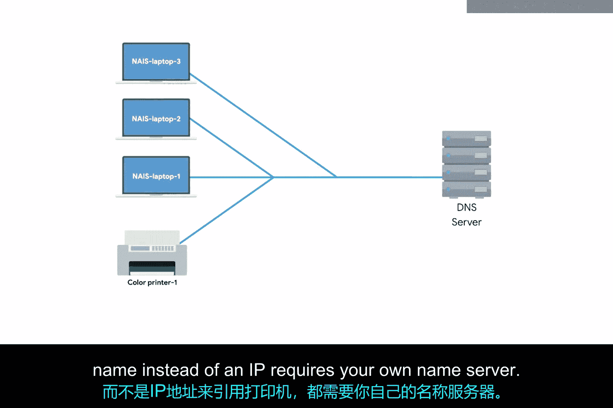
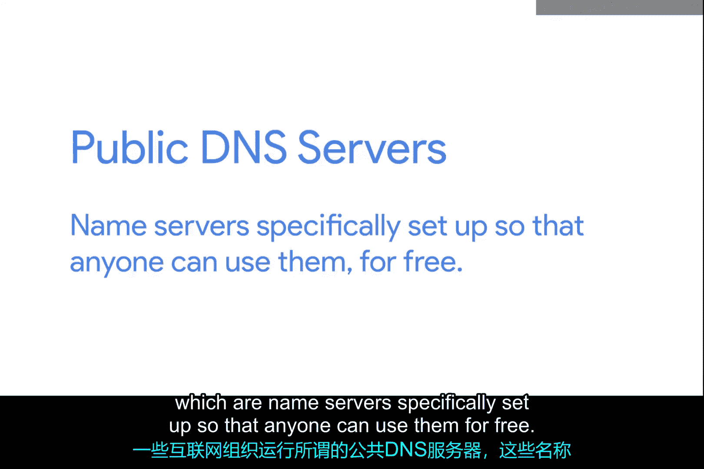
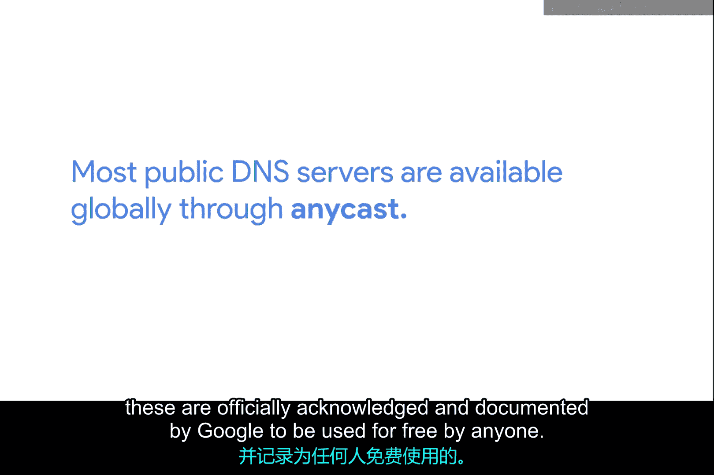
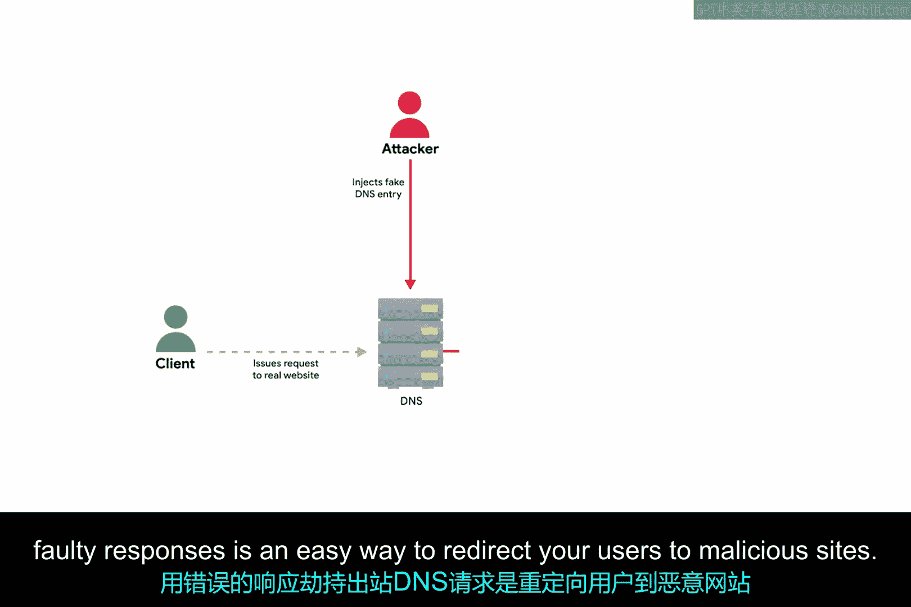
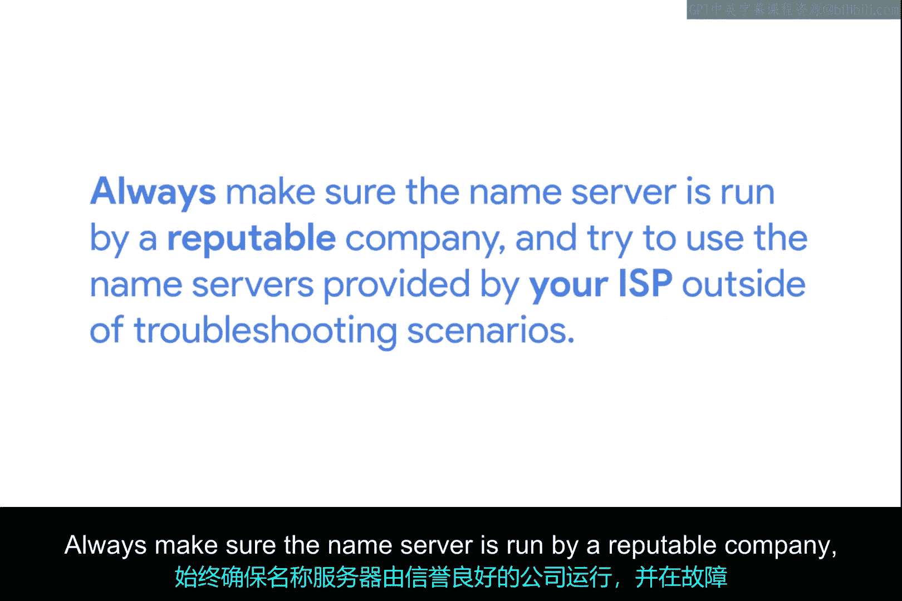
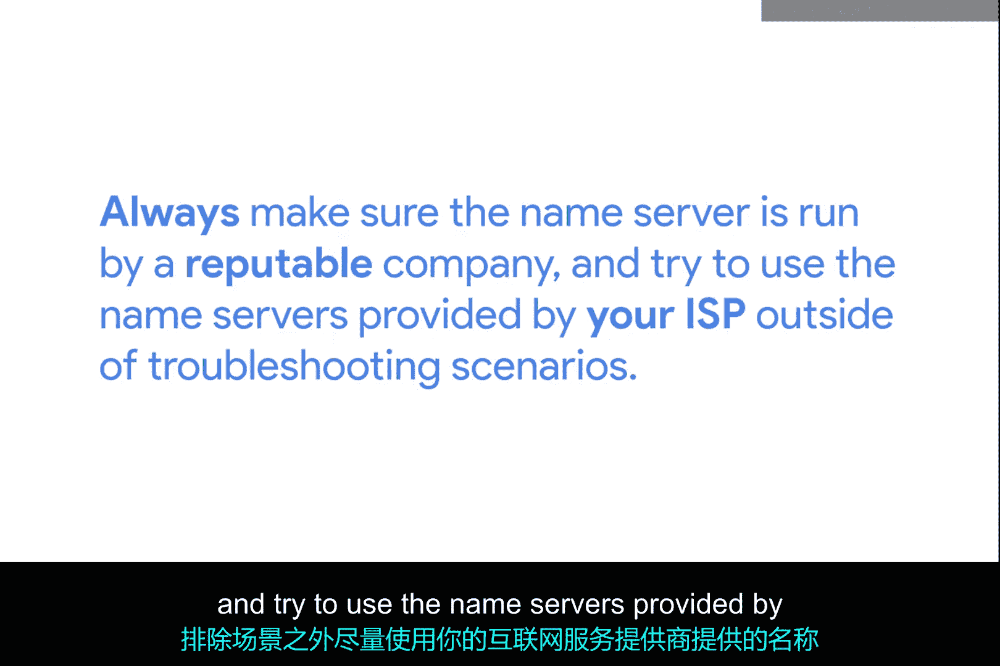

# 谷歌《IT支持（计算机网络⧸操作系统，第2、3课⧸共5课）｜Google IT Support》中英字幕deepseek p81 79_公共DNS服务器.zh_en -BV1uyqcYpExr_p81-

Having functional DNS is an important part of a functional network。

An ISP almost always gives you access to a recursive name server as part of the service it provides In most cases。

 these name servers are all you really need for your computer to communicate with other devices on the internet。

But most businesses also run their own DNS servers。In the very least。

 this is needed to resolve names of internal hosts。

 anything from naming a computer NOS laptop to being able to refer to a printer by a name instead of an IP requires your own name server。

A third option is to use a DNS as a service provider， and it's getting more and more popular。

 Don't worry， we'll cover that concept more in an upcoming lesson。

No matter what DNS service model you're using on your network。

 it's useful to have a way to test DNS functionality in case you suspect something isn't working right。

It can also be super useful to have a backup DNS option in case you experience problems with your own。

You might even be in the early stages of building out a new network。

 and even if you plan to have your own name server eventually， it may not be ready for use。

 some internet organizations run what are called public DNS servers。

 which are name servers specifically set up so that anyone can use them for free。

Using these public DNS servers is a handy technique for troubleshooting any kind of name resolution problems you might be experiencing。

Some people just use these name servers for all their resolution needs。For a long time。

 public DNS servers were a kind of tribal knowledge passed down from one cis admin to another。

In Hs adminlore， it said that for many years， the most commonly used public DNS servers were those run by level 3 communications。

 One of the largest ISps in the world。 Lel 3 is， in fact。

 so large they mostly do business by selling connectivity to their network to other ISps that actually deal with consumers Instead of dealing with end users themselves。

The IP addresses for levell 3's public DNS servers are 4。2。2。1 through 4。2。2。6。

These I Ps are easy to remember， but they've always been shrouded in a bit of a mystery While they've been available for use by the public for almost 20 years now。

 it's not a service level 3 officially has ever acknowledged or advertised， why。

We might never know It's one of the great mysteries of our ancient cis admin lore。 Anyway。

 other easy to remember optionstion are the Is for Google's public DNS。

 Google operates public name servers on the Is 8。8。8。8 and 8。 8。4。4， Unlike the level 3 Is。

 These are officially acknowledged and documented by Google to be used for free by anyone。

 Most public DNS servers are available globally through any cast。

 Lots of other organizations also provide public DNS servers。

 but few are as easy to remember as those two options。😊。

Always do your research before configuring any of your devices to use that type of name server Hijacking outbound DNS requests with faulty responses is an easy way to redirect your users to malicious sites。

Always make sure the name server is run by a reputable company and try to use the name servers provided by your ISP outside of troubleshooting scenarios。

 Most public DNS servers also respond to ICMP E requests。

 so they're a great choice for testing general internet connectivity using ping。😊。

