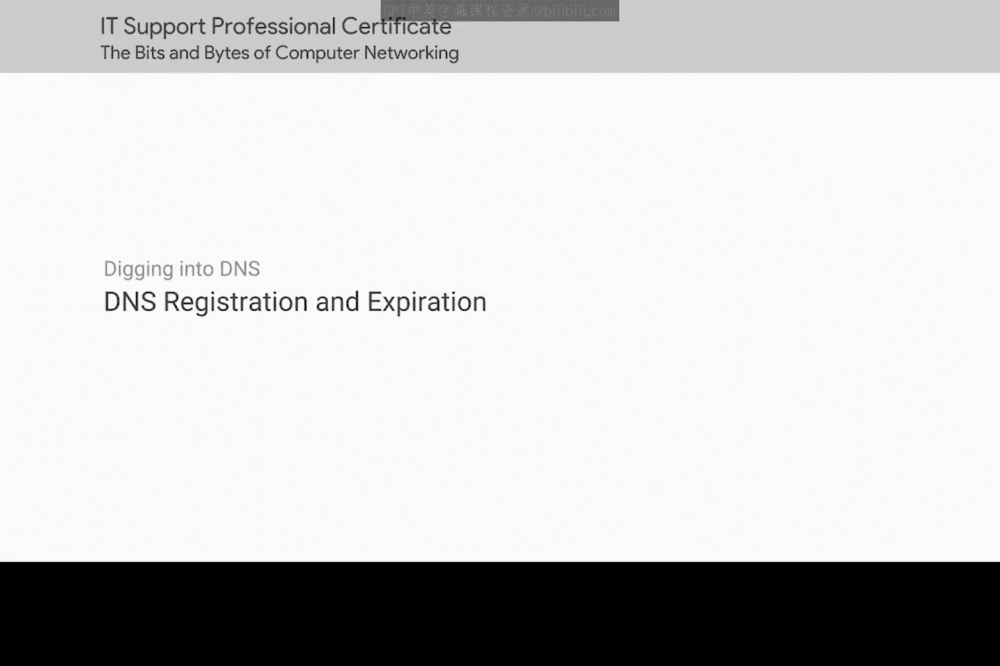
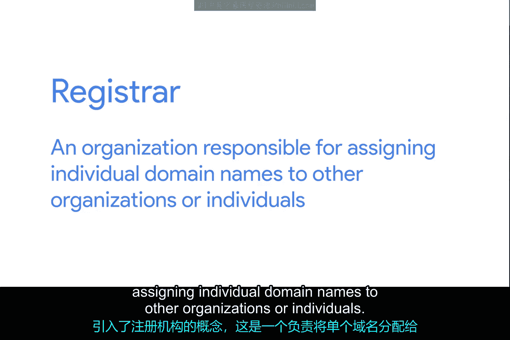
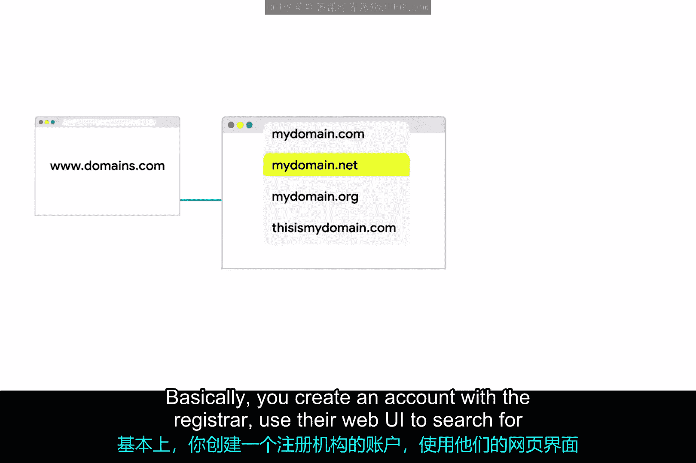
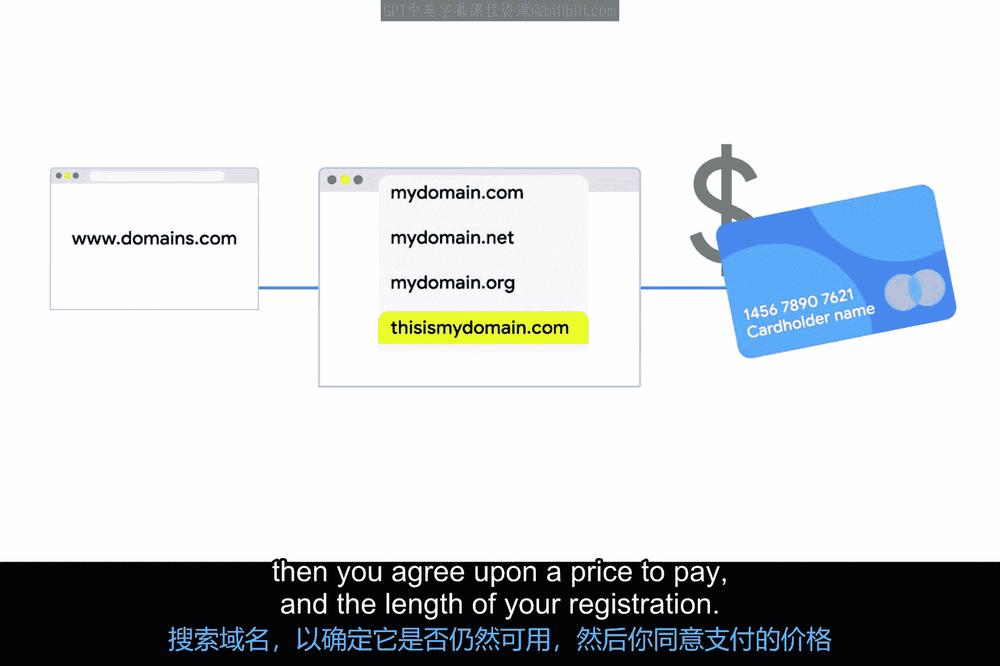
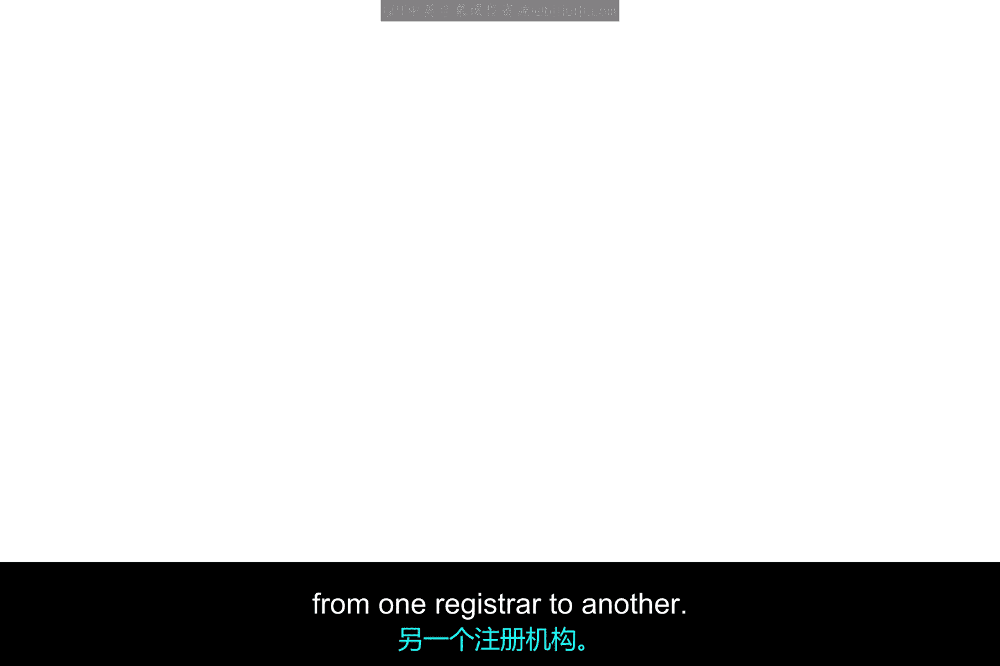
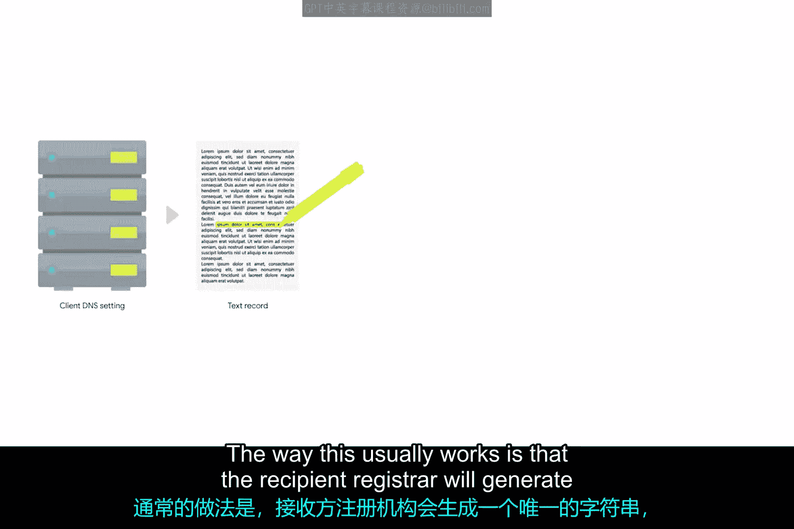
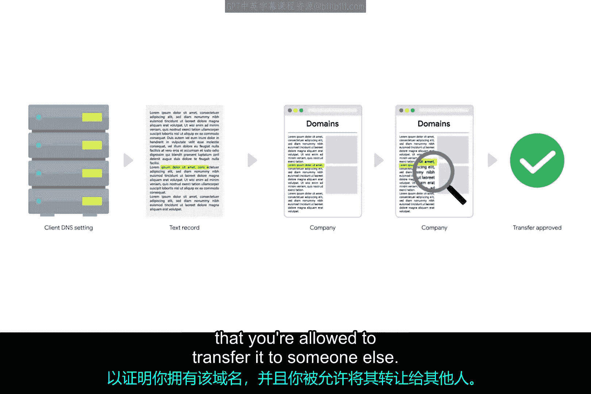

# 谷歌《IT支持（计算机网络⧸操作系统，第2、3课⧸共5课）｜Google IT Support》中英字幕deepseek p82 80_DNS注册与过期.zh_en -BV1uyqcYpExr_p82-

Refresh your time Remember that DNS is a global system managed in a tiered hierarchy with IcanN at the top level。

 domain names need to be globally unique for a global system like this to work。

You can't just have anyone decide to use any domain name itd be chaos。Enter the idea of a registrar。

 an organization responsible for assigning individual domain names to other organizations or individuals。

Originally， there were only a few registrars， the most notable was a company named Network Solutions Inc。

It was responsible for the registration of almost all domains that weren't country specific。

As the popularity of the Internet grew， there was eventually enough market demand for competition in this space。

 Finally， the United States government and network Solutions Inc came to an agreement to let other companies also sell domain names。

 Today， there are hundreds of companies like this all over the world。

 registering a domain name for use is pretty simple。 Basically。

 you create an account with a registrar， use their web Ui to search for a domain name to determine if it's still available。

 Then you agree upon a price to pay and the length of your re。😊。

Once you own the domain name， you can either have the registrar's name servers act as the authorative name servers for the domain。

 or you can configure your own servers to be authorative domain names can also be transferred by one party to another and from one registrar to another。

The way this usually works is that the recipient registrar will generate a unique string of characters to prove that you own the domain and that you're allowed to transfer it to someone else。

 you configure your DNS settings to contain this string in a specific record。

 usually a text record once this information has propagated。

 it can be confirmed that you both own the domain and approve its transfer。

After that， ownership would move to the new owner or registrar。

An important part of domain name registration is that these registrations only exist for a fixed amount of time。

 you typically pay to register domain names for a certain number of years。

 it's important to keep on top of when your domain names might expire because once they do。

 they're up for grabs and anyone else could register them。

