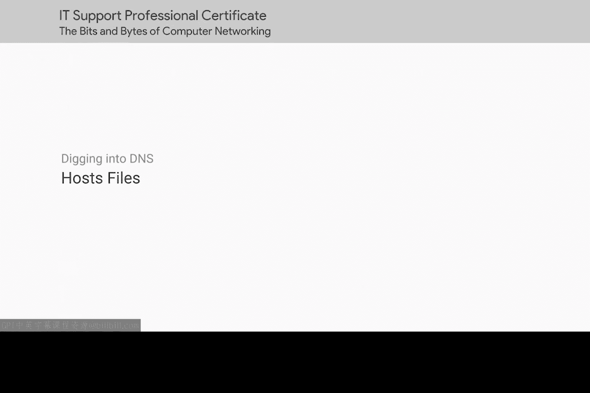
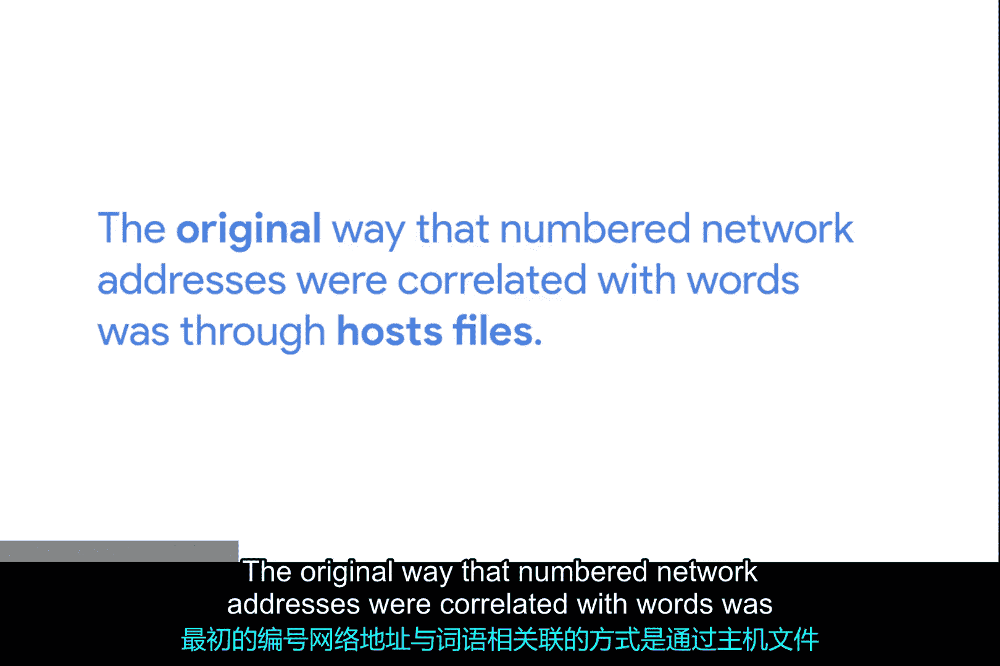
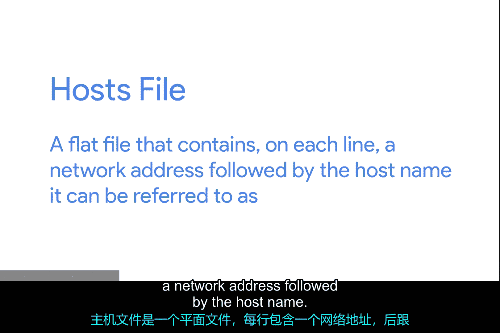
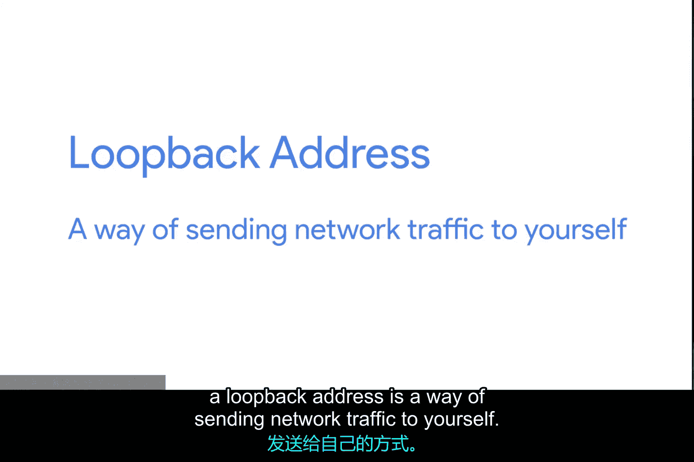
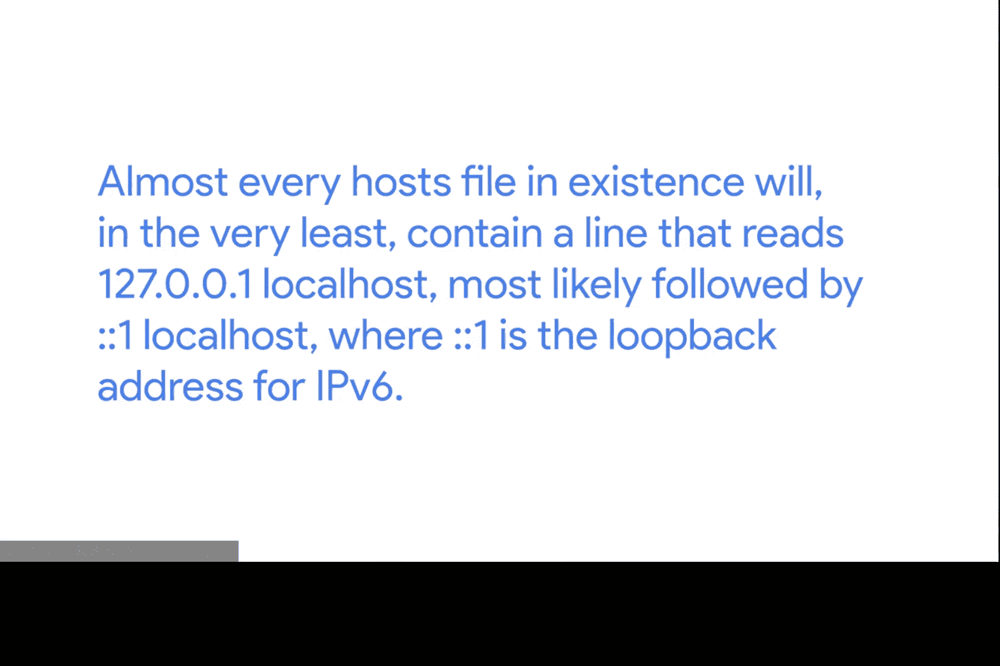
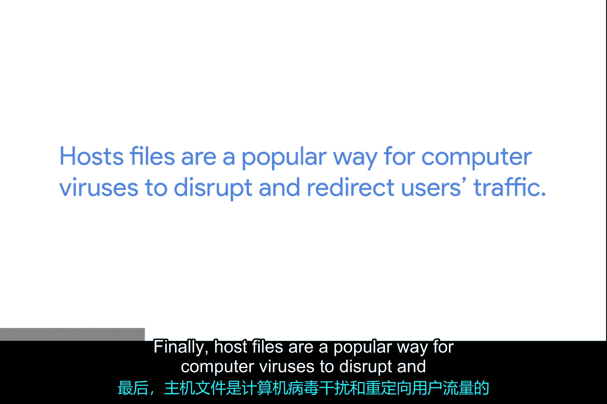

# 谷歌《IT支持（计算机网络⧸操作系统，第2、3课⧸共5课）｜Google IT Support》中英字幕deepseek p83 81_主机文件.zh_en -BV1uyqcYpExr_p83-

Long before DNS was an established and globally available technology。

 it was clear to computer operators that they needed a language based system to refer to network devices。

We've talked about how humans are way better at remembering descriptive words than numbers。

 but numbers represent the natural way that computers think and communicate。

The original way that numbered network addresses were correlated with words was through host files。

A host file is a flat file that contains on each line a network address followed by the host name it can be referred to as。

 for example。

A line in a host file might read 1。2。3。4 web server。

This means that on the computer where this host file resides。

 a user could just refer to web server instead of the IP 1。2。3。

4 hosts files are evaluated by the networking stack of the operating system itself。

That means the presence of an entry there would translate to anywhere you might refer to a networking address。

Sticking with our earlier example， a user could type web server into a web browser URL bar or could issue a Ping web server command。

 and it would get translated to 1。2。3。4 in either case。Host files might be ancient technology。

 but they've stuck around all this time， all modern operating systems。

 including those that power our phone and tablets still have hosts files。

 One reason is because of a special IP address we haven't covered yet， the loop back address。

A loop back address always points to itself。So a loop back address is a way of sending network traffic to yourself。

Sending traffic to a loop back address bypasses all network infrastructure itself and traffic like that never leads the node。

The loop back IP for IPV4 is 127。0。0。1。And it's still to this day configured on every modern operating system through an entry in a host file。

Almost every host file in existence will in the very least contain a line that reads 127。0。0。

1 local host。Most likely followed by Col Colon1， local host。

 where Colon Colon1 is the loop back address for IPV6。

Since DNS is everywhere， host files aren't used much anymore。

But they still exist and they're still important to know about some software even requires specific entries in the hostst file to operate properly as antiquated as this practice may seem。

 Finally， hostt files are a popular way for computer viruses to disrupt and redirect users traffic。

It's not a great idea to use hostt files today， but they do have some useful troubleshooting purposes that can be helpful in IT support。

Host files are examined before a DNS resolution， attempt occurs on just about every major operating system。

This lets you force an individual computer to think a certain domain name always points at a specific IP。

 Go it。We've covered a lot， so take time to go back if you need to and make sure you understand the concepts we're discussing next up a short quiz。

