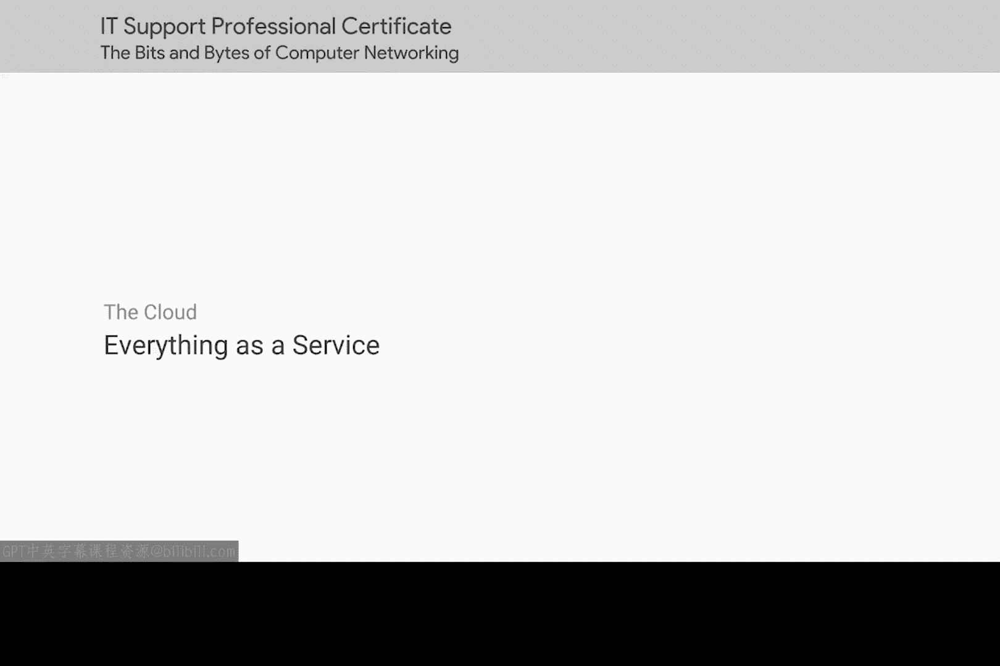
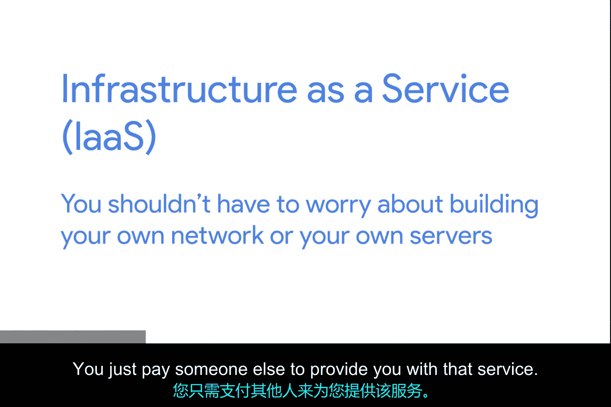
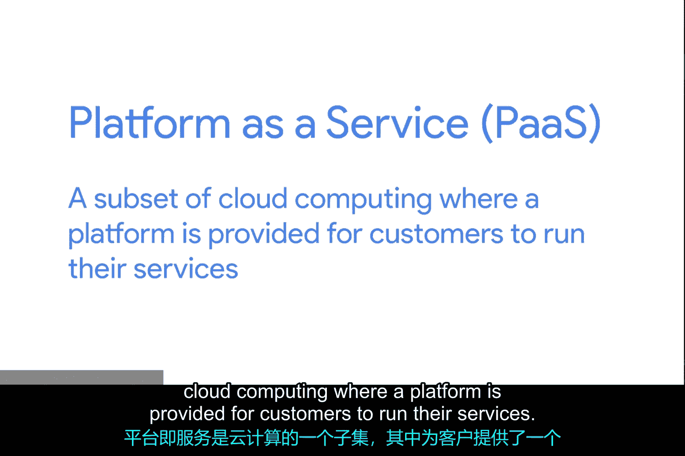
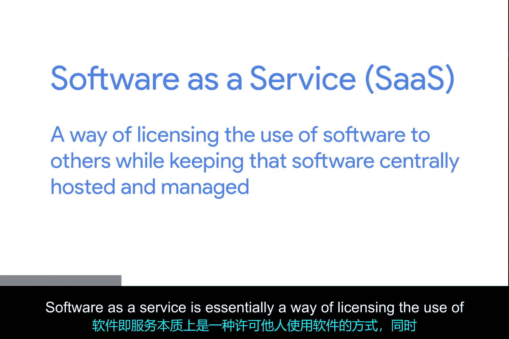
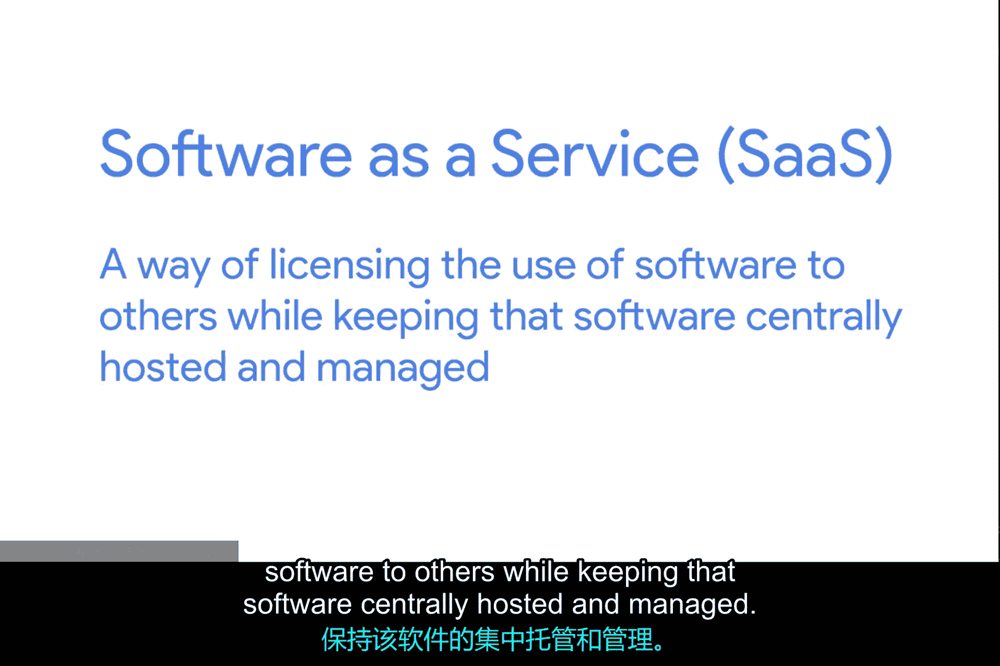

# 谷歌《IT支持（计算机网络⧸操作系统，第2、3课⧸共5课）｜Google IT Support》中英字幕deepseek p85 83_一切即服务.zh_en -BV1uyqcYpExr_p85-

In our last video， we gave you a basic definition of what cloud computing is。

 but the term has really come to mean so much more than just hosting virtual machines。

Another term that's been used more and more with the rise of cloud computing is X as a service。Here。

 the X can stand for lots of different things， the way we've described the cloud so far would probably best be defined as infrastructure as a service or I。

The idea behind infrastructure as a service is that you shouldn't have to worry about building your own network or your own servers。

 you just pay someone else to provide you with that service。

Recently， we've seen the definition of the cloud expand well beyond infrastructure as a service。

 the most common of these are platform as a service or PAS and software as a service or SAS。

Platform as a service is a subset of cloud computing where a platform is provided for customers to run their services。

This basically means that an execution engine is provided for whatever software someone wants to run。

 a web developer writing a new application doesn't really need an entire server complete with a complex file system。

 dedicated resources， and all those other things。It doesn't matter if this server is virtual or not。

 they really just need an environment that their web app can run in。

 That is what platform as a service provides。Software as a service takes this one step further Inra as a service abstracts away the physical infrastructure you need and platform as a service abstracts away the server instances you need software as a service is essentially a way of licensing the use of software to others while keeping that software centrally hosted and managed。

Software as a service has become really popular for certain things。

A great example is email offeringsings like Gmail for business from Google or Office 365 Outlook from Microsoft are really good examples of software as a service。

 Uing one of those services means you're trusting Google or Microsoft to handle just about everything about your email service。

 Software as a service is a model that's gaining a ton of traction。

 Web browsers have become so feature packed that lots of things that required standalone software in the past can now run well inside of a browser。

😊，And if you can run something in a browser， it's a prime candidate for SAS。Today。

 you can find everything from word processors to graphic design programs to human resource management solutions offered under a subscription based SAS model more and more。

 the point of a business's network is just to provide an internet connection to access different software or data in the cloud。

