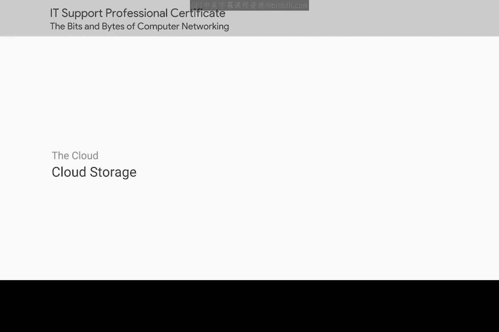

# 谷歌《IT支持（计算机网络⧸操作系统，第2、3课⧸共5课）｜Google IT Support》中英字幕deepseek p86 84_云存储.zh_en -BV1uyqcYpExr_p86-

Another popular way to use cloud technologies is cloud storage and a cloud storage system。

 a customer contracts a cloud storage provider to keep their data secure， accessible and available。

 This data could be anything from individual documents to large database backups。

 There are lots of benefits of cloud storage over a traditional storage mechanism。😊。

Without cloud storage， there's the general headache of managing a storage array。

 hard drives are one of the most frequent components that may experience a malfunction in a computer system。

 that means that you'd have to carefully monitor the devices being used for storage and replace parts when needed。

By using a cloud storage solution， it's up to the provider to keep the underlying physical hardware running。

Also， cloud storage providers usually operate in lots of different geographic regions。

 This lets you easily duplicate your data across multiple sites。

 Many of these providers are even global in scale， which lets you make your data more readily available for users all over the world。

😊，This also provides protection against data loss， since if one region of storage experiences problems。

 you can probably still access your data in a different region。

 Cloud storage solutions also grow with you。 Typically you'll pay for exactly how much storage you're using instead of having a fixed amount like you would with local storage while this doesn't always mean that cloud storage is necessarily a cheaper option。

 It does mean that you can better manage what your expenses for storage actually are。

Not only is cloud storage useful for replacing large scale local storage arrays。

 It's also a good solution for backing up smaller bits of data。

 Your smartphone might automatically upload every picture you take to a cloud storage solution。

 If your phone dies， you lose it or accidentally delete pictures。

 they're still there waiting for you in the cloud。 That way。

 you'll never lose those precious photos of your pooch Taco。 Don't worry， Taco。

 All 2000 of those photos of you are fully protected。 While I look at some more pictures of taco。

 It's time for a quick quiz。😊。