# 谷歌《IT支持（计算机网络⧸操作系统，第2、3课⧸共5课）｜Google IT Support》中英字幕deepseek p87 85_IPv6地址与子网划分.zh_en -BV1uyqcYpExr_p87-

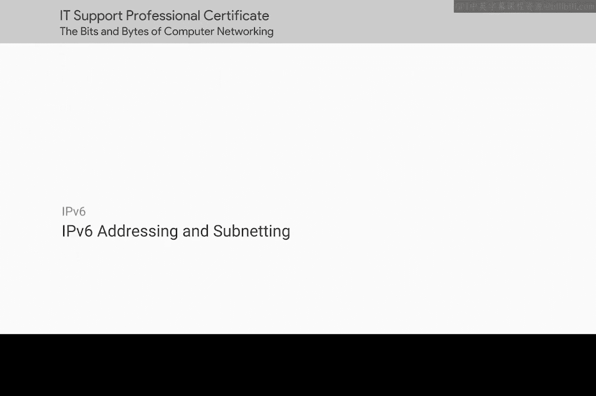

Time for some real talk。 Here's the hard truth。 The IA N A is out of I P addresses。

 When IV 4 was first developed， a 32 B number was chosen to represent the address for a node on a network。

 The Internet was in its infancy， and no one really expected it to explode in popularity the way it has32 B were chosen。

 but it's just not enough space for the number of Internet connected devices we have in the world。

 IPV 6 was developed exactly because of this issue。By the mid 1990s。

 it was more and more obvious that we were going to run out of IPV4 address space at some point。

 So a new internet protocol was developed。 Internet protocol version 6 or IPV6。

 You might wonder what happened to version 5 or IPV5。 It's actually a fun bit of trivia。

 IPV5 was an experimental protocol that introduced the concept of connections。

 it never really saw wide adoption and connection state was handled better later on by the transport layer and TCP。

 even though IPV5 is mostly a relic of history， when development of IPV6 started。

 the consensus was to not reuse the IPV5 name， the biggest difference between IPV4 and IPV6 is the number of bits reserved for an address while IPV4 addresses are 32 Bs。

 meaning there can be around 4。2 billion individual addresses。

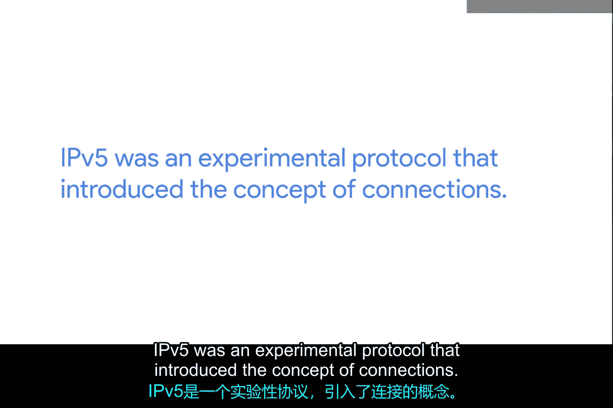

IPV6 addresses are 128 bits in size。The size difference is staggering once you do the math。

Don't worry， we won't make you。Two to the power of 128 would produce a 39 digit long number。

That number range has a name you've probably never even heard of。In undediciillion。

An uncillion isn't a number you hear a lot because it's ginormous。

 there really aren't things that exist at that scale。

 some guesses on the total number of atoms that make up the entire planet Earth and every single thing on it get into that number range。

That should tell you， we're talking about a very， very large number。

 if we can give every atom on Earth its own IP address。

 well probably be okay when it comes to network devices for a very long time。 Just for fun。

 Let's look at what that number actually looks like。It looks like this。Whoa， mind blowing， right。

 just like how an IPV4 address is really just a 32 bit binary number。

 IPV6 addresses are really just 128 bit binary numbers。

IPV4 addresses are written out in fouroctets of decibel numbers just to make them a little more readable for humans。

But trying to do the same for an IPV6 address just wouldn't work， instead。

 IPV6 addresses are usually written out as eight groups of 16 bits each。

Each one of these groups is further made up of four hexadeadecimal numbers。

A full IPV6 address might look something like this。That's still way too long。

 so IPV6 has a notation method that lets us break that down even more。

A way to show how many IPV6 addresses there are is by looking at our example IP。

Every single IPV6 address that begins with 2001 colon 0 DB8 has been reserved for documentation and education or for books and courses just like this one。

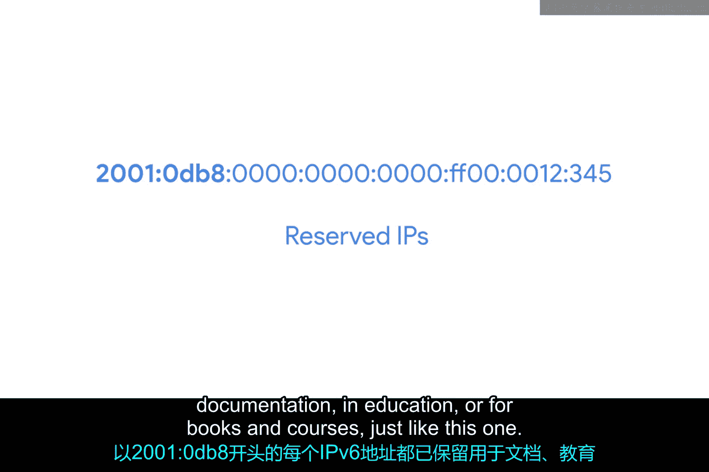

That's over 18quintillion addresses， much larger than the entire IPV4 address space。

 reserved just for this purpose。There are two rules when it comes to shortening an IPV6 address。

The first is that you can remove any leading zeroes from a group。

The second is that any number of consecutive groups composed of just zeros can be replaced with two colons。

I should call out that this can only happen once for any specific address。Otherwise。

 you couldn't know exactly how many zeros were replaced by the double colons for this IP。

 we could apply the first rule and remove all leading zeroes from each group。

 This would leave us with this。

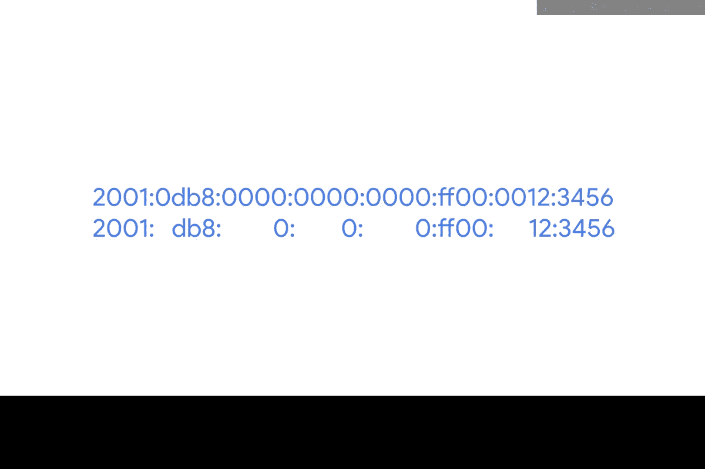

Once we apply the second rule， which is to replace consecutive sections containing just zeros with two colons。

 we'll end up with this。

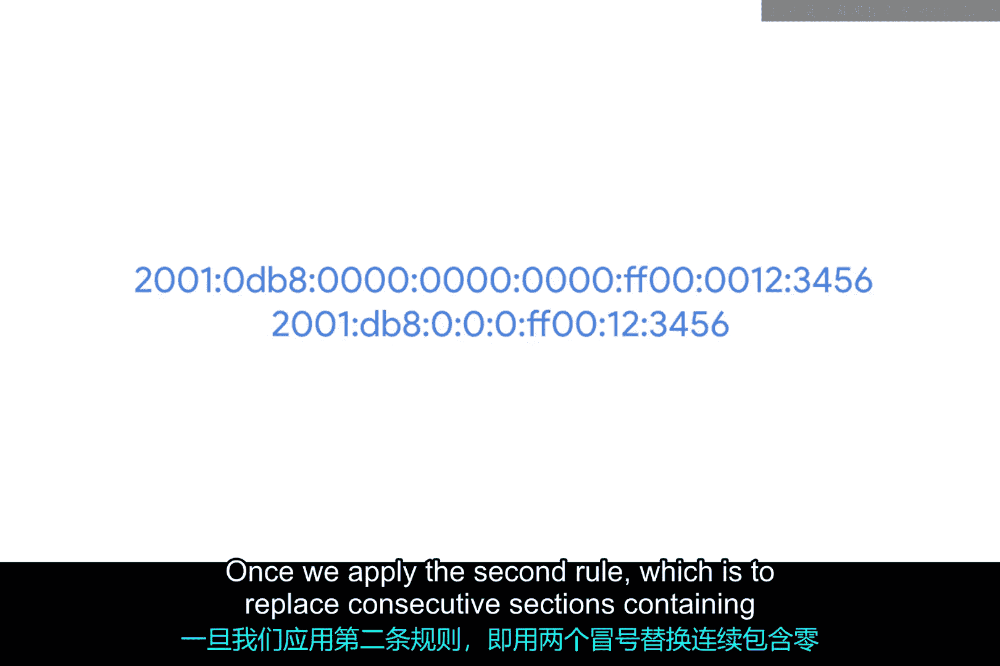

This still isn't as readable as an IPV4 address， but it's a good system that helps reduce the length a little bit。

 We can see this approach taken to the extreme with IPV 6 loop back address。

 You might remember that with IPV 4， this address is 1，2，7 dot 0 do 0 1。

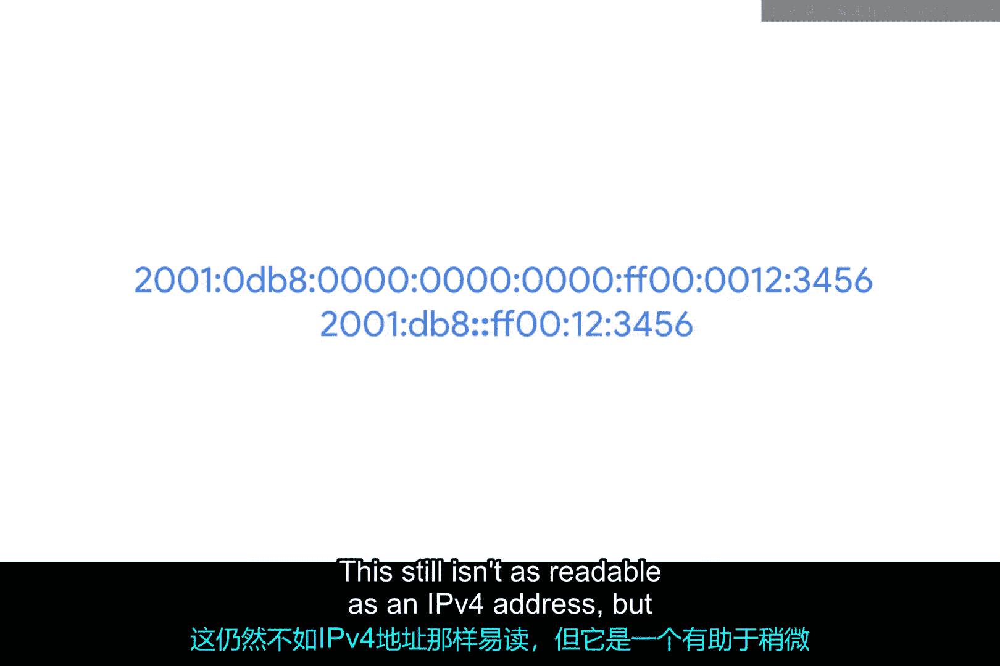

With IPV6， the loop back address is 31 zeros with a one at the end。

Which can be condensed all the way down to just colon colon one。

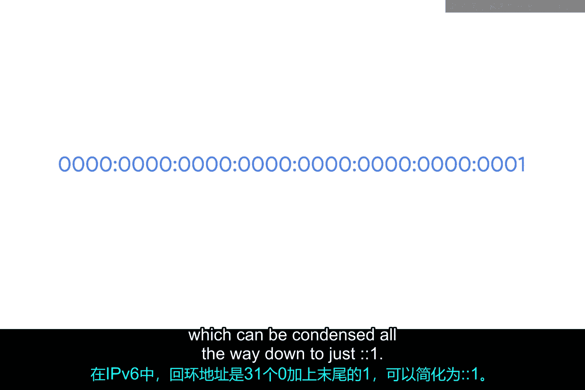

The IPV6 address space has several other reserved address ranges。

 besides just the one reserved for documentation purposes or the Lo back address。

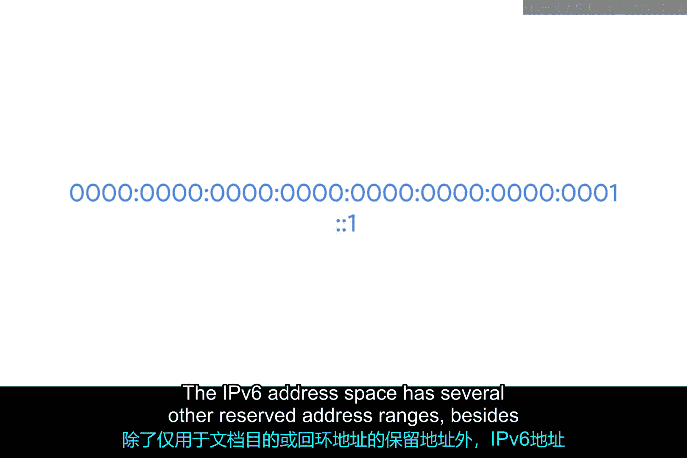

For example。Any address that begins with FF00 colon colon is used for multicast。

 which is a way of addressing groups of hosts all at once。

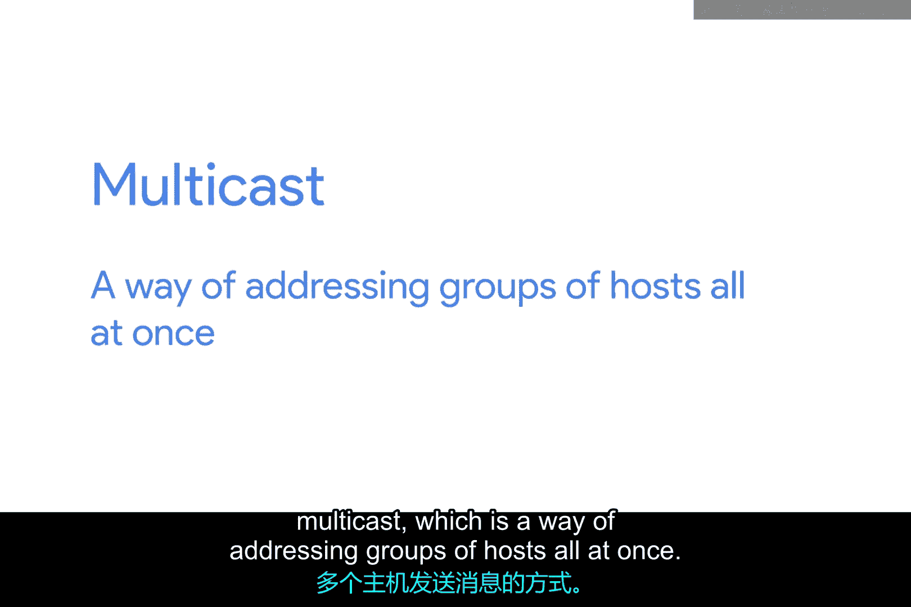

It's also good to know that addresses beginning with FE80 colon colon are used for link local UniIA link local UniIA addresses allow for local network segment communications and are configured based upon a host's Mac address。

 the link local address are used by an IPV6 hosts to receive their network configuration which is a lot like how DHCP works The host's Mac address is run through an algorithm to turn it from a 48 bit number into a unique 64 bit number。

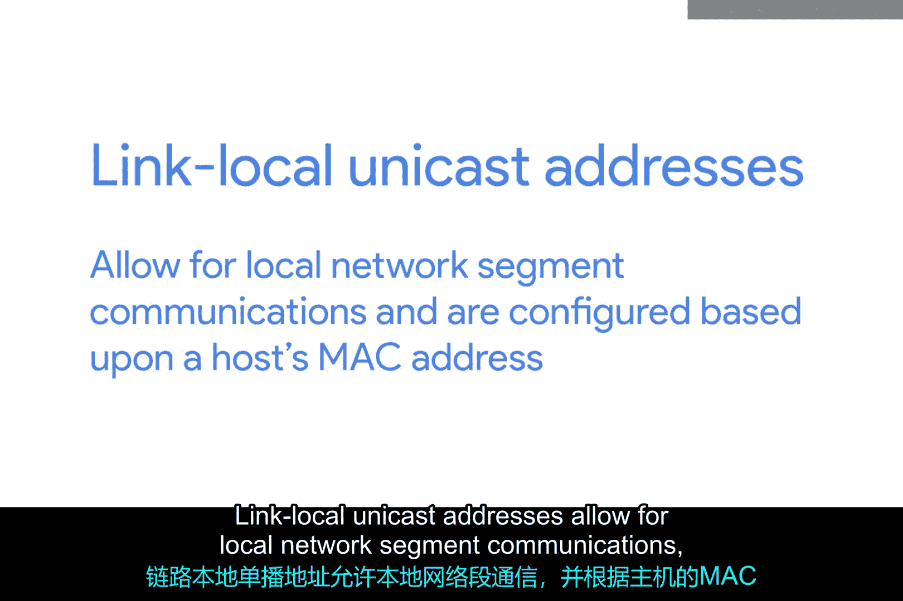

It's then inserted into the address's host ID。The IPV6 address space is so huge there was never any need to think about splitting it up into address classes like we used to do with IPV4 from the very beginning。

 in IPV6 address had a very simple line between network ID and host ID The first 64 bits of any IPV6 address is the network ID and the second 64 bits of any IPV6 address is the host ID This means that any given IPV6 network has space for over 9 quintillion hosts。

 Still， sometimes network engineers might want to split up their network for administrative purposes。

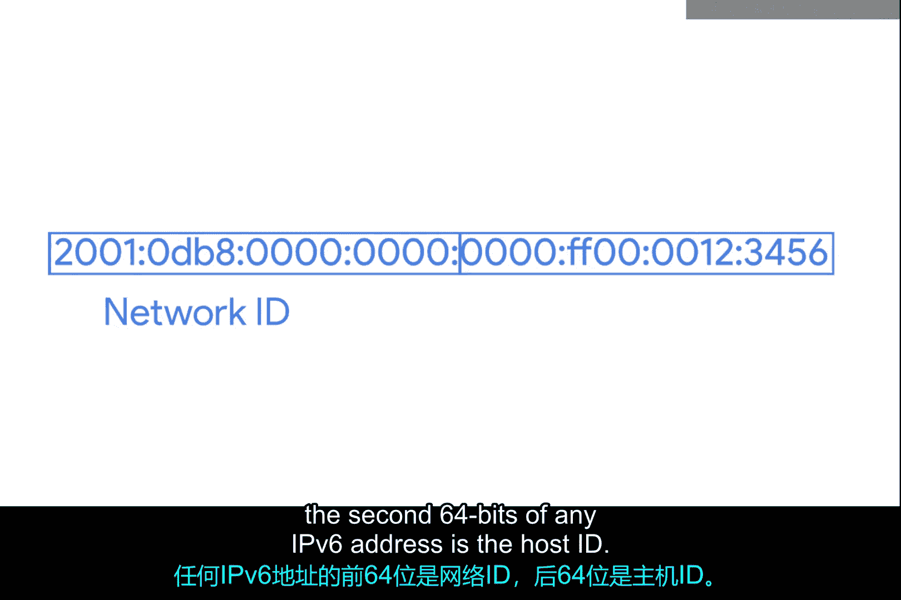

IPV6 subneting uses the same cider notation that you're already familiar with。

This is used to define a subnet mask against the network ID portion of an IPV6 address。

