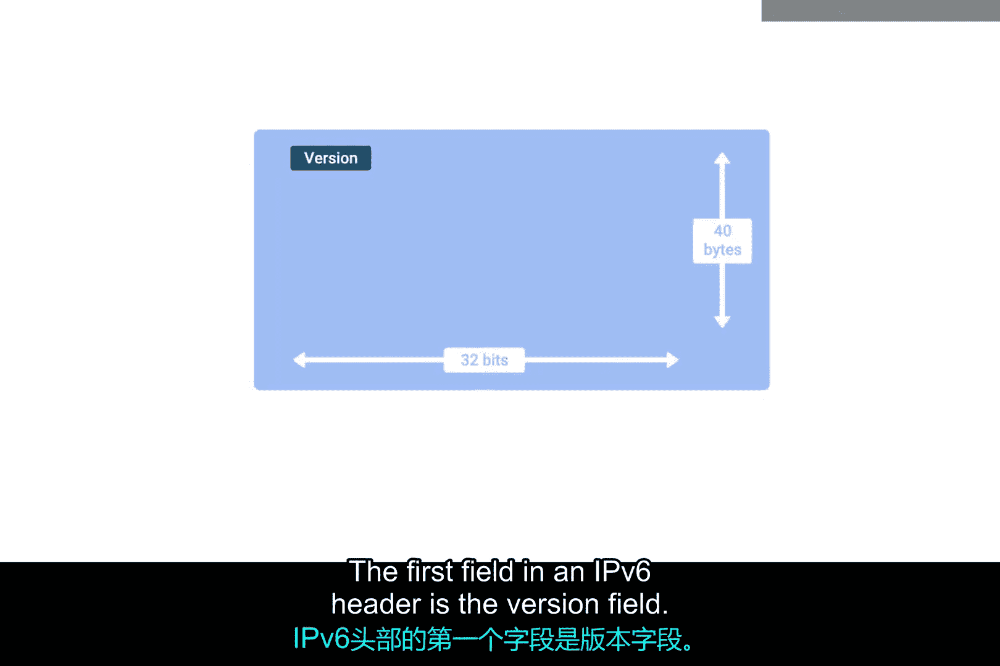
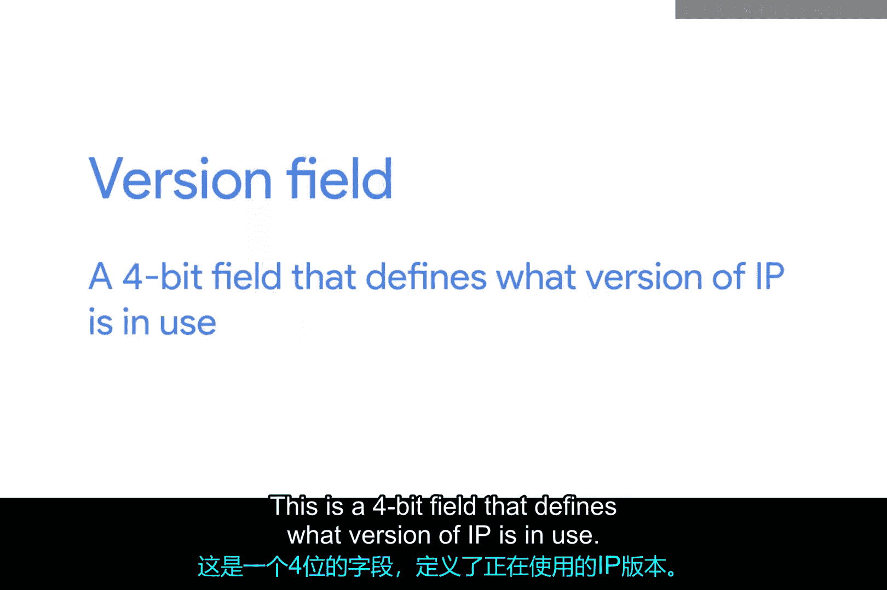
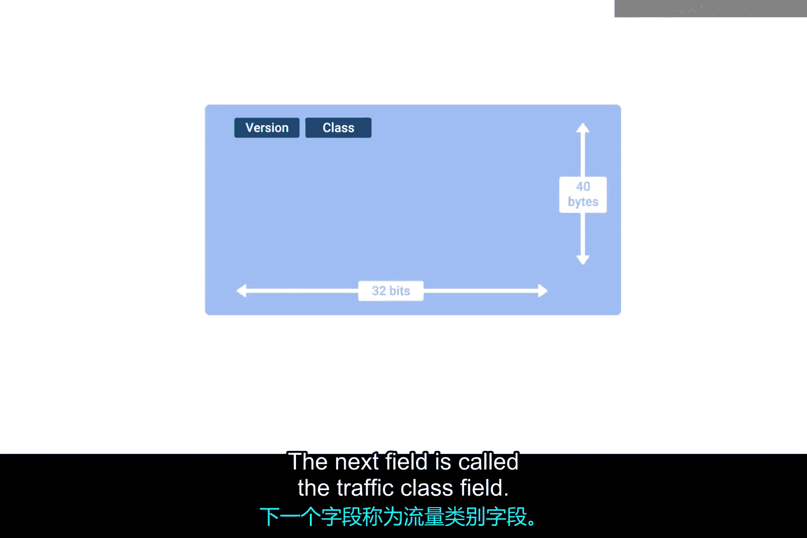
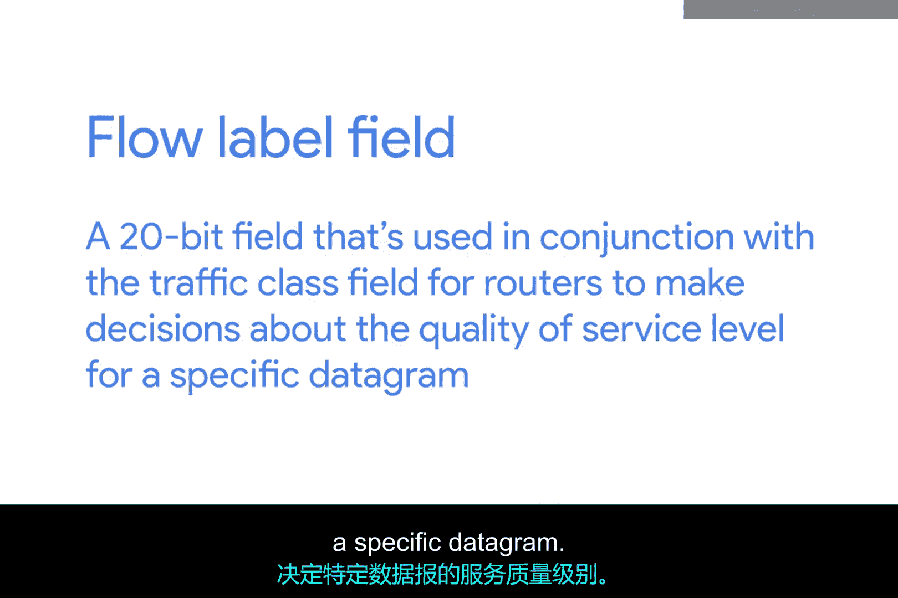
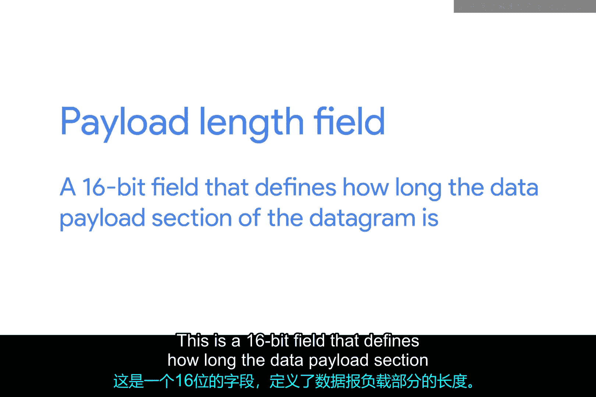
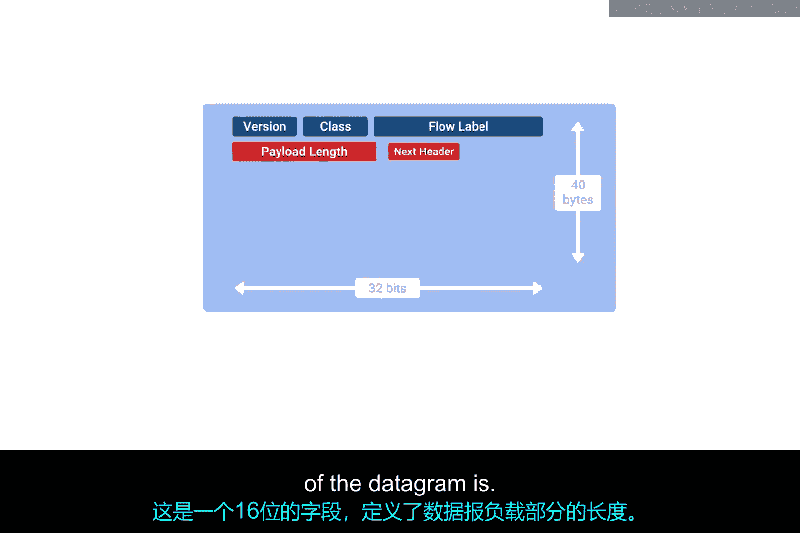
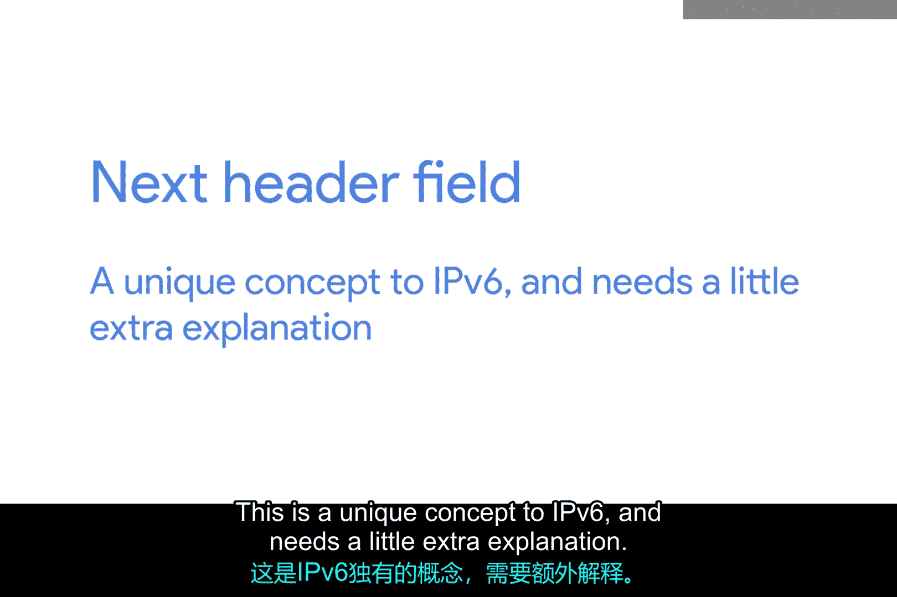
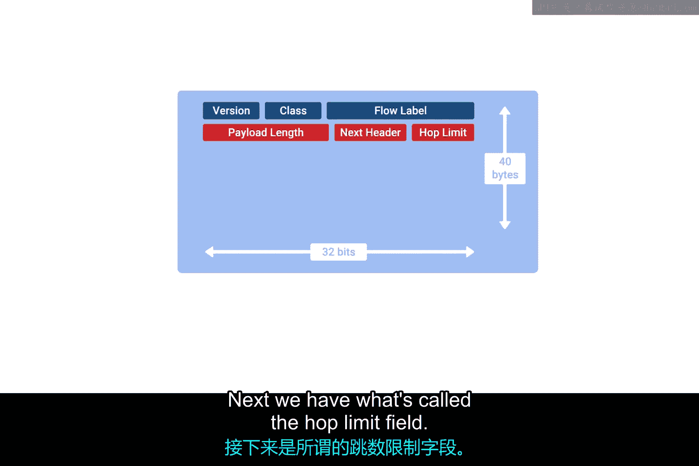
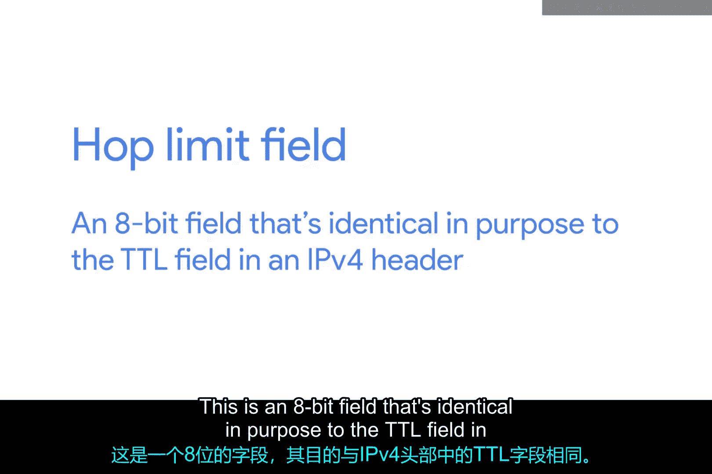
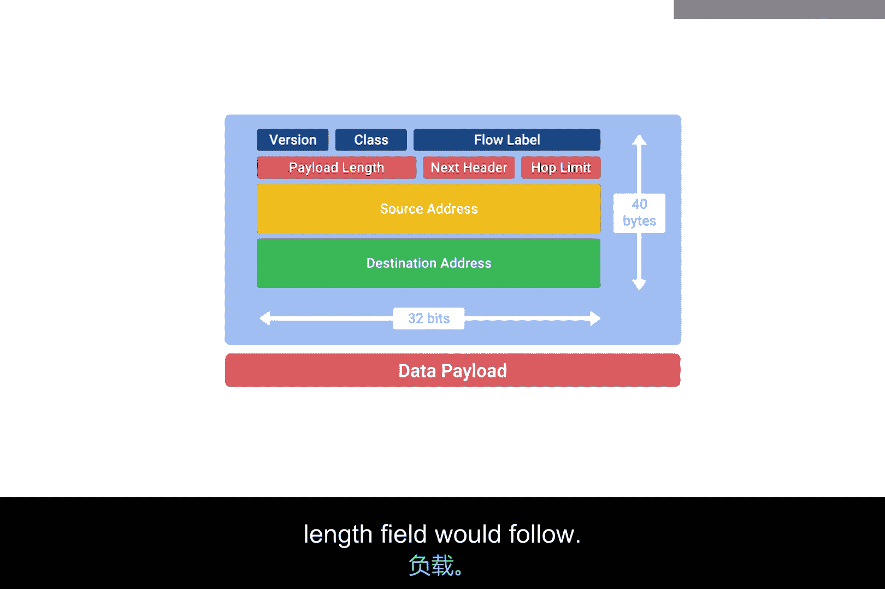

# 谷歌《IT支持（计算机网络⧸操作系统，第2、3课⧸共5课）｜Google IT Support》中英字幕deepseek p88 86_IPv6头部.zh_en -BV1uyqcYpExr_p88-

When IPV6 was being developed。They took the time to introduce a few improvements instead of just figuring out a way to increase the address size。

This should come as a relief to you， and IT support specialists love networks that perform well。

One of the most elegant improvements was made to the IPV6 header。

 which is much simpler than the IPV41。 The first field in an IPV6 header is the version field。

 This is a 4 bit field that defines what version of I is in use。

 You might remember that an IV4 header begins with this exact same field。

 The next field is called the traffic class field。 This is an 8 bit field that defines the type of traffic contained within the IP datagram。

 and allows for different classes of traffic to receive different priorities。

 The next field is the flow label field。 This is a 20 B field that's used in conjunction with the traffic class field for routers to make decisions about the quality of service level for a specific datagram。

😊。

Next， you have the payload length field。 This is a 16 B field that defines how long the data payload section of the datagram is。

 Then you have the next header field。 This is a unique concept to IPV6 and needs a little extra explanation。

 IPV6 addresses are four times as long as IPV4 addresses。 That means they have more ones and zeros。

 which means that they take longer to transmit across a link。

To help reduce the problems with additional data that IPV6 addresses impose on the network。

 the IPV6 header was built to be as short as possible。

 One way to do that is to take all of the optional fields and abstract them away from the IPV6 header itself。

The next header field defines what kind of header is immediately after this current one。

These additional headers are optional， so they're not required for a complete IPV6 datagram。

Each of these additional optional headers contain a next header field and allow for a chain of headers to be formed if there's a lot of optional configuration。

Next， we have what's called the hop limit field， this is an8 bit field that's identical and purposed for the TTL field in an IPV4 header。

Finally， we have the source and destinationestation Ad fields， which are each 128 bits。

If the next header field specified another header， it would follow at this time， if not。

 a data payload， the same length as specified in the payload length field would follow。

