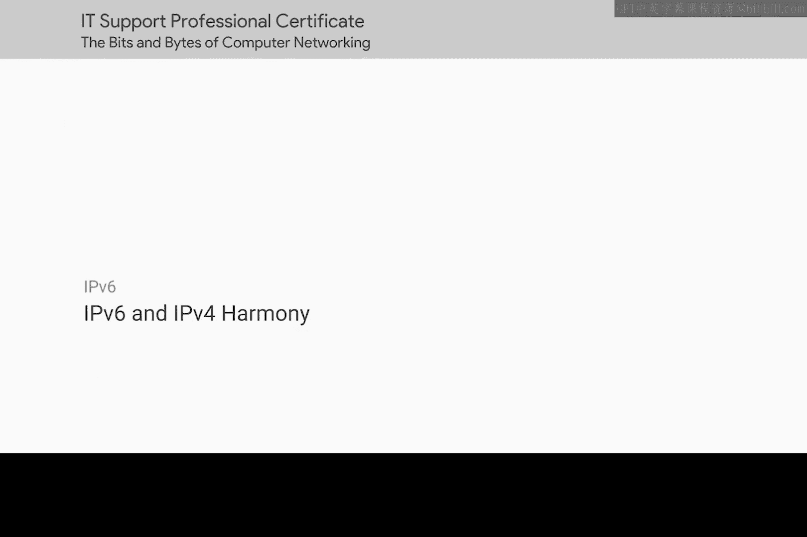
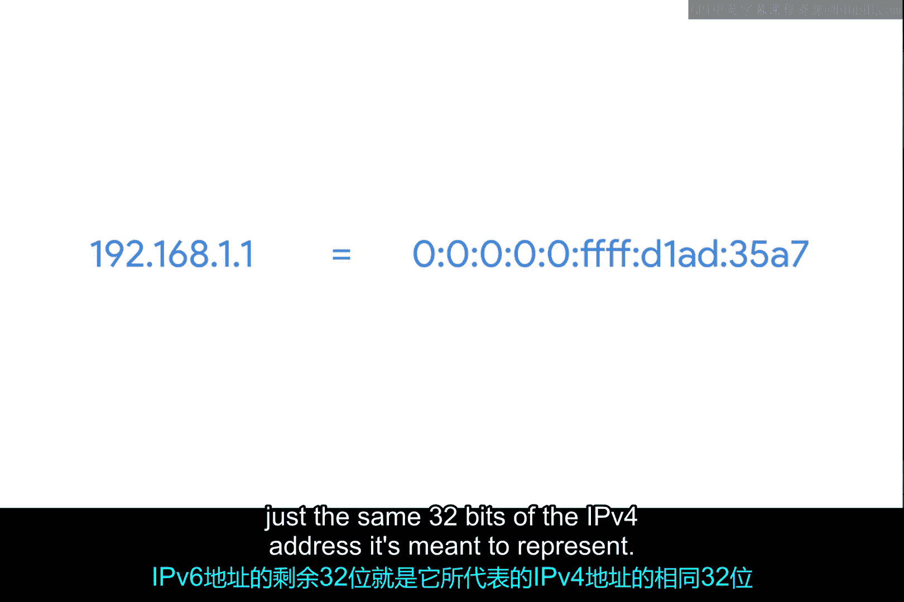
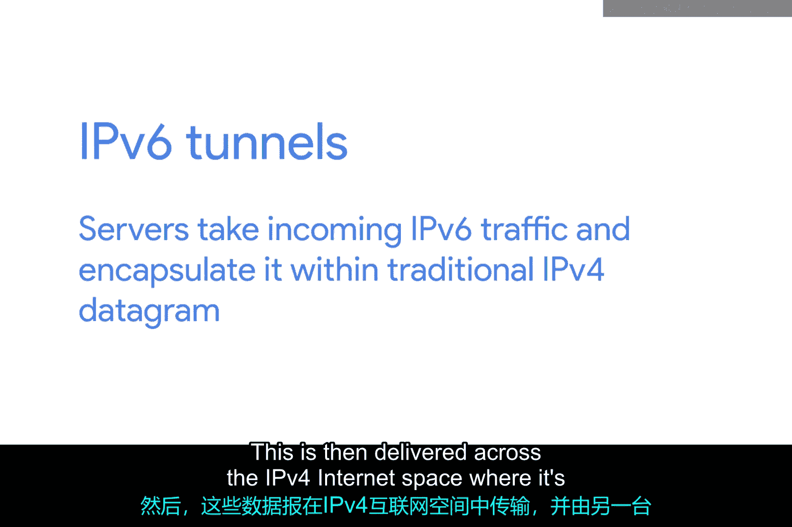
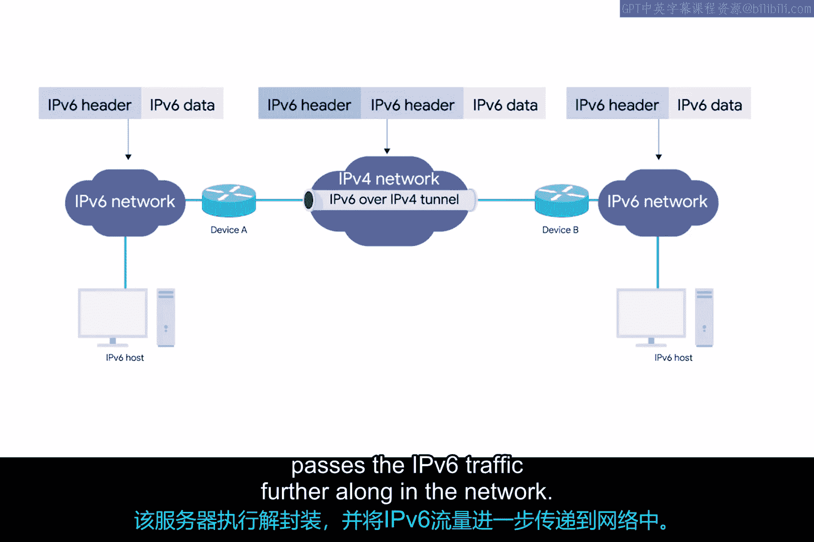
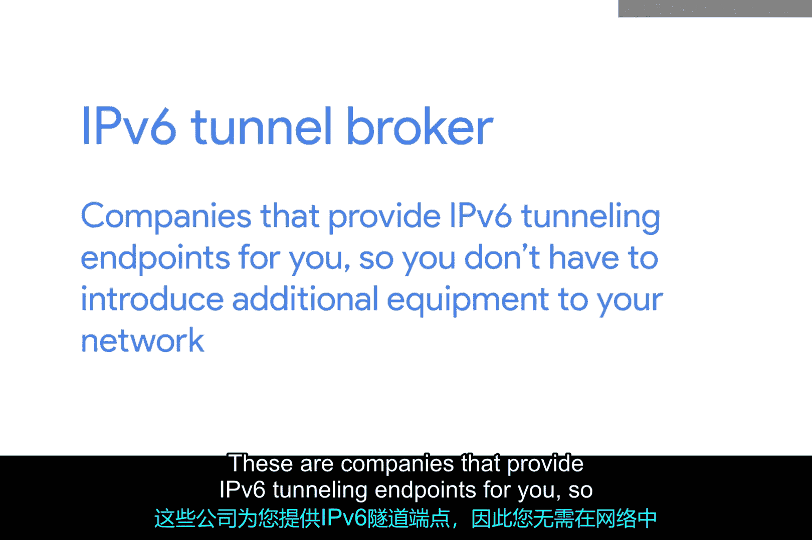

# 谷歌《IT支持（计算机网络⧸操作系统，第2、3课⧸共5课）｜Google IT Support》中英字幕deepseek p89 87_IPv6与IPv4的和谐.zh_en -BV1uyqcYpExr_p89-

It's just not possible for the entire internet and all connected networks to switch to IPV6 all at once。

There would be way too much coordination at play， too many old devices that might not even know how to speak IBV6 at all。

 still requiring connections。So the only way IPV6 will ever take hold is to develop a way for IPV6 and IPV4 traffic to coexist at the same time。

 this would let individual organizations make the transition when they can。

One example of how this can work is with what's known as IPV4 Maped address space。

 the IPV6 specifications have set aside a number of addresses that can be directly correlated to an IPV4 address。

Any IPV6 address that begins with 80 zeros and is then followed by 161s is understood to be part of the IPV4 mapped address space。

The remaining 32 bits of the IPV6 address is just the same 32 bits of the IPV4 address it's meant to represent This gives us a way for IPV4 traffic to travel over an IPV6 network。

But probably more important is for IPV6 traffic to have a way to travel over IPV4 networks。

 it's easier for an individual organization to make the move to IPV6 than it is for the networks at the core of the Internet too so while IPV6 adoption becomes more widespread。

 it'll need a way to travel over the old IPV4 remnants of the internet backbone。

The primary way this is achieved today is through IPV6 tunnels。

IPV6 tunnels are conceptually pretty simple。 They consist of IPV6 tunnel servers on either end of a connection。

 These IPV6 tunnel servers take incoming IPV6 traffic and encapsulate within traditional IPV4 datagrams。

 This is then delivered across the IPV4 internet space where it's received by another IPV6 tunnel server。

 That server performs the de encapsulation and passes the IPV6 traffic further along the network。

Along with IPV6 tunnel technologies， the concept of an IPV6 tunnel broker has also emerged。

These are companies that provide IPV6 tunneling endpoints for you。

 so you don't have to introduce additional equipment to your network。

There are a lot of competing protocols to be used for these kinds of IPV6 tunnels。

 since this is still a new and evolving space， it's not clear who the winner will be。

I've left you with some links to read about the main competitors right after this video。

 it doesn't really matter which tunneling technology ends up becoming the most common solution。

 it'll probably fade away in the time itself。The future of networking is the adoption of IPV6 as the main protocol at the network layer。

 and one day we won't need any tunnels at all， the future is limitless and tunnelless or something like that。

You've done an amazing job getting through all this information。

 so take some time to pat yourself on the back。 you've got one final quiz and a final project to get through。

 and then you can check this course off your to do list。

 Are you starting to see the light at the end of the tunnel。😊。

