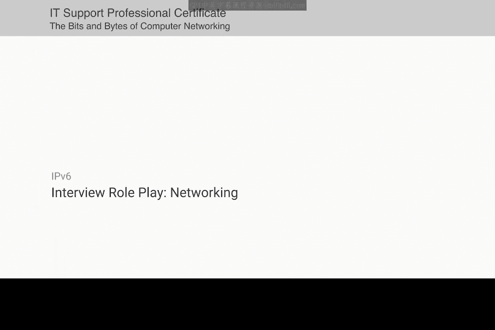
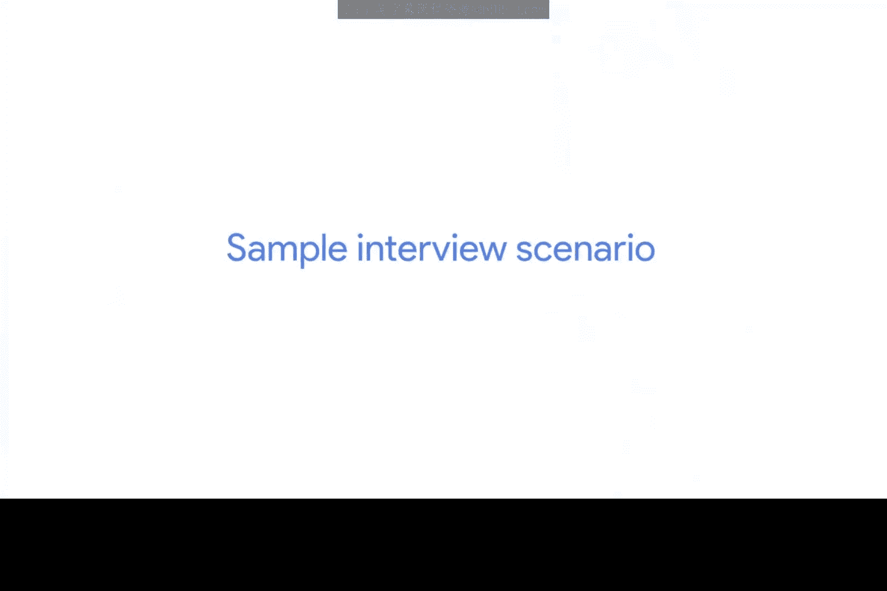

# 谷歌《IT支持（计算机网络⧸操作系统，第2、3课⧸共5课）｜Google IT Support》中英字幕deepseek p90 88_面试角色扮演：网络.zh_en -BV1uyqcYpExr_p90-

Hi I'm Rob and I'm Candice congrats on making it through this course now that you've made it this far。

 we're here to give you a sneak peek into what an interview on the technical subjects covered by this course might look like。

We hope this will help you have a better idea what to expect in your next interview。

 just in order to keep learning and keep practicing。

All right， so for this scenario， let's say that you working helped us for a global company and you get a call first thing in the morning from a user in a remote office。

 they sound panicked and they tell you that the network is down in their office What do you do？

I was assure the user that I'll be able to help them out and then I would also want to know the network outage symptom。

 so are you receiving the error message？Yeah， let's say that I just opened up my laptop and I tried to access one of our internal websites。

 but I get an error message and it saysP can't be displayed。Okay。

 do you know if any other users are having this issue？You know。

 I'm not sure it's first thing in the morning and and I'm the first one here Okay can you actually give me the name of the website I like to test that on my computer Sure the the URL for the internal website is intranet。

companyX。com Okay thanks I'm going to test that out。All right。

 and let's say that it loads up fine just for you。Okay， so now I want to try an external website。

 so maybe try google。com。Okay， so I get the same result on Google。

com page Camp be displayed Okay what OS are you using let's say I'm using Windows 7 Okay so I want you to navigate to command prompt so the way you could do that is just go into the start menu and search CMD。

Okay so let's say I launched that I have my black command print window open Okay so now can you run the command IP Compx slash all Okay I do that and I see a bunch of things I see IP address。

 default gateway DNS and I'm a curious user so can you explain to me what all those things mean Yes so IP addresses is a unique numerical address given the computing devices to communicate on the internet to other computers default gateway serves as an access point that's used by computers to send information to another computer or on the internet so that could be like a router DNS says domain name system so that translate domain names into the IP address。

Okay， great， so let's say I read you all this info and I tell you my IP address is 192。 something。

 dot something。But you know that our network only uses addresses in the range of 172。

 something do something。Does that mean anything？Yeah， so does this machine use DHCP？It does。

 but since you brought that up， can you explain to me what DHCP is Yes。

 so dynamicynamic host configuration protocol automatically assigns IP addresses to computing devices and it can also send network configurations to。

And why would that be important in this scenario So this would be important just because if the IP address is getting assigned statically。

 then we have to go in and change it， but it should be to sign automatically right so back to our scenario What are some reasons I might be getting the wrong IP address from DHP DHP can be configured incorrectly or you could be connected to the wrong network So let's start with a more simple explanation how can we check what network I'm connected to Do you know if you're connected to wired or wireless network？

I'm on my laptop so I'm on wireless Okay， so if you're on wireless。

 let's go to the bottom right corner and click on the Wifi symbol and then go into network preferences just to see what network you're actually connected to。

All right， and when I do that， you're right， I'm connecting to some random network across the street and once I switch back to our corporate wireless。

 it seems to solve the issue， I guess the network wasn't down after all。Good job。In this scenario。

 we saw a great example of asking clarifying questions。

Prom started with the user saying that the network was down。But that can actually mean many things。

It's important to figure out what exactly is going wrong before we start trying to fix things。

We also saw a few examples of having to explain the terms we used during the interview。

If you use a term like DNS or DHCP， it's important that you know what it means and how it might be relevant。

That's it for now， see you again at the end of the next course。

