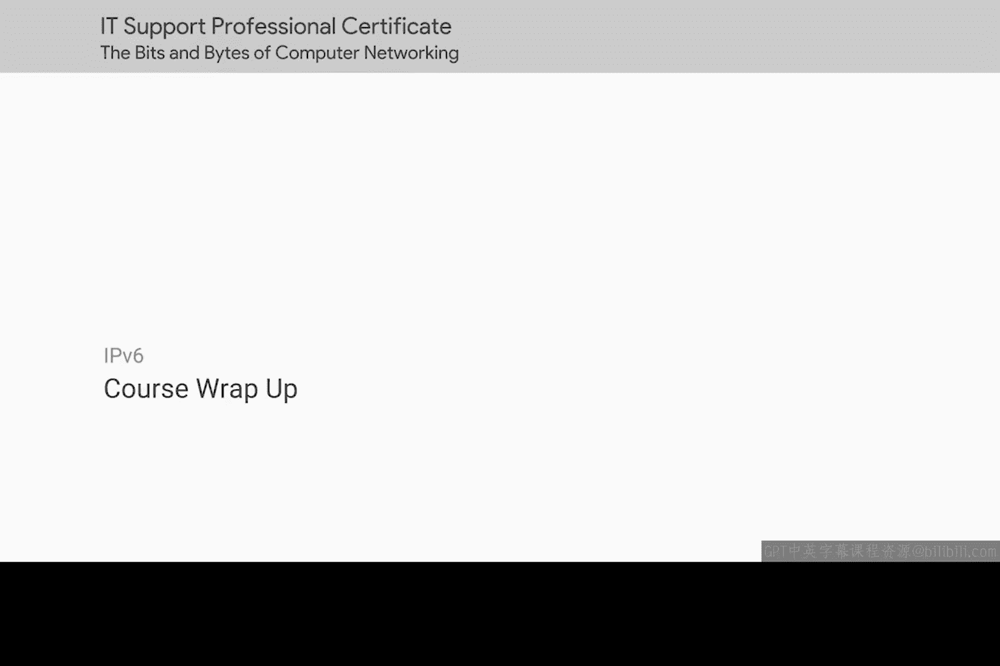

# 谷歌《IT支持（计算机网络⧸操作系统，第2、3课⧸共5课）｜Google IT Support》中英字幕deepseek p91 89_课程总结.zh_en -BV1uyqcYpExr_p91-

You did it。You should be really proud of yourself because getting through all of this material is a huge accomplishment。

 The material we've covered has been pretty technical and super complicated。

 and getting through it all is a real feat。 Take a moment to think about just how much you've learned。

 You now know a lot about how computers communicate with each other。

 which is an essential part of how people communicate with each other。

 Comp networks are used by billions of people every day。

 and they form the backbone of the global economy。 You've learned about how signals are carried across cables and how many different protocols are used in conjunction to make sure this data is delivered properly。

 You've learned about all sorts of network services like DNS that help humans use computers。😊。

This is all very important to learn， you'll be able to apply all of this knowledge into your IT support career。

😊，You can also just use it to help your own home network run better either way， congrats。

 you've given yourself a legup。Next time you visit a social media site or stream of video or even just chat with your friends and family online。

 take a moment to think about how amazing it is that so many different network devices and layers and protocols are involved with every little bit of data sent across the internet。

And you should also take a moment to marvel at the fact that you now understand how all of that works。

 congratulations in the next course， Opera Systems in you， becoming a power user。

 my friend and colleague Cindy Quach will be your guide as you navigate the Windows and Linux OSs。

Get ready to have some fun and get your hands dirty as Cindy teaches you how to become a command line wizard。

