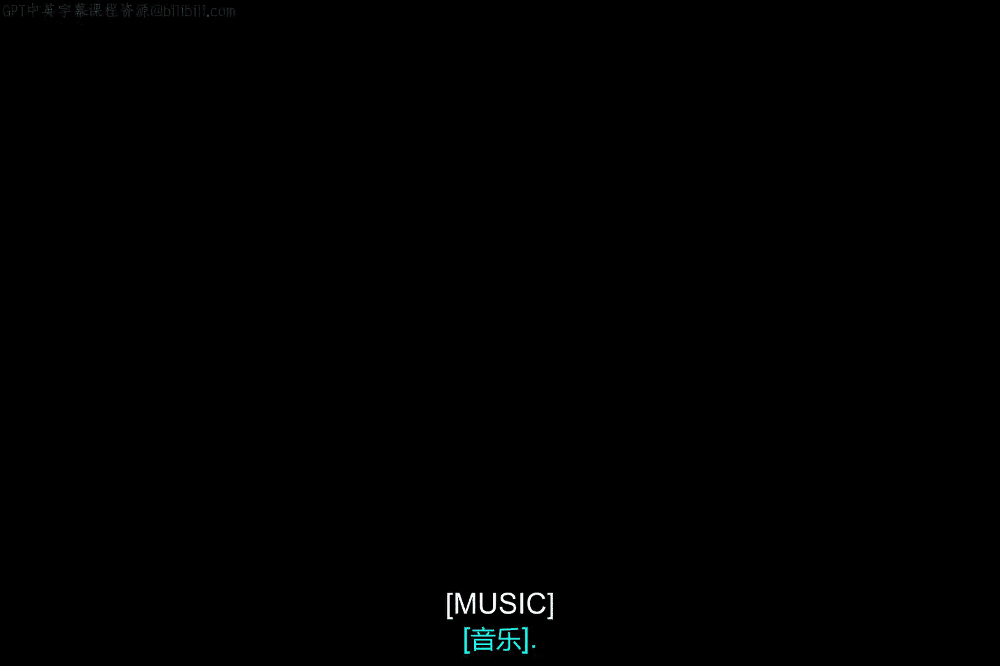

# 谷歌《IT支持（计算机网络⧸操作系统，第2、3课⧸共5课）｜Google IT Support》中英字幕deepseek p92 90_亚历克斯的职业路径.zh_en -BV1uyqcYpExr_p92-

So I think a big misconception that a lot of people have about ITU or tech work in general is that。

It's complicated or that it's difficult or that only some small subset of people are capable of handling these tasks。

And none of that is true these are very specific skills that you have to know and that's absolutely true and maybe it's true that most people don't have these skills。

 but that doesn't mean that people can't learn IT is incredibly stable。

 you have the opportunity to make a very good living you have a ton of directions that your career can go so many people I know started off in desktop support and or now network engineers or site reliability engineers or software engineers and it's an industry that's not going away。

 it's only growing， there's always gonna be opportunities。

I studied philosophy and history and actually also minored in creative writing。

While some of those skills have absolutely transferred and allowed me to excel at my job I didn't learn anything about the technical aspects from my time in college at all。

 I've never taken an academic computer science course， I've never taken a course in networking。

 I've never taking course in anything related to computers in any way whatsoever。

 education is important but there are other ways that you can learn the skills that you need to have a successful career in IT in tech。

