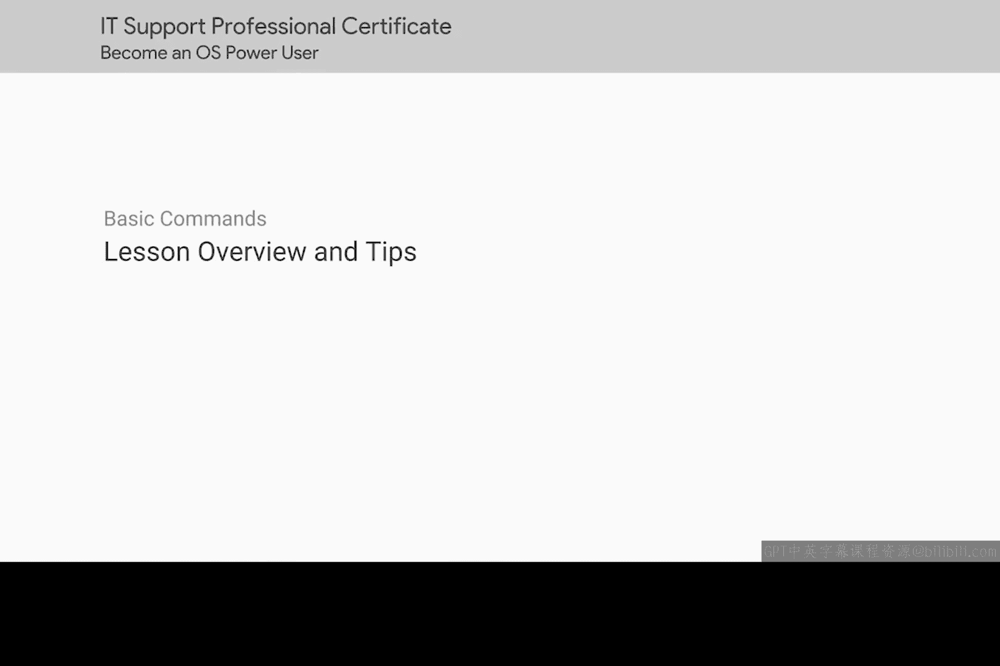
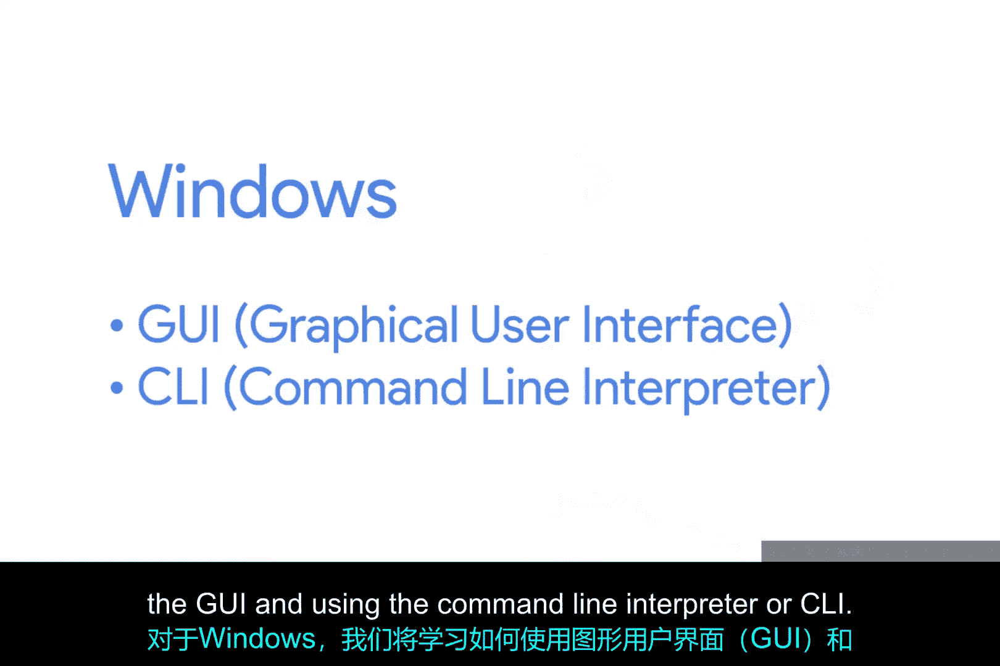
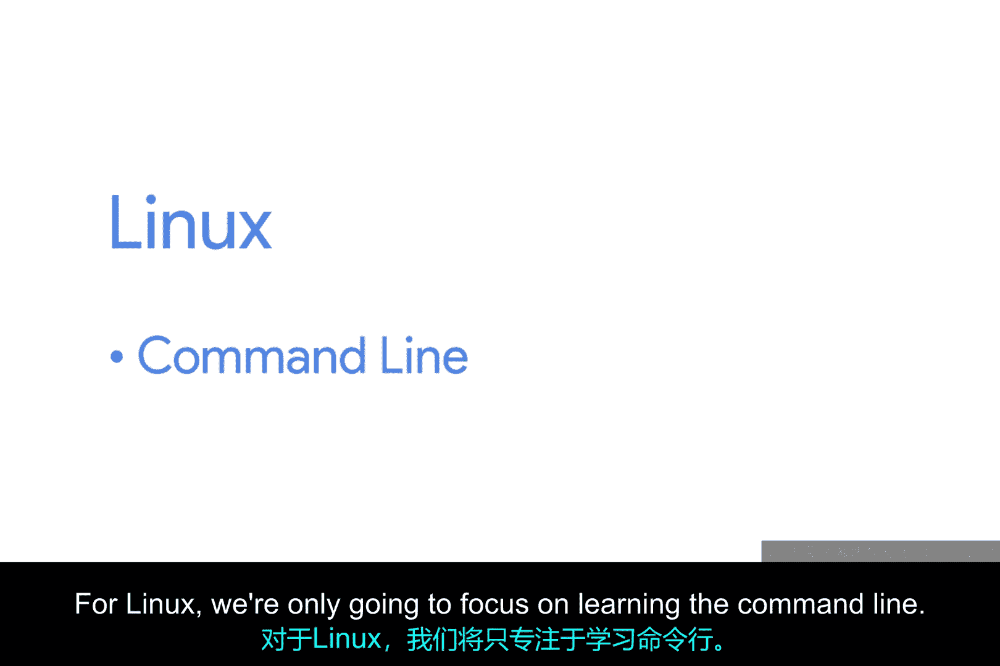
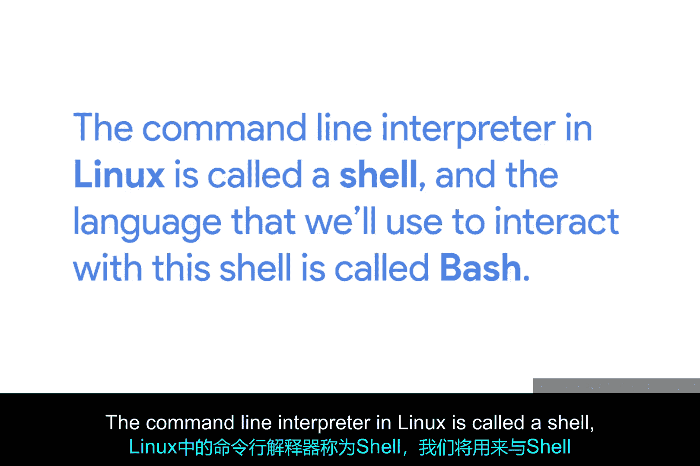
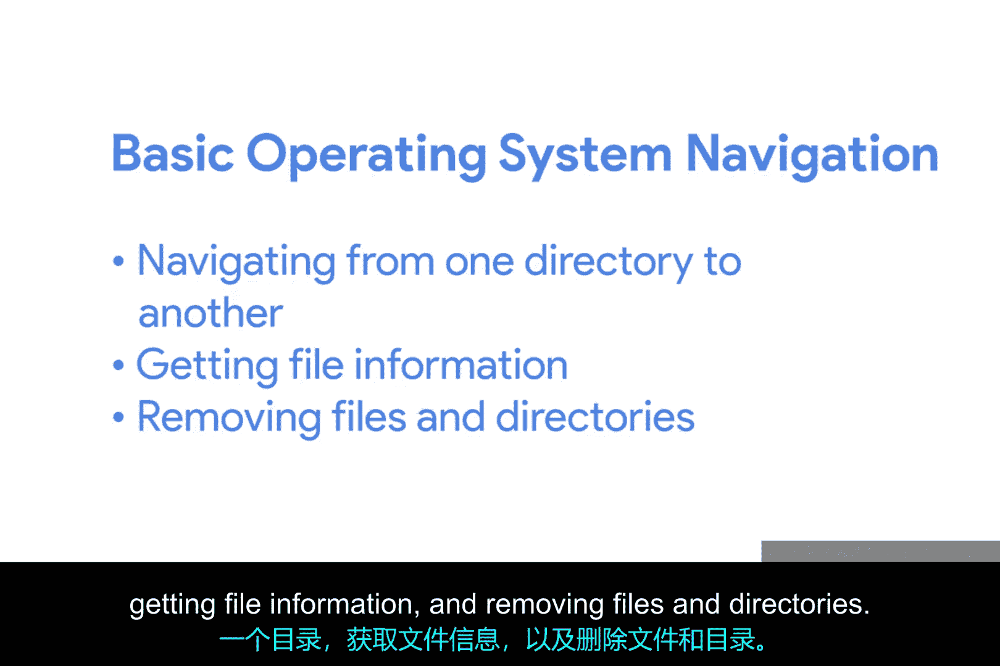
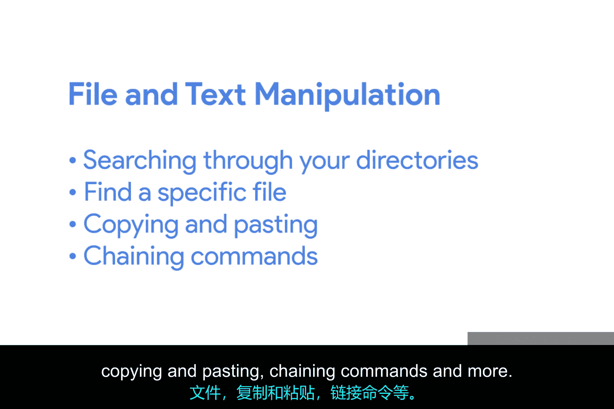

# 谷歌《IT支持（计算机网络⧸操作系统，第2、3课⧸共5课）｜Google IT Support》中英字幕deepseek p95 1_课程概述与实践技巧.zh_en -BV1uyqcYpExr_p95-

We dipped our toes in the windows and Linux OSs in the first course of this program。

Now let's jump right in and learn how to perform all the common navigational tasks of both operating systems for Windows we're going to learn how to navigate the operating system using the GuUI and using the command line interpreter or CLI。

For Linux， we're only going to focus on learning the command line。

The command line interpreter in Linux is called a shell。

 and the language that we'll use to interact with the shell is called bash。

 it's worth calling out that these two operating systems are very similar to one another。

So even if you don't know how to use the Linux GuoI。

 as long as you know how to navigate the Windows GuI。

 you'll be able to apply those tools to the Linux GuI。

It's possible that you'll only be using the Windows GuI in the workplace。 Even so。

 if you learn how to use the Windows command line， this will set you apart from other IT support specialists。

You'll soon discover that using the command line in any operating system can actually help you complete your work faster and more efficiently。

 we strongly encourage you to follow along and actually perform the tasks we do in this course yourself。

If you can， pause the video and do the exercises that we do or type out any of the commands we introduce。

It will be much easier for you to understand them this way。

 we also recommend that you document all of the commands that we show you。

Either write them down with an old fashioned pen and paper notebook or type them out in a doc or text editor。

 Chile them on a stone。 if you have to。 We just want you to write them down somewhere。

You probably won't remember all of the commands immediately when we first introduced you to them。

 but with a little practice， typing the commands will become second nature to you。

You can also use the official Windows CMI and bash documentation that we've provided for you in the supplemental reading right after this video for reference。

 if you need to in this lesson the content is broken down into two themes。

 the first is basic operating system navigation like navigating from one directory to another。

 getting file information and removing files and directories。

The second theme is file and text manipulation， like searching through your directories to find a specific file。

 copying and pasting， chaining commands and more。

Okay， enough chit chat， let's get started。