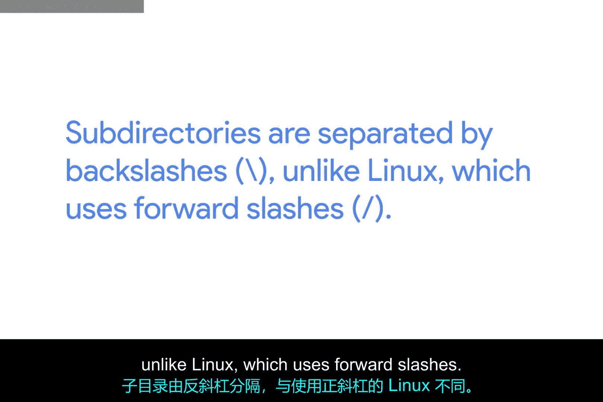
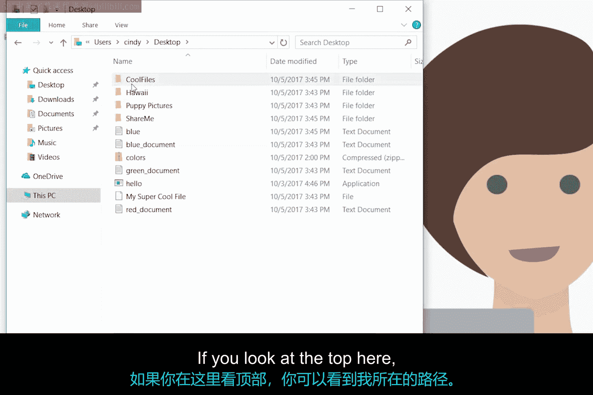
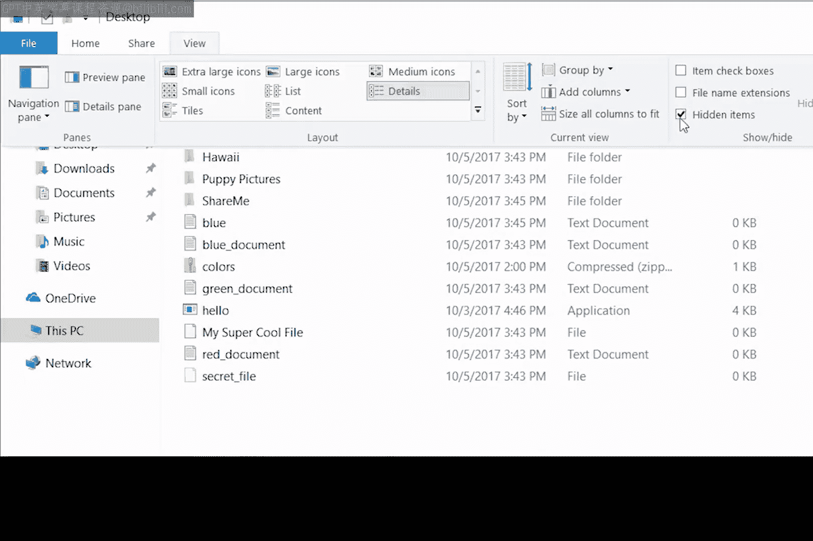
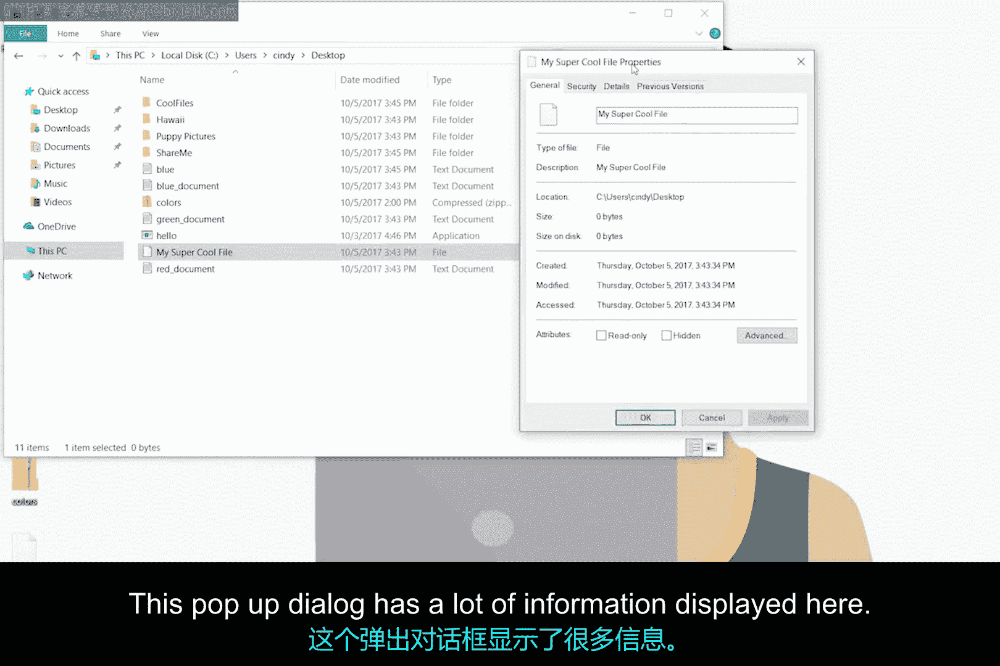
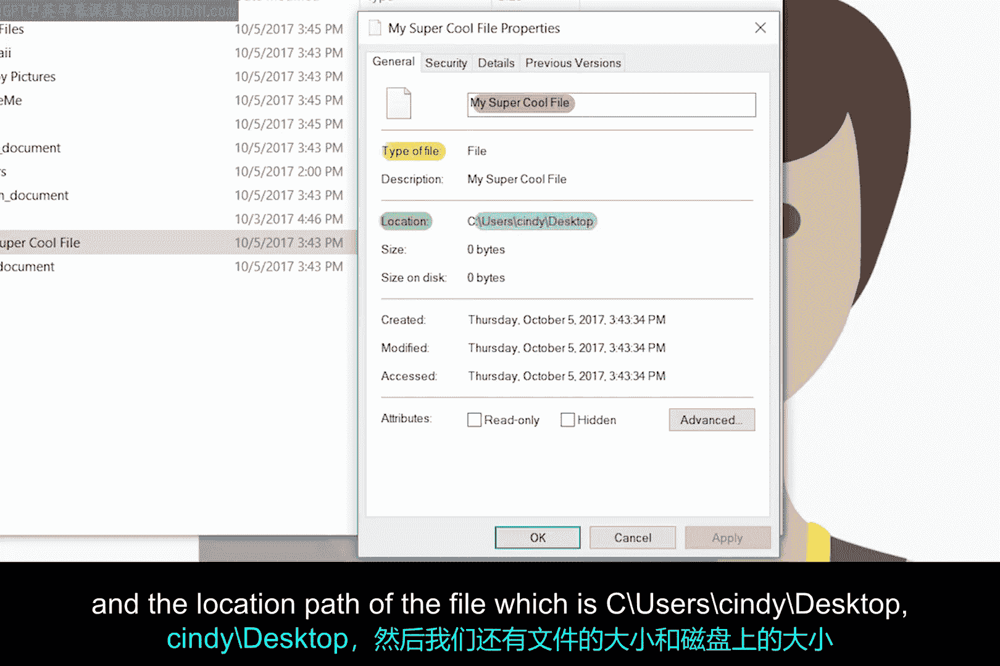
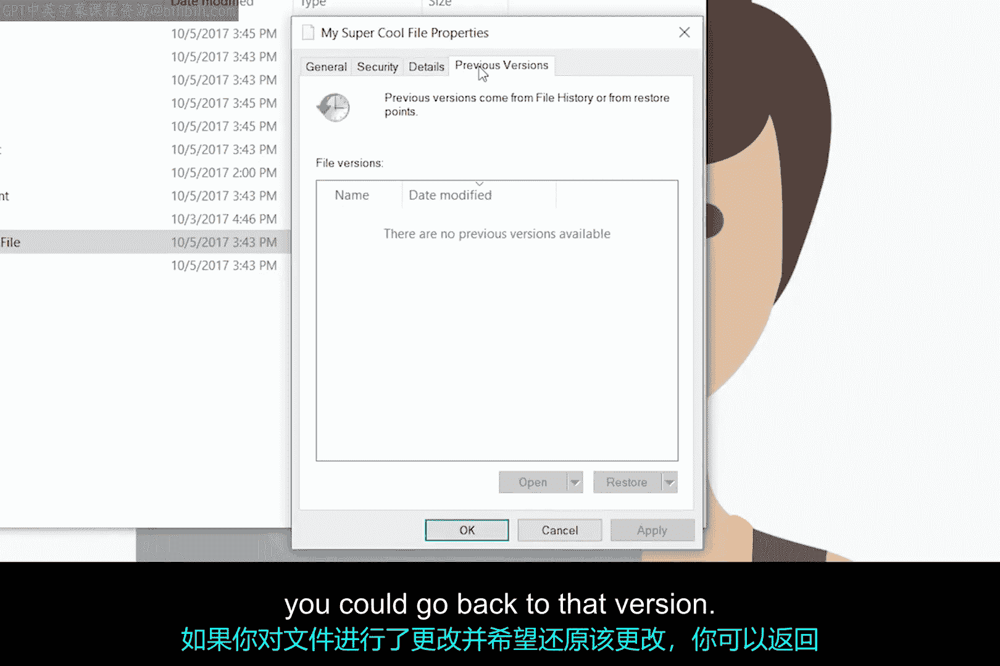
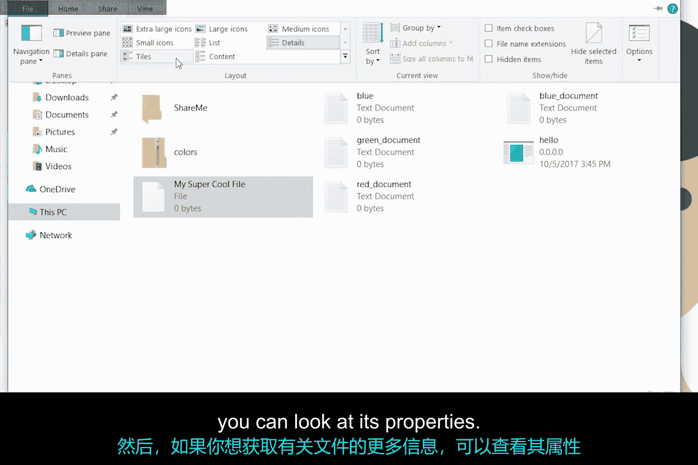

# 谷歌《IT支持（计算机网络⧸操作系统，第2、3课⧸共5课）｜Google IT Support》中英字幕deepseek p96 2_在GUI中列出目录.zh_en -BV1uyqcYpExr_p96-

In operating systems， files and folders or directories are organized in a hierarchical directory tree。

You have a main directory that branches off and holds other directories and files。

 We call the location of these files and directories paths。

Most paths and windows look something like this C backslash users， backlash Cindy backslash desktop。

In Windows， file systems are assigned to drive letters， which look like C or D or X。

Each drive letter is a file system。Remember that file systems are used to keep track of files on our computer。

 each file system has a root directory， which is the parent for all other directories in that file system。

So the root directory of C would be written C backslash。

 and the root directory of x would be written x backslash。Subdirecties are separated by backslashes。

 unlike Linux， which uses forward slashes。

A path starts at the route directory of a drive and continues to the end of the path let's open up this PC and navigate to our main directory。

The main directory in a Windows system is the drive that the file system is stored on， in this case。

 our file system is stored on local disk C。From here， I'm going to go to users。

Then my user folder Cindy。And finally， to desktop。

If you look at the top here。You can see the path I'm in。Local disc users， Cindy desktop。

That wasn't too hard， right？You can see here in our desktop directory that we have a few folders and files。

 we have a puppy'ies pictures folder， a Hawaii folder， and a file calledMy Super coolol file。

There are also some files on here that you can't see， we call these hidden files。

They're hidden for a few reasons。One is that we don't want anyone to see or accidentally modify these files。

They could be critical system files or configs， or even worse。

 embarrassing pictures of you in grade school rocking a mullet。It's okay。

 you aren't the first person who liked their hair to be business in the front and party in the back。

Just for fun， let's see what kind of hidden files we have in here。We'll go to the top。Click view。

Then check the hiddendden Its checkbox。Now we can see all the hidden files on our system。Oh。

 interesting， there is a file named secretcr fileile。As much as I'd like to take a peek at it。

 whoever created it probably doesn't want us to see what's inside。So we're going to leave it alone。

Let's go ahead and revert this option so we don't accidentally change something else。

Okay， so what if we wanted to view information about a file？Well， to do this。

 we can actually just right click and choose properties。Let's try this for my super cool file。

Oh， this pop up dialogue has a lot of information displayed here。 Let's break it down。

In the general tab， we can see the file name。The type of file。

 what applications we use to open it and the location path of the file， which is C backlash users。

 back slash Cindy back slash desktop。

Then we have the size of the file and the size on disk。 This can be a little confusing。

The size of the file is actually the amount of data that it takes up。

 but size on disk is a little different。It's not something you need to know right now。

 but if you want to learn more about it， you can check out the next supplemental reading。All right。

 let's move on。Next， you have timestamps of when the file was created。

 last modified and last accessed。After that， our file attributes we can enable for our file。

 we have read only and hidden。You might guess that if you check hiddend。

 our file will be hidden and only visible if we enable show hidden items。

 there are some advanced options too， but we won't touch those for now。

You'll also notice a few other tabs here at the top。Security， details and previous versions。

We'll talk more about the Security tab in a later lesson。

The detailstails tab basically tells us the information we just discussed about our file。

ThePrevious versions tab lets us restore an earlier version of a file。

So if you made a change to a file and wanted to revert to that change。

 you could go back to that version。

So to sum up listing the directories in the Windows GuI。

We can see the list of files and folders by default here。

You can even change how you want to view them using icons or even a list。

Then if you want to get more information about a file， you can look at its properties。

Next up， let's see how to view all this information through the Windows CI。

