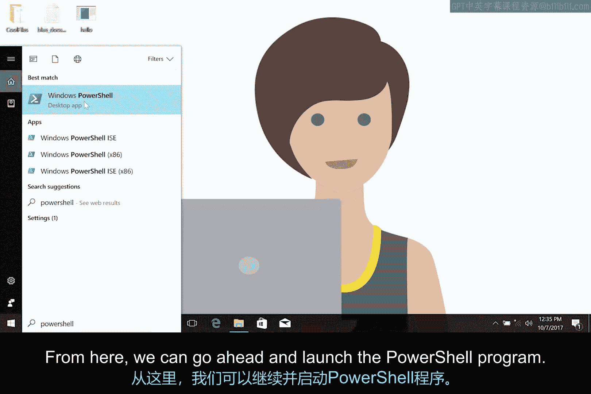
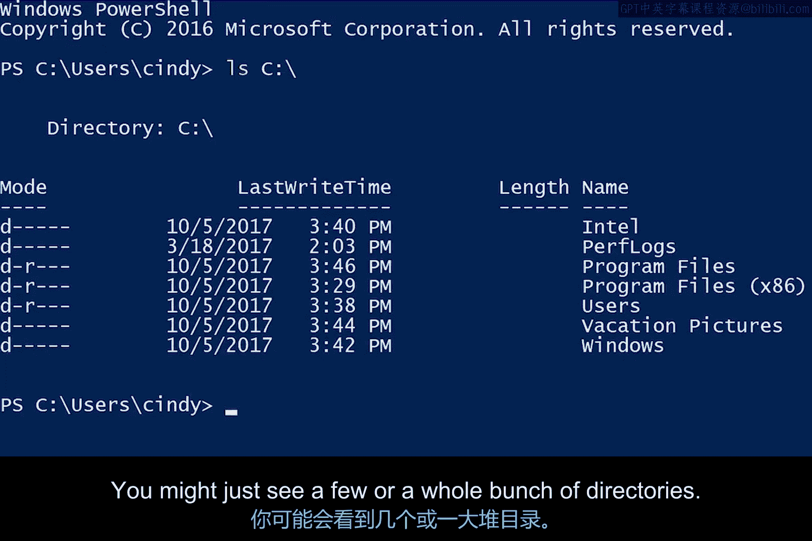
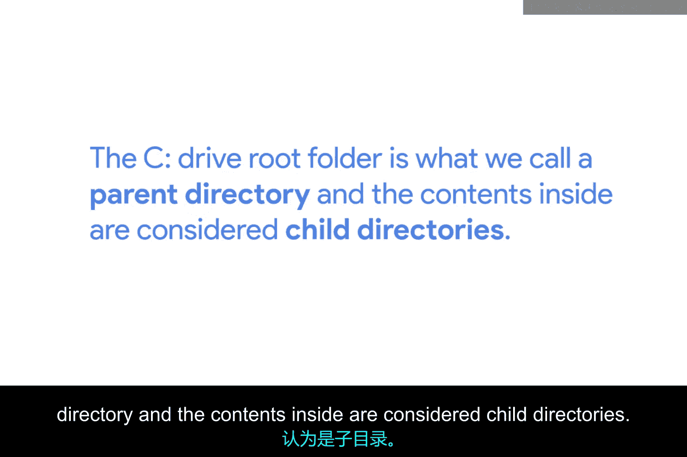
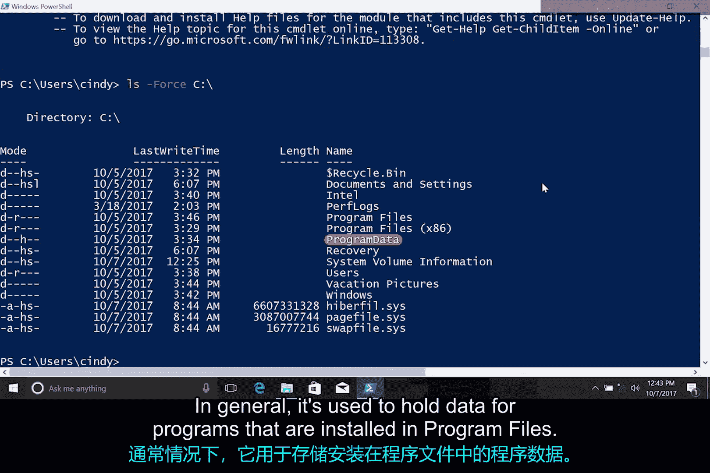

# 谷歌《IT支持（计算机网络⧸操作系统，第2、3课⧸共5课）｜Google IT Support》中英字幕deepseek p97 3_Windows在CLI中列出目录.zh_en -BV1uyqcYpExr_p97-

It's important to know that there are a couple of command line interfaces or CLIs available in Windows。

 The first one is called the command Pro command。 EX。The second one is Powerhell， her Powerhell。 EX。

The command prompt has been around for a very long time。

 it's very similar to the command prompt that was used in MSDs。

Since PowerShell supports most of the same commands as command prompt and many， many more。

 we're going to use PowerShell for the exercises in this module。

 I want to call out that many powerShell commands that we'll use are actually aliases for common commands in other shells。

An alias is sort of like a nickname for a command。The first command that we'll use is for listing files and directories。

Let's start by listing the directories in the route of our C drive。

The C drive is where the Windows operating system is installed For many of you。

 it might be the only hard drive that you have in your computer。To get to the PowerShell CLI。

 just search in your applications list PowerShell。From here。

 we can go ahead and launch the PowerShell program。

We're going to use the LS or listist directory command and give it the path of where we want to look。

The path is not actually part of the command， but it is a command parameter。

You can think of parameters as a value that's associated with a command。

Now you can see all the directories in the root of your C drive。

You might just see a few or a whole bunch of directories。

 it all depends on what your computer is used for the C drive route folder is what we call a parent directory and the contents inside are considered child directories。

As you continue to work with operating systems， you'll encounter terms that may seem a bit out of place at first。

 but they actually make a lot of sense。Parents and children are common terms that stand for hierarchical relationships in OSs。

If I have a folder named dogs and a second folder nested within that folder called Corgi。

 dogs would be the parent directory， and Corgi would be the child directory。

 Let's look at a few of the common child directories in this folder。Program files X 86。

 These directories contain most of the applications and other programs that are installed in Windows users。

This contains the user profile directories or home directories。

 each user who logs into this Windows machine will get their own directory here。 Windows。

 This is where the Windows operating system is installed。

 If we open up Powerhell and run gethelp LS we'll see the text describing the parameters of the LS command。

This will give us a brief summary of the commands parameters。

 but if you want to see more detailed help， try gethellp LS full。

Now you can see a description of each of the parameters and some examples of how to use the command。

What if we wanted to see all the hidden files in this directory？Well。

 we can use another useful parameter for the LS command dash force。

The dash force parameter will show hidden and system files that aren't normally listed with just LS。

Now you can see some important files and directories like Recycle bin。

This is where the recycl bin lives。When you move files to the recycle bin。

 they're move to this directory instead of being deleted immediately。Program data。

 this directory contains lots of different things。In general。

 it's used to hold data for programs that are installed in program files Allright。

 now that you've seen how to take a look around the file system in Windows。

 let's see what this process looks like in Linux。

