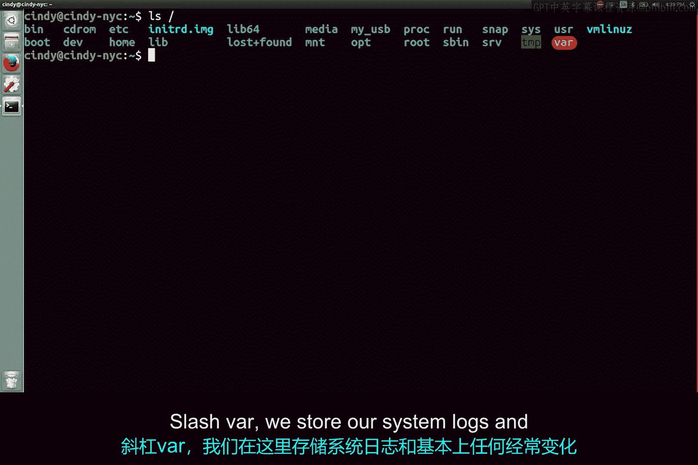
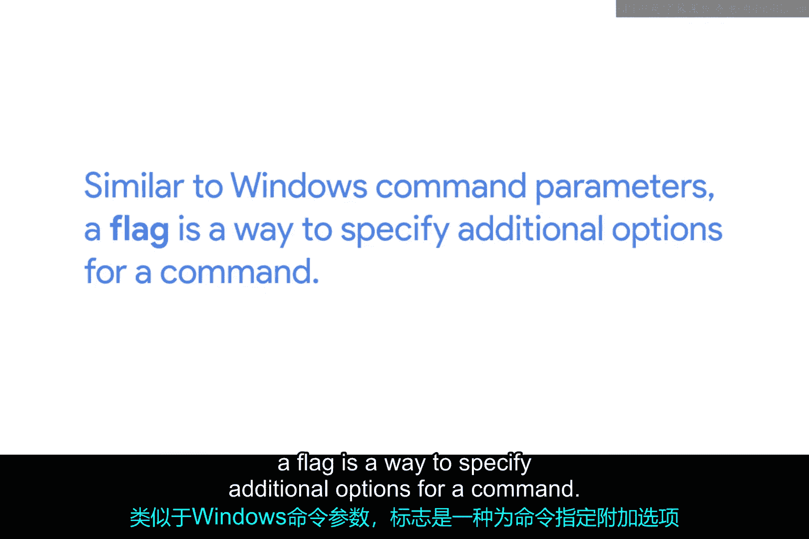
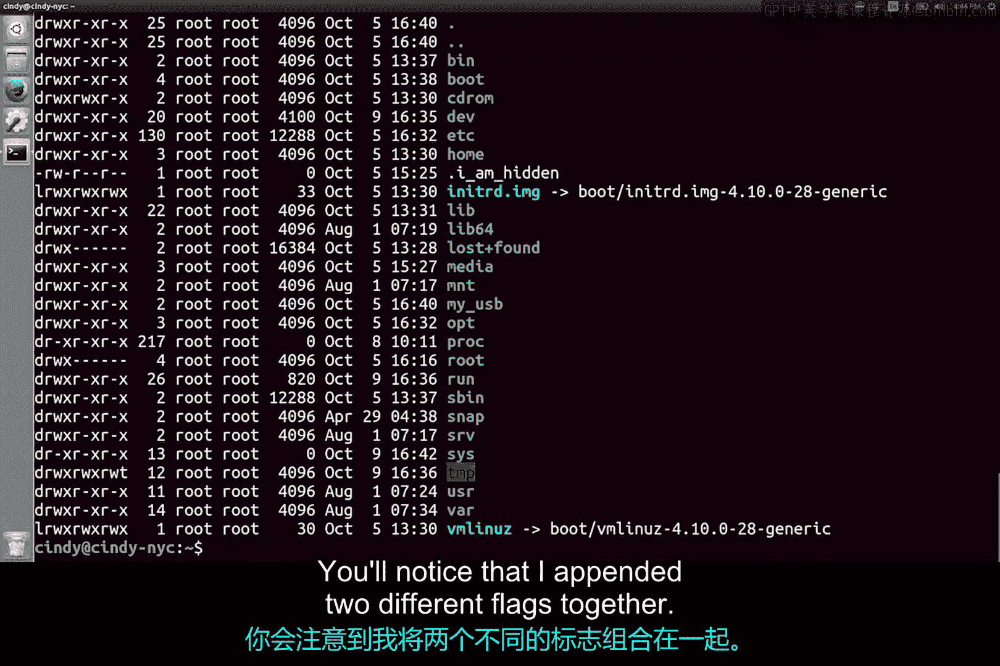
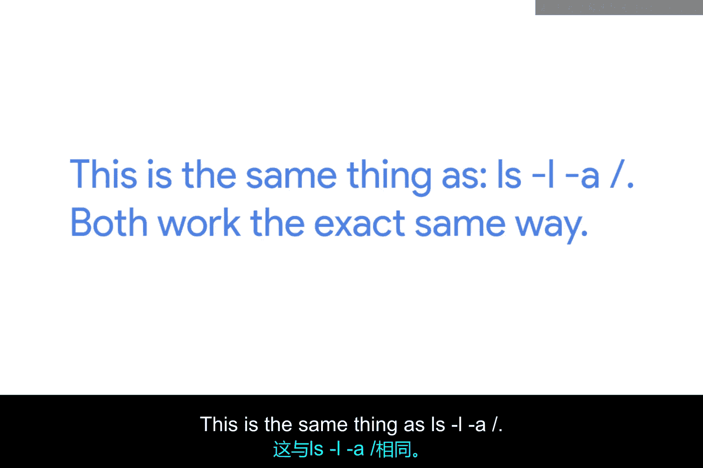
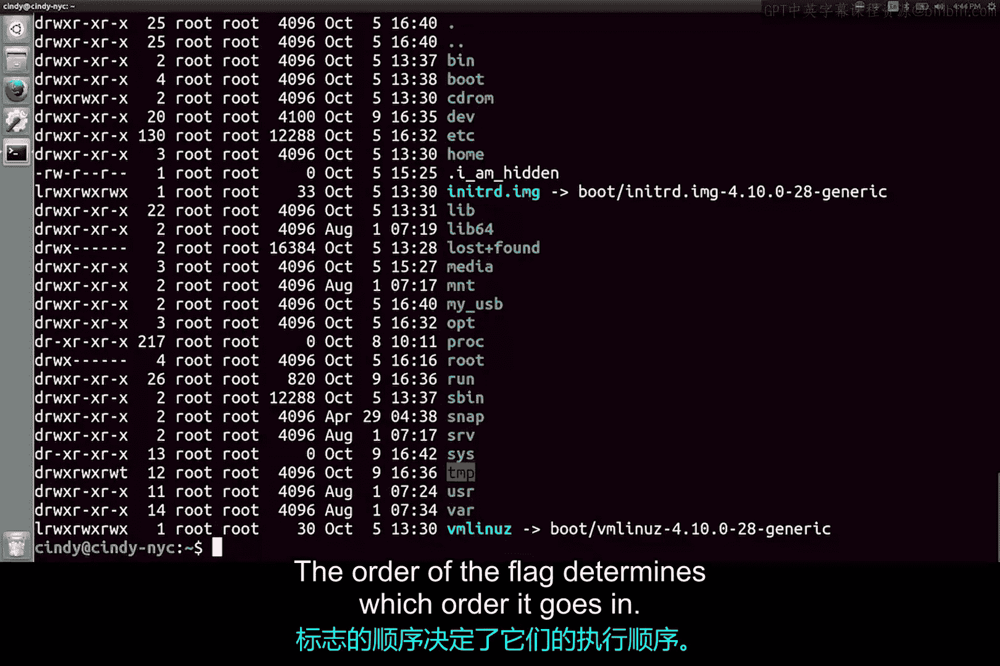
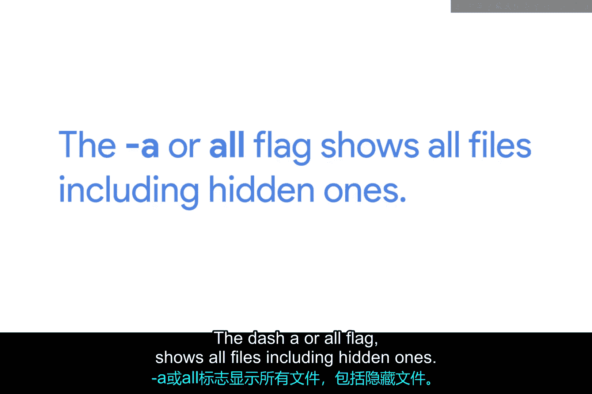

# 谷歌《IT支持（计算机网络⧸操作系统，第2、3课⧸共5课）｜Google IT Support》中英字幕deepseek p98 4_Linux列出目录.zh_en -BV1uyqcYpExr_p98-

In Linux， the main directory that all others stem from is called the root directory。

 The pass to the root directory is denoted by a slash or forward slash。

An example of a path in Linux that starts from the root directory is/lash home/Cindy/ desktop。

Just like C back slash users， back slash Cindy back slash desktop in Windows。

Let's go ahead and see what's under the root directory。

We're going to be using the LS or list directory contents command。

 We also want to give this command the path of the directory that we want to see。

If we don't provide a path， it'll just default to the current directory we're in。So LS slash。

All right， now we can see all the directories that are listed under the root directory。

There are a lot of directories here and they're all used for different purposes。

We won't go through them all， but let's talk about a few of the important ones， slash bin。

This directory stores are essential binaries or programs。

 The LS command that we just used is a program and it's located here in the slash bin folder。

 It's very similar to our Windows program files directory slash Etsy。

 This folder stores some pretty important system configuration files， slash home。

This is the personal directory for users。 It holds user documents， pictures， and et cetera。

 It's also similar to our Windows users directory slash Proc。

 This directory contains information about currently running processes。

 We'll talk more about processes in an upcoming lesson。 slash user。

 The user directory doesn't actually contain our user files like our home directory。

 It's meant for user installed software slash bar。 We store our system logs and basically any file that constantly changes in here。

 The Ls command has a couple of very useful flags that we can use， too。😊。

Similar to Windows command parameters， a flag is a way to specify additional options for a command。

We can usually specify a flag by using a hyphen， then the flag option。

This varies depending on the program though， every command has different flag options。

You can actually view what options are available for a command by adding the dash dash Help flag。

Let's see this in action。There is an incoming wall of text， but don't panic。

 you don't have to memorize these options。 this is mainly used for reference for now。

 let's just quickly go through the help menu。At the top here。

 it tells you what format to put the command in。And here it gives you a description of what the command does。

 this huge chunk of text lists the options that we can use。

It tells us what command flags are available and what they do。

 The dash dash help flag is super useful， and even experienced Os users refer to it every so often。

 Another method that you can use to get information about commands is the man command for manual。

 It's used to show us manual pages in Linux， we call the man pages。 to use this command。

 Just run man。 Then the command you want to look up。😊，So let's look up， man。Llls。

And here we get the same information as dash dash help， but with a little more detail。Okay。

 back to using an LS command。Right now it's not quite friendly to read。

 so let's make our directory list more readable with the dash L flag for long。

This shows detailed information about files and folders in the format of a long list。

Now we can see additional information about our directory and the files and folders in them。

Similar to the Windows Show properties， the LS command will show us the detailed file information let's break down this output starting from the left。

The first column here are file permissions side note we're going to cover file permissions in an upcoming lesson Okay。

 next up is the number of links a file has again， we'll discuss this in more detail in a later lesson。

Next， we have the file owner， then the group the file belongs to。

Groups are another way we can specify access。 We'll talk about this in another lesson too。

 So then we have the file size， the timetamp of last modification。 And finally。

 the file or directory name。 The last flag that we'll discuss for the L S command is the dash A or all option。

 This shows us all the files in the directory， including the hidden files。😊。

You'll notice that I appended two different flags together。 This is the same thing as L S， dash L。

 dash A slash Both work the exact same way。 The order of the flag determines which order it goes in。

 In our case， it doesn't matter if we do a long list first or show all files first。

Check out how there are some new files are visible when we use this flag。

 The dash A or all flag shows all files， including hidden ones。

 you can hide a file or directory by preending a dot to it。

Like the file shown here， dot I am hidden。W， we've covered a lot in this video。

 We learned how to view detailed information about files with the Ls command。

 We also started using computer paths， and we learned how to get help with commands using the dash。

 dash help flag and man pages。 We even took a sneak peek at our Linux file system。😊。

If I went through any of this a little too quickly， just rewatch the video。

 we'll meet back up at the next one where we'll start changing directories in the GoUI。 See there。

