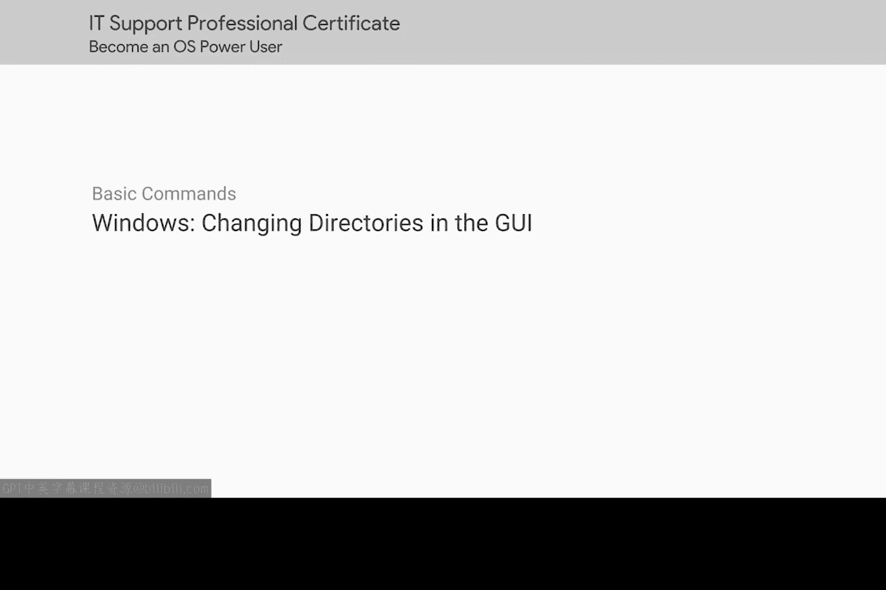
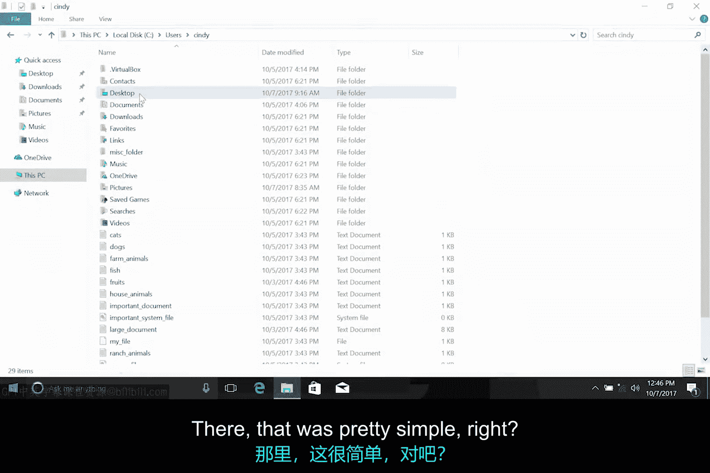
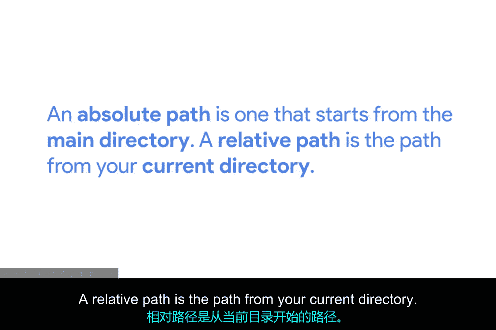

# 谷歌《IT支持（计算机网络⧸操作系统，第2、3课⧸共5课）｜Google IT Support》中英字幕deepseek p99 5_Windows在GUI中更改目录.zh_en -BV1uyqcYpExr_p99-

Okay， now that we know how directories are laid out。

 let's start moving from one directory to the next。

You probably change directories in your GuUI a lot without even realizing it。

Even if that's not the case， we're going to go ahead and show you how to do it。Knledge is power。

There， that was pretty simple， right？We can move freely between any directory and any path on our systems。

One thing to call out is that there are two different types of paths。Absolute and relative。

An absolute path is one that starts from the main directory。

A relative path is the path from your current directory。

These two distinctions aren't as important when we're working in a GuI。

 but they're important when you work in a shell， so let's see what this looks like in the Windows CLI。

