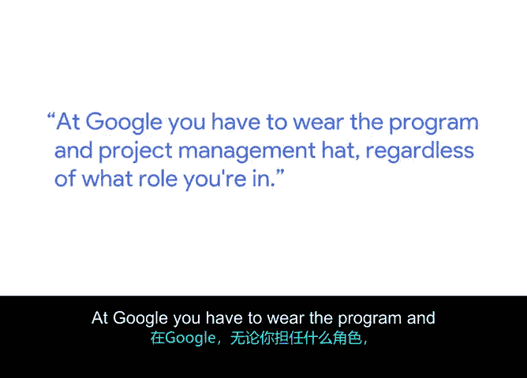
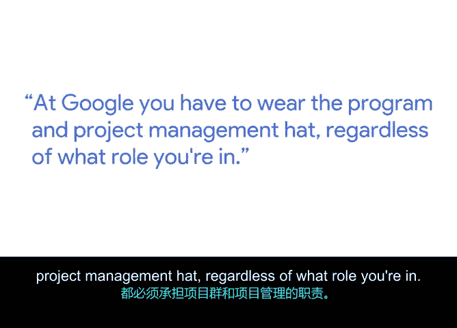
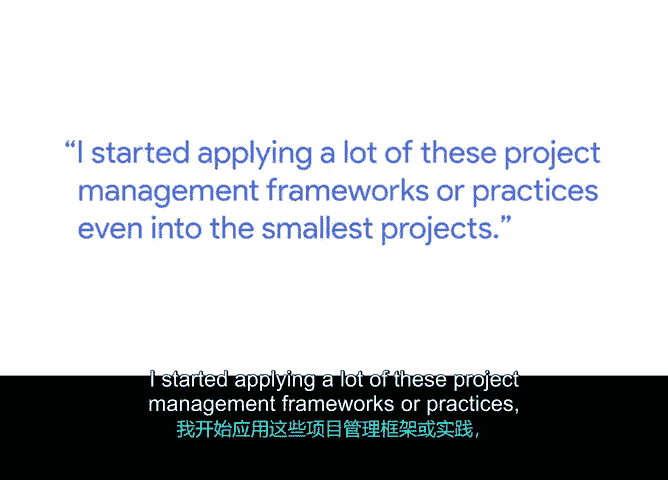
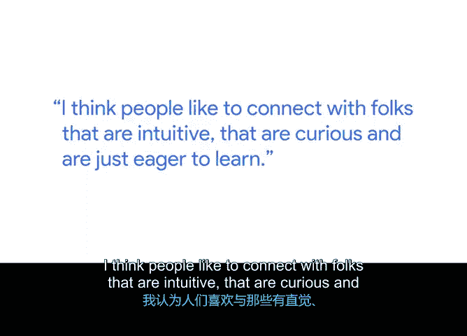

# 谷歌项目管理：专业证书 第1课：《项目管理基础课程（Google）》｜project-management-foundations｜ - P10：10_01_04_吉尔伯特：项目管理技能在我工作中的应用.zh_en - GPT中英字幕课程资源 - BV1nr4y1R7rb

My name is Gilbert and I'm a talent outreach specialist here at Google talent can mean many things it can mean folks that have never envisioned themselves at Google and so part of our team's remit is to identify talent that Google or other companies may not necessarily reach out to or consider for roles in the past and helping them navigate the interview process。

 but could also mean candidates that are already interested or have expressed interest in opportunities at Google in the past and engaging them to support them through the interview process today。

 at Google you have to wear the program and project management hat regardless of what role you're in。

And that's definitely been the case for me so in my role I've had to practice skills such as communicating to stakeholders managing a budget。

 managing a project timeline in many different projects within my role an example of this could be organizing events for university students that come to Google's campus and here from guest speakers about the projects we work on the roles in their career journeys and so as you can imagine this is can be a complex project my first job out of college was completely unrelated to what I'm doing now I was an assistant manager at a big box retailer and so a lot of the skills that I actually learned in that role have translated to support me in my role and allowed me to have success so some of these skills are being able to talk to and have difficult conversations being able to manage a budget managing resources and managing your time these are especially important in the retail setting。

I started applying a lot of these project management frameworks or practices。

 even into the smallest projects。

Maybe it's related to my goals for the next three months setting a project plan based around that right I was the only stakeholder。

 I was the only one reviewing maybe this documentation。

 but the practice of being able to do this really helped me so that when I had to do it for a project at Google with multiple stakeholders with multiple timelines competing priorities。

It was already second nature to me because I even applied it just in my day to day。

So I think one of the biggest support that I had as far as。

Working through imposter syndrome or like lack of confidence as I stepped into a lot of these skills is really just practice and you can practice it in many different ways in your personal life and your professional life in anything in between so that was really important for me as I've gone through this journey of upskilling as a program and project manager but I'd say that by joining this course and stepping into this you're already taking the first step and I think that's just as important right like not letting fear or fear failure get in the way of new opportunities for you and the second piece is don't be afraid to ask for help I think that。

Folks are generally willing to help and support you。

 so the biggest thing that you can do is reach out and not be afraid to ask questions。

 not be afraid to do an informational interview， to ask for resume tips。

 to ask for advice from people that are maybe already in the role that you're hoping to step into or in the field that you're looking to work in。

 just reach out to them， ask them questions， I think people like to connect with folks that are intuitive that are curious and then are just eager to learn。

And so if you can leverage those two pieces， I think that you're going to have success in whatever you do。

