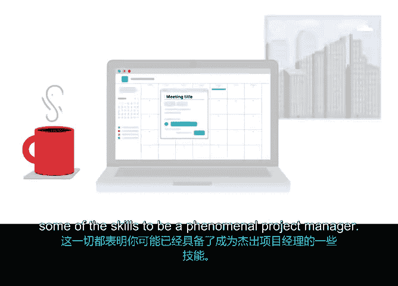

# 谷歌项目管理：专业证书 第1课：《项目管理基础课程（Google）》｜project-management-foundations｜ - P11：11_01_01_总结_1.zh_en - GPT中英字幕课程资源 - BV1nr4y1R7rb

And just like that， you're done with the first module。 congrats on hitting this exciting milestone。

 You're one step closer to becoming a rock star in project management。😊。

Let's revisit the concepts we've learned so far we started by discussing how project management is the application of knowledge。

 skills， tools and techniques to meet the project requirements and achieve the desired outcome。

Then we learned that project management is alive in nearly every industry and company。

 So you're working on an incredibly useful and versatile certification。

 We also learned what a project is。😊，A unique endeavor and temporary pursuit carefully planned out to achieve a particular goal。

 Hopefully by now， you're familiar with the idea that every project has a defined time frame， cost。

 scope and dedicated resources。We've covered some broad concepts and key terms that will help you become a successful project manager。

And we've gone over how to search for jobs when that time comes。

We've also discussed how to effectively translate your past experiences into talking points for why you'll be a successful project manager。

 We talked about how you can transfer skills from your previous job into your new project management role and how that'll really set you apart。

 Everything from juggling a to do list to budgeting for a loved one's birthday party。

 demonstrates that you probably already have some of the skills to be a phenomenal project manager But no worries if you don't。

 We're starting from scratch here。😊。

By the end of this course， you'll have the skills， but also the experience。

And knowledge to find the role you want， whether that's contract work。

 internships or general project management positions。

 you'll be able to figure out what's the best fit for you。 And as we go forward。

 I want to encourage you to keep thinking about what kind of work you might like to do in the future。

And let's not forget the most exciting news we learned about project management。

Just about everyone needs a project manager。 This position is in high demand。

 and that demand just keeps growing。 Wow， okay， that's a lot of ground we covered。

 And we've just barely scratched the surface。 I hope you've enjoyed the course so far。

 because it's about to get even more fun。😊，Coming up， we have your first graded assignment。

 and I know you'll ace it。 Remember， take your time and relax。 Trust yourself。 you've got this。😊。

Don't forget， you can always review your notes and readings。

 or go back and rewatch some of the videos if you're unsure about an answer。Good luck。

 and I'll see you again soon。