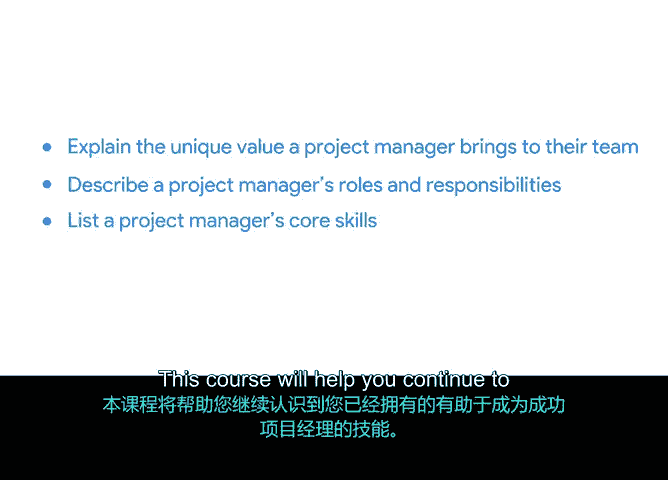

# 谷歌项目管理：专业证书 第1课：《项目管理基础课程（Google）》｜project-management-foundations｜ - P12：12_02_01_引言：成为高效项目经理.zh_en - GPT中英字幕课程资源 - BV1nr4y1R7rb

Welcome back， let's start by reviewing what we've discussed so far。Earlier。

 you were introduced to project management as a career path。

 we discussed how this course can help you advance your career goals with a project management certification。

And we also discussed some of the basics of project management。

 like how to define a project and its different components。

Then we went over some distinct project management careers， roles， and responsibilities。

Now it's time to gain a deeper understanding of a project manager's role。By the end of this module。

 you'll be able to explain the unique value a project manager brings to their team。

You'll also be able to describe a project manager's roles and responsibilities and list their core skills。

🎼This course will help you continue to recognize the skills that you already have that will help you become a successful project manager。

 It will also help you identify new skills that you may need to learn in preparation for your new career。

 Ready， Let's get started。