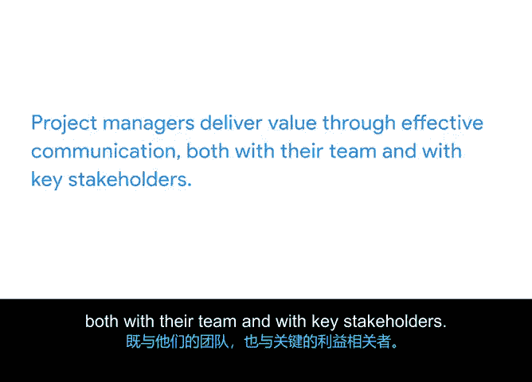

# 谷歌项目管理：专业证书 第1课：《项目管理基础课程（Google）》｜project-management-foundations｜ - P13：13_02_02_项目经理的价值.zh_en - GPT中英字幕课程资源 - BV1nr4y1R7rb

Earlier in this course， we introduce you to the world of project management。

We discussed how project management spans industries and companies of all kinds。

 from large corporations to small businesses。Now， let's define what a project manager is and describe how they add value to their teams and organizations。

 Let's start with a definition。 Project managers， shepherd projects from start to finish and serve as guides for their team。

 using their impeccable organizational and interpersonal skills every step of the way。

As you learned earlier， project managers usually follow a process that involves planning and organizing。

Managing tasks。Budgeting and controlling costs so that the project can be completed within the approved timeframe。

We'll dig deeper into these topics throughout this program。

 What you need to know right now is that project managers play a crucial role in their organizations。

 Project managers add value to their teams and organizations in key ways that include prioritization。

Delegation and effective communication。So let's break these down。First， we'll discuss prioritization。

Project managers add value to their teams and organizations through effective prioritization of tasks required to complete a project。

 They're experts at helping team members identify and break down large tasks into smaller steps。

 There will be times when a project manager may not know which task to prioritize to determine which ones are the most critical to the success of the project。

 They'll connect with their teams and with stakeholders to gather information and make a plan。

Stakeholders are people who are interested in and affected by the project's completion and success。

 like the leader of an organization。You've probably used prioritization to complete work in the past in any kind of project。

 personal or professional。 There are tasks with different levels of priority。 For example。

 let's imagine that you've decided to rent a house and plan to repat the rooms。

 You've picked out your paint and you're eager to get started。

 while it may be tempting to start painting right away。

 You'll need to prioritize tasks like laying out drop cloths to protect the floors and furniture。

 applyingly blue tape to the room's edges and much more。😊。

Those preliminary steps are critical and need to come before painting。

Other related steps like choosing new face plates for your light switches can come later in the process or be switched out of the project entirely if you run out of time or money。

When you choose to take care of these preliminary steps before wedging open the pink can。

 you're prioritizing the tasks or steps of your project。

You're also increasing the likelihood that you'll be satisfied with your newly painted rooms。

This process is similar for professional projects。 When you effectively prioritize important tasks。

 you set up your team and yourself for a better project outcome。Now， let's discuss delegation。

Project managers use delegation to add value to their teams and organizations by matching tasks to individuals who can best complete the work。

Let's return to our house painting example for a second here。

Painting multiple rooms can be a time consuming project。

 so it's possible that you might enlist a few friends to help you get it done。

Maybe one friend has professional painting experience。 Now， with that in mind。

 you might ask her to handle the more challenging aspects of the project。

 like painting the ceiling or the detailed moing。You might also schedule her to paint the molding before another friend paints the walls。

So by delegating this task to the person with the right skills to complete the work and ordering the tasks appropriately。

 you're applying knowledge of your team's strengths to the planning of your project。

 that makes sense， right。Finally， let's talk about effective communication。

 Project managers deliver value through effective communication。😊。

Both with their team and with key stakeholders。 this refers to being transparent。

 which means being upfront with plans and ideas and making information readily available。

Project managers keep in regular contact with their team about the progress of the work and help identify areas where a teammate may need support。

In our house painting example， this might involve checking in with your friends periodically to ask if they have enough paint or supplies left to complete their tasks。

Checking in regularly means you'll know if you need to buy more paint before the can is empty。

 which ensures that the project stays on track。In addition to keeping up with teammates。

 project managers keep in regular contact with people outside of the team。

 like company leaders who are invested in the project outcomes。For example。

 you might reach out to your landlord to get permission to paint and to share the days you'll be working on this project。

Though your landlord isn't directly involved in the project's execution。

 the outcomes will affect her property， and so it's important to keep her informed without your project management skills。

 you might run out of paint halfway through the project。

 Your walls might get painted without drop cloths to protect the floors and your landlord could be caught off guard about your plans。

 So it's a good thing you're here to keep the project running smoothly and efficiently。Great。

 now you should be able to define what a project manager is and explain how they use prioritization。

 delegation and effective communication to deliver value to their organizations。Coming up。

 you'll hear about the career path of a real life project manager at Google。

 Their journey to me is fascinating， and we can't wait to share it with you。😊。

