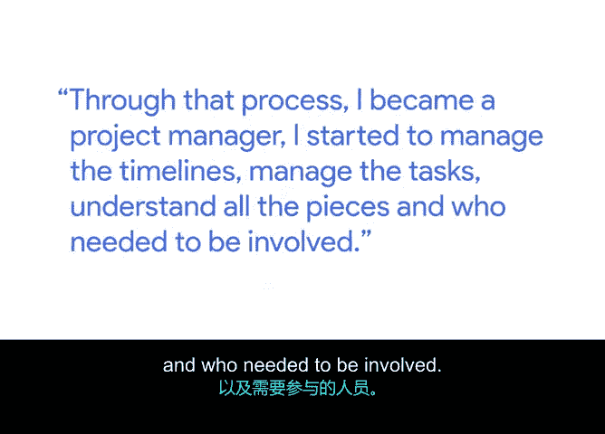
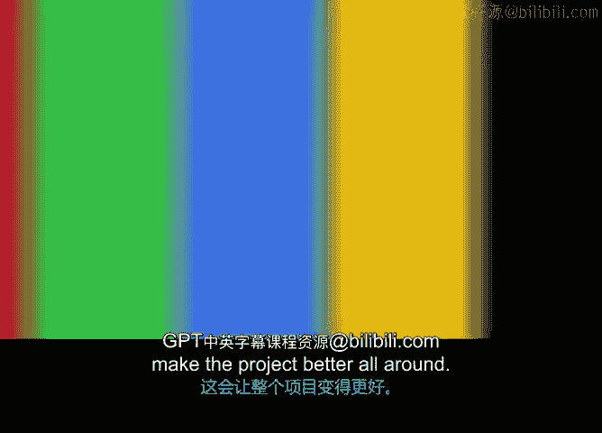

# 谷歌项目管理：专业证书 第1课：《项目管理基础课程（Google）》｜project-management-foundations｜ - P14：14_02_03_朱安妮：成为项目经理之路.zh_en - GPT中英字幕课程资源 - BV1nr4y1R7rb

My name is Joanne。 I'm a senior program manager at Google。 Im a first generation Chinese American。

My family and I came to the United States when I was young。

 my parents worked really hard when I was growing up， and I spent a lot of time by myself。

 basically just having to take care of myself， you know， planning my meals， doing my homework。

 taking care of chores， So I feel like I got a little bit of my program management skills from just being really organized。

 like having to be really organized all the time。 My path to being a project manager。

 really started as a business systems analyst。 I was writing requirements or gathering requirements for our customers。

And translating them into documentation for our engineers so that they could implement it through that process。

 I became a project manager。 I started to manage the timelines， manage the tasks。

 understand all the pieces and who needed to be involved。

And there you go。 You have a project manager。 I think the funnest part about being a project manager is really working with people。

 You get to meet all different kinds of people， different personalities。

 Sometimes you get to travel to places to meet them。 But even when you don't， I think， just。😊。

Meeting new people and understanding how， how we interact。

 how people interact and and behave is fascinating。 I think if you build a relationship。

 focus on the relationship and really understand what their style， where they're coming from。

 what their concerns are。 It will help your relationship， your working relationship much better。

 You can communicate with them， in the style that's necessary。

 you can work with them in the style that's more receptive to them。

 and that would just make the project better all around。

