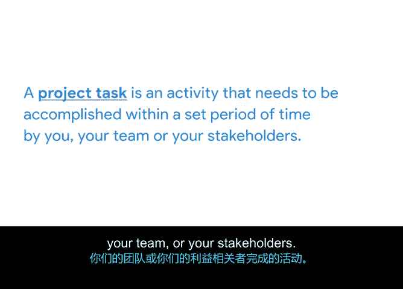

# 谷歌项目管理：专业证书 第1课：《项目管理基础课程（Google）》｜project-management-foundations｜ - P15：15_02_01_项目经理的关键角色与职责.zh_en - GPT中英字幕课程资源 - BV1nr4y1R7rb

Welcome back。 I hope you enjoyed that last story， because for me。

 it's always helpful to hear about someone else's career path。

 Maybe you even noticed a few parallels between their career path and your own。

 or you felt inspired to pursue a specific area of project management。 So far。

 we've discussed the types of project management roles you'll be qualified for and how to search for them。

😊，And earlier， we discussed the value that project managers bring to their teams and their organizations。

Now let's learn more about the roles and responsibilities of a project manager Earl。

 you learned that project management is the application of knowledge， skills， tools。

 and techniques to meet the project requirements and achieve the desired outcome。

How does that actually happen， Well， that's where you come in。

 Project managers usually follow a process that involves planning and organizing， managing tasks。

 budgeting and controlling costs and other factors so that the project can be completed within the approved budget and time frame。

Let's break these down into examples of responsibilities that you might find in a job listing for a project management role。

 we'll start with planning and organizing。One responsibility that falls under the umbrella of planning and organizing is making use of productivity tools and creating processes during the planning and execution of a project。

 you might need to use certain tools and develop processes to improve information sharing across the team。

 You may also need to create plans， timelines， schedules and other forms of documentation to track project completion。

 and you'll usually need to maintain those documents throughout the entirety of the project。

The next task is budgeting and controlling costs and other factors。 As the project is underway。

 changes to the plan and budget are bound to come up。 believe me。

 this will require you to monitor and manage the budget。

 track issues and risks as they arise and manage quality by mitigating those issues and risks。

One way to do this is by removing unforeseen barriers that come up。 Now， by barriers。

 we mean things that can get in the way of project progress。 For example。

 if your teammates lack the resources needed to complete a task。

 you might identify that issue or barrier。Up front。

 escalate the issue to a stakeholder and work to secure the resource so your team can move forward。

Another huge piece of the project manager's role is managing tasks。

 A project task is an activity that needs to be accomplished within a set period of time by you。

 your team or your stakeholders。😊。

Keeping track of tasks is a great way to help manage the team's workload and ensure that things are getting done。

Keeping track of tasks is also a great tool for demonstrating progress to people outside the immediate team。

 like your stakeholders。Back when I was a program manager in student development here at Google。

 one of our goals was to create pathways for students who identify with communities that are underrepresented in the technology industry。

A large part of my day to day responsibilities involved working with two separate engineering teams to create our technical curriculum。

To manage the tasks associated with this project， I created separate project trackers for each team that outlined the vision for the curriculum。

 These trackers kept both teams in the loop about the timeline for delivery。

 The categories and subcategories for work and the team members assigned to each task。

 I also made sure to update our stakeholders every step of the way。😊。

By actively managing tasks throughout the project life cycle。

 I was able to keep tabs on everyone's work and efficiently inform stakeholders。

 which allowed us to achieve our project goal with minimal issues。😊。

Nice job Now you should be able to describe the roles and responsibilities of a project manager coming up we'll discuss a project manager's role within the extended team。

 including how to work alongside the people tasked with executing the project， catching a bit。😊。

