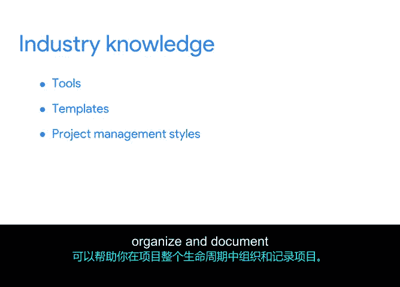

# 谷歌项目管理：专业证书 第1课：《项目管理基础课程（Google）》｜project-management-foundations｜ - P18：18_02_01_项目经理的核心技能.zh_en - GPT中英字幕课程资源 - BV1nr4y1R7rb

Hey， and welcome back。 Now that you've learned about the roles and responsibilities of a project manager。

 Let's discuss the core skill sets that a project manager should bring to the role。 Well。

 there are lots of different skills a project manager can bring to their role。

 There are four specific skill sets that we think can help a project manager be successful。

 Those are enabling decision making， communicating and escalating。

 flexibility and strong organizational skills。😊，First， let's talk about enabling decision making。

The ability to enable decision making on the team or gathering decisions from the appropriate leader。

Is crucial to keep projects on task and achieve their goals。

Lots of the day to day decisions within the project will likely fall to you and your teammates to discuss and agree on。

You'll ensure that projects stay on schedule by gathering information from teammates and using those insights to help the team make informed decisions。

You'll also make sure that those decisions are communicated to the necessary coworkers。

 whether that's the immediate team or company leaders， for example。

 you might provide relevant data or feedback to help your teammates make an informed decision between choice A and choice B。

The second skill is communicating and escalating。As a project manager。

 you'll use your communication skills in just about everything you do。

This might look like documenting plans， sending emails about the status of the project or holding a meeting to escalate risks or issues to stakeholders。

 The third skill is flexibility。 As a project manager。

 knowing how to be flexible when changes are needed is key。

 plans definitively will change even with careful upfront planning。 For example。

 maybe the goals of your company change。 or maybe a member of your team unexpectedly takes a new position at another company。

 A good project manager knows that unpredictable moments like these are almost always guaranteed。

A quote we love here at Google is the only constant is change， and that's true。

 by staying cool under pressure， you'll be able to adjust while helping your team stay calm to。

 And finally， a successful project manager needs strong organizational skills。😊。

As you learned earlier， the role of a project manager requires using a lot of different processes to keep the project on track。

Having strong organizational skills means having the ability to organize these processes and the core elements of a project to ensure nothing gets lost or overlooked。

 which trust me， can and does happen to prevent this。

 you might decide to track daily tasks in a spreadsheet or send frequent status updates or reminders。

 There are many ways to stay organized and hone your organizational skills。

 and will talk more about them throughout the program to recap。Decision making。

 communicating and escalating， flexibility and strong organizational skills are for core skill sets that are essential to successful project management。

😊，You can continue to build on these skills by becoming familiar with industry knowledge that applies to most project management roles。

Knowledge of helpful tools and templates and familiarity with popular project management styles like waterfall and Agile can help you organize and document the project throughout its life cycle。

We'll learn about these throughout this program。Hopefully you feel better equipped to explain the core skills a project manager should bring to the role。

 These skills really help enforce team morale and accountability for the tasks of a project。

 We'll discuss this coming up See you soon。