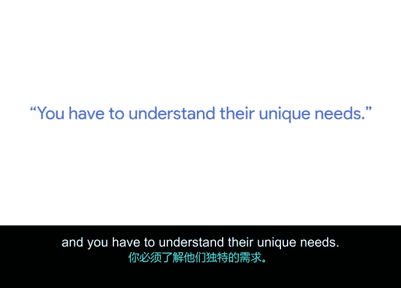
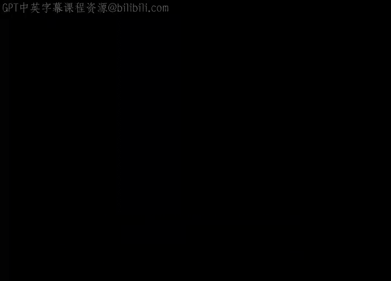

# 谷歌项目管理：专业证书 第1课：《项目管理基础课程（Google）》｜project-management-foundations｜ - P19：19_02_03_雷切尔：我的项目经理成长之路.zh_en - GPT中英字幕课程资源 - BV1nr4y1R7rb

My name is Rachel， I'm a senior program manager in Google New York。

 Google hired me out of a bar in the East Vill about 12 years ago for about three years。

 a group of NY Ops and SreE drank at my bar and like everyone at the bar they asked the bartender for advice so I gave them advice and helped them through a lot of problems and also became friends with them I really admired them they were incredibly smart and charming and really good drinkers and tippers eventually I wanted something different from my life and standing behind a bar all night long and there was an opportunity to apply for an admin role on their team。

 so I joined Google in 2008 they hired me first as an administrator for site reliability and engineering ops in New York City。

After about two years transferred into program management。

 Google's hiring is a little more conventional now。

 but the skills that I polish while being a bartender inform my everyday work。😊。

A wise old bartender that I knew in the Low East side once told me that a bar was a room full of tables and chairs and some beer and a meeting room was the same。

 A room full of tables and chairs。 People come into a bar like they come into a meeting room。

 wanting to leave feeling something else。 So as a program manager。

 my job was to help people through that experience。

 The aesthetic experience of meeting with each other making decisions and coming to conclusions together。

 very similar to bartending and helping people have a better night。

 My role as a program manager started by someone taking a risk on me。

 My engineering partner picked me out of the admin pool because he knew that I could build community with his engineers。

 When you work at a bar， you have to talk to anyone who comes into the bar。

 Anyone who walks through that door is your customer， you have to understand what they want。

 what they want to drink whether they can continue drinking whether they might be done drinking all of these things。

 when you are working with a subject matter expert， and engineer a product design。A UX person。

 The same things apply。 So you have to be able to talk to any engineer on your team。

 any product manager you need to work with。 And you have to understand their unique needs。

Program management isn't just about the the process and the artifacts that you create。

 It's about how you relate to people understanding what you've learned in other parts of your life。

 whether it was in a bar or art school。 These are the experiences that you bring into the job that make your work unique。

 your skills at talking to people or deescalating conflict or understanding what people need。

 This is what makes you a great program manager。

