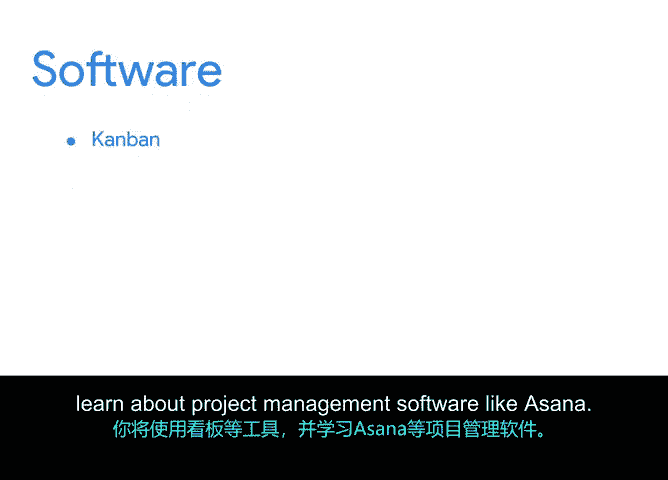

# 谷歌项目管理：专业证书 第1课：《项目管理基础课程（Google）》｜project-management-foundations｜ - P1：01_01_01_欢迎来到谷歌项目管理证书课程.zh_en - GPT中英字幕课程资源 - BV1nr4y1R7rb

🎼Hi， we're so excited that you're here。 I'm Emilio。

 and I'm a program manager on the responsible innovation team here at Google。

 and I'd like to officially welcome you to Google's certificate program in project management。

 Let's start with the simple exercise。 Take a moment。

 and think about some of the different tasks that you've completed in your life。😊。

Maybe you planned your wedding or a birthday party， or you filed your annual tax returns。

Maybe you move from one state to another， or maybe you're the family member who somehow every year is tasked with organizing the annual family reunion。

Believe it or not， you've been developing all kinds of skills through these tasks that'll help you become a successful project manager for any organization or your own business。

With this program in project management by Google， we've put together a set of courses， activities。

 quizzes and exercises that'll teach you the fundamentals of project management。And， of course。

 help you get a job or advance in your career。 Wo how I started my own career in project management。

 while in college， I always gravitated towards things that were more hands on and action oriented and less theoretical。

😊，I wanted to make an impact in whichever career I took on。

So my first job out of college was as a Spanish and leadership teacher in Los Angeles， California。

My main objective in guiding the student leadership team at the school was to identify。

 mobilize and inspire the student leaders。 After two years of teaching。

 I realized that the moments when I felt the most energized were when I was building a vision for how to get a big project done or when I was working to bring different groups together around a common goal。

😊，That's when I realized I had a lot of core project management skills。

 and I could focus on growing and developing them in the business world。

 I'm grateful that I get to be here for the start of your journey When I was first starting to think about my career。

 project management wasn't even on my radar。😊，It was one of those professions that I didn't even know existed until I entered the business world and experienced how great of a need there is for folks who are organized。

 action oriented， diligent， and strategic。I hope that by the end of this program。

 you'll be as excited as I am about the prospects of a career in project management。Okay。

 let's get into it。 We'll start with an important question。What exactly is project management。

 Project management is the application of knowledge， skills。

 tools and techniques to meet the project requirements and achieve the desired outcome。

It's possible that you've been project managing every day on some level without even knowing it。

In this course， you'll learn how to hone those skills to become a truly great project manager。

 And the awesome thing about project management is that it spans a lot of industries and company types。

 and it doesn't require deep technical knowledge。😊。

This means that any job or life experience you've gained so far will help you in building those skills to become successful in a project management career。

 There are a lot of people around the world like you who are hoping to learn the skills to get a project management role。

 Whatever your reason for being here。 We're glad you joined us。

 This program is rooted in a belief that a strong foundation in project management can help anyone start a great career as a project manager。

😊，This program includes six industry relevant courses that focus on topics like project management fundamentals。

Goals， objectives and deliverables， risk management， team dynamics， project management methodologies。

Data driven decision making and more。Each course is made up of personal anecdotes， reading materials。

 quizzes and case studies， and you can go through the program at your own pace。

 S the sections that you might already know and review the videos again if you need a refresher。

 You'll be doing a lot of hands on learning。 You'll build project plans and timelines。

 You'll learn how to manage budgets and meet the needs of the people involved in the project。

And you'll learn different project methodologies like agile， scrum and waterfall。

You'll use tools like Canban and learn about project management software like Asana。

 You'll also develop your soft skills， some of which you likely already have。 Don't worry。

 Even if you aren't quite sure how to tap into them yet。

 We'll explore which skills are transferable to a project management role。 Above all。

 this program will help get you ready for a new job。

But we're taking it one step further when you complete this program。

 you'll have the opportunity to share your work with Google and other top employers aiming to hire project management professionals and the best part is。

 you'll have professional work examples。 You can share with them to showcase what you've learned。

 along the way， you'll hear from Google employees like me。

 We'll share personal stories about how we became project managers and how our foundations in project management launched our careers。

We'll also share what we do at work every day and give you tips for job interviews。

 We've got a truly amazing group of course instructors for you to learn from ready to meet them。😊，Hi。

 I'm Joanne， a senior program manager on cloud security programs。 I'm your instructor for course，2。

 where we'll learn more about what's needed to set the stage for a successful project。😊，Hey there。

 My name's Roena， a senior program manager in Google Cloud。I'm your instructor for course 3。

 project planning， putting it all together， where we'll learn about the importance of thorough project planning。

 identifying key milestones and dependencies， documenting project plans， scheduling， budgeting。

 and risk management。I'm Elita， a senior engineering program manager at Google。

 and I'm your instructor for Cose 4， Project execution， running a project。

 but well learn about communicating effectively， managing risks， understanding team dynamics。

 using data to inform decision making and tracking progress。Hi， I'm Sue。

 I'm a technical program manager for Googles support Plat， I'm your instructor for Course 5。

 Agile Project management， where we'll gain a deeper understanding of agile project management。

 including principles and practices， the benefits and costs of agile transformations。

 the dynamics of agile teams， and the process of running sprints and releases。And I'm Dan。

 a program manager in Google research。 I'm really excited to be your instructor for Co 6。

 App project management in the real world， Where we'll take all the knowledge。

 skills and understanding you've built up throughout this certificate and apply it to an advanced project scenario。

😊，Ready to get started， let's go。