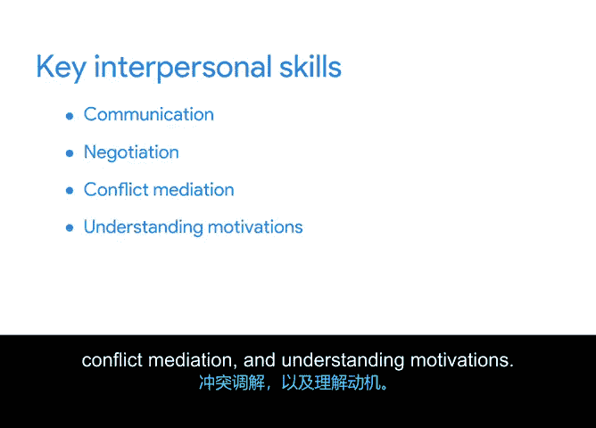

# 谷歌项目管理：专业证书 第1课：《项目管理基础课程（Google）》｜project-management-foundations｜ - P20：20_02_05_领导力与团队动态.zh_en - GPT中英字幕课程资源 - BV1nr4y1R7rb

Earlier， you learned about the role of the project manager and the core skills you'll need to be successful in that role。

 You've also learned more about your role within the project team。 Now。

 let's discuss a few key skills that you'll use to build relationships with your teammates and stakeholders using your interpersonal skills is key to building relationships with the people involved in your project。

😊，By developing these relationships， you'll learn about the needs and concerns of the team。

 This will help you determine the priorities of the project and motivate your team throughout the process。

Possessing strong interpersonal skills is a huge part of good leadership。

 Even if you've never held a formal leadership position。

 having these skills will help you when you need to guide a team。

This is calledInfluencing Without authorityity， which refers to a project manager's ability to guide teammates to complete their assigned work without acting as their direct managers。

There's a few key interpersonal skills that you can use to accomplish this and guide the project outcomes even without the authority of being your teammate's boss。

These skills include communication， negotiation， conflict mediation and understanding motivations。

 So let's break these down。 First up is a key skill we've mentioned a few times now， communication。

In the context of leading a team， communication can include checking in with teammates to understand how they're progressing on a task and providing clear feedback on the quality of a teammate's work。

Next is negotiation。Negotiation might include working with a teammate to compromise on a new deadline when they tell you that they won't be able to complete their work on time。

 Now， trust me， I know this can be frustrating， but you'll need to use your negotiation skills often with your teammates and stakeholders to balance their needs and what is best for the project。

Another important skill is conflict mediation。As we mentioned。

 project plans can change and issues will arise。 This can sometimes lead to tension and conflict within the team。

 So conflict mediation is a great skill to practice and develop。

 to ensure the project does not suffer as a result。

This might involve setting up a meeting with two teammates who are struggling to agree upon the best way to handle a shared task。

And finally， there's understanding motivations。This means getting to know your teammates and figuring out what pushes them to do their best work。

Understanding motivations might also include learning how your teammates prefer to receive feedback。

And how they like to receive recognition for doing a great job。

You would use that individualized information to motivate and encourage each person on your team。

So to recap。Communication， negotiation， conflict mediation and understanding motivations are all interpersonal skills that will help you influence without authority。

During job interviews for project management positions。

 you might be asked to discuss a time when you influenced without authority。

And it's possible that you've already noticed ways that you've used these skills in your personal life without even realizing it。

 For example， let's say you have a coworker who's constantly late to every meeting。 And， I mean。

 every meeting。 while you can't force them to arrive on time。

It's likely that you thought about ways to motivate them to want to be on time。In doing so。

 you might have also wondered how to change the way you communicate with your coworker to influence them to be on time。

Maybe you've tried asking them to arrive 15 minutes earlier than the rest of the group。

 or maybe you've told them how this behavior impacts the rest of the team。

Both of these strategies are examples of influencing without authority。

 and they serve to encourage specific behavior。Influencing without authority is one of the most critical and one of the most challenging aspects of project management。

As you've just learned， you'll need to leverage your interpersonal skills in order to do it effectively。

In later courses， we'll review and learn more about using your interpersonal skills to manage various projects。

 We'll see you in the next video。